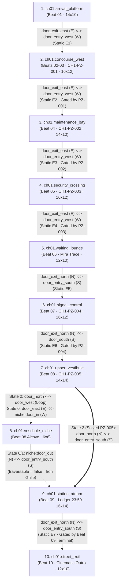

# Chapter 1 Station Room Graph & Level Flow — "The Forgotten Station"

**Task:** TLF-005  
**Owner:** Agent 2 (Argon — Narrative, Puzzle, Level Design & Art)  
**Source Documents:** `design/ch01/CH01_BEAT_SHEET.md` (`db09cc2`), `design/ch01/puzzles/CH1-PZ-001.md` … `CH1-PZ-005.md` (`eed7c4e`)  
**Architecture Baseline:** `docs/ADR_LOG.md` (ADR-003, ADR-005, ADR-009, ADR-010, ADR-015, ADR-016)

---

## 1. Isometric Coordinate, Boundary Wall & Camera Standard (`ADR-003`)

- **Internal Canvas:** `640 × 360 px` (integer-scaled `×3` to `1920 × 1080`).
- **Tile Footprint:** `32 × 16 px` (2:1 dimetric isometric diamond). Character height ≈ `48 px`.
- **Tile-to-Pixel Mapping (Fixed-Camera Room Space):**
  - Each room grid of `W × H` tiles (`x ∈ [0 .. W-1]` running North-West to South-East, `y ∈ [0 .. H-1]` running North-East to South-West) has its top-north floor apex `(0, 0)` anchored at screen coordinate **`(320, 64)`** (leaving a `64 px` top margin for rear wall height and HUD):
    $$\text{px\_x}(x, y) = 320 + (x - y) \times 16, \qquad \text{px\_y}(x, y) = 64 + (x + y) \times 8$$
  - Total floor diamond pixel width = $(W + H) \times 16\text{ px}$; total floor diamond pixel height = $(W + H) \times 8\text{ px}$.
- **Boundary Wall & Opposite-Side Transition Convention:**
  - Every doorway sits strictly on a boundary tile of its `W × H` room grid:
    - **W (North-West wall):** `x = 0`, `y ∈ [1 .. H-2]`
    - **E (South-East wall):** `x = W - 1`, `y ∈ [1 .. H-2]`
    - **N (North-East wall):** `y = 0`, `x ∈ [1 .. W-2]`
    - **S (South-West wall):** `y = H - 1`, `x ∈ [1 .. W-2]`
  - **Continuous Opposite-Side Transitions:** Exiting a room through a **W (`x = 0`)** doorway enters the next room through an **E (`x = W-1`)** doorway (and vice versa); exiting through an **N (`y = 0`)** doorway enters the next room through an **S (`y = H-1`)** doorway (and vice versa).
- **Camera Rule:** Every room in Chapter 1 is sized between `6 × 6` tiles (`192 × 96 px` floor) and `16 × 14` tiles (`480 × 240 px` floor + `64 px` north wall = `480 × 304 px`). **All 10 rooms fit completely inside a fixed `640 × 360` camera** with zero camera scrolling required.

---

## 2. Chapter 1 Room Table (10 Rooms)

| # | Room ID (`ADR-005`) | Beat(s) | Purpose | Footprint (`W×H` Tiles / Floor Px) | Camera | Doorways (`door_id`, Boundary Side, Tile `(x,y)`) | Puzzle(s) | Checkpoint (`checkpoint_id`) | Safe Anchors (`object_id` @ Tile `(x,y)` / Px) |
|---|---|---|---|---|---|---|---|---|---|
| **1** | `ch01.arrival_platform` | Beat 01 | Awakening, movement & inspect tutorial, pocket watch pickup (`global.pocket_watch`) | `14 × 10`<br>(`384 × 192 px`) | Fixed `640×360` | • `door_exit_east` (**E**, `(13, 5)`) | — | **Yes**<br>`ch01.cp.arrival` | • `ch01.arrival_platform.safe_anchor_spawn` @ `(7, 5)` `(352, 160)` |
| **2** | `ch01.concourse_west` | Beat 02,<br>Beat 03 | Pocket-watch tutorial (`Trace` + `Rewind`) at Turnstile threshold; Call Box 09 dialogue with The Operator | `16 × 12`<br>(`448 × 224 px`) | Fixed `640×360` | • `door_entry_west` (**W**, `(0, 5)`)<br>• `door_exit_east` (**E**, `(15, 5)`) | `CH1-PZ-001` | **Yes**<br>`ch01.cp.concourse_west` | • `ch01.concourse_west.safe_anchor_east` @ `(1, 5)` `(256, 112)` *(entry side)*<br>• `ch01.concourse_west.safe_anchor_west` @ `(4, 5)` `(304, 136)` *(concourse side)* |
| **3** | `ch01.maintenance_bay` | Beat 04 | Teach `Freeze`; test `Rewind` + `Freeze` on dropped fire shutter & counterweight gear | `14 × 10`<br>(`384 × 192 px`) | Fixed `640×360` | • `door_entry_west` (**W**, `(0, 5)`)<br>• `door_exit_east` (**E**, `(13, 4)`) | `CH1-PZ-002` | **Yes**<br>`ch01.cp.maintenance_bay` | • `ch01.maintenance_bay.safe_anchor_west` @ `(5, 4)` `(336, 136)`<br>• `ch01.maintenance_bay.safe_anchor_east` @ `(10, 4)` `(416, 176)` |
| **4** | `ch01.security_crossing` | Beat 05 | Teach `Echo` record/replay/reset and persistent trigger occupancy on pressure switch | `16 × 12`<br>(`448 × 224 px`) | Fixed `640×360` | • `door_entry_west` (**W**, `(0, 6)`)<br>• `door_exit_east` (**E**, `(15, 6)`) | `CH1-PZ-003` | **Yes**<br>`ch01.cp.security_crossing` | • `ch01.security_crossing.safe_anchor_west` @ `(6, 6)` `(320, 160)`<br>• `ch01.security_crossing.safe_anchor_east` @ `(13, 6)` `(432, 216)` |
| **5** | `ch01.waiting_lounge` | Beat 06 | Recorded character presence (Mira `Trace` silhouette, audio log, memory fragment `ch01.fragment.mira_departure`) | `12 × 10`<br>(`352 × 176 px`) | Fixed `640×360` | • `door_entry_west` (**W**, `(0, 5)`)<br>• `door_exit_north` (**N**, `(6, 0)`) | — | **Yes**<br>`ch01.cp.waiting_lounge` | • `ch01.waiting_lounge.safe_anchor_center` @ `(6, 5)` `(336, 152)` |
| **6** | `ch01.signal_control` | Beat 07 | Two-step synthesis puzzle (`Rewind`+`Freeze` on capacitor, then `Echo` on dual breakers); Operator intercom warning | `16 × 12`<br>(`448 × 224 px`) | Fixed `640×360` | • `door_entry_south` (**S**, `(8, 11)`)<br>• `door_exit_north` (**N**, `(8, 0)`) | `CH1-PZ-004` | **Yes**<br>`ch01.cp.signal_control` | • `ch01.signal_control.safe_anchor_center` @ `(8, 6)` `(352, 176)` |
| **7** | `ch01.upper_vestibule` | Beat 08 | Spatial foreshadow hub (`SpatialGraph` doorway reassignment via two junction relay levers + `Trace`) | `14 × 14`<br>(`448 × 224 px`) | Fixed `640×360` | • `door_south` (**S**, `(7, 13)`)<br>• `door_west` (**W**, `(0, 7)`)<br>• `door_east` (**E**, `(13, 7)`)<br>• `door_north` (**N**, `(7, 0)`) | `CH1-PZ-005` | **Yes**<br>`ch01.cp.upper_vestibule` | • `ch01.upper_vestibule.safe_anchor_center` @ `(7, 7)` `(320, 176)` |
| **8** | `ch01.vestibule_niche` | Beat 08 *(Sub-room)* | Side inspection alcove for `CH1-PZ-005` (`door_out` has physical iron grille, `traversable = false`) | `6 × 6`<br>(`192 × 96 px`) | Fixed `640×360` | • `door_in` (**W**, `(0, 3)`)<br>• `door_out` (**N**, `(3, 0)`, *grille*) | *(Part of `CH1-PZ-005`)* | No *(uses `ch01.cp.upper_vestibule`)* | • `ch01.vestibule_niche.safe_anchor_niche` @ `(3, 3)` `(320, 112)` *(relocates to `upper_vestibule.safe_anchor_center` on graph change)* |
| **9** | `ch01.station_atrium` | Beat 09 | Grand concourse under the `23:59` master clock; Central Dispatch Recorder **Major Revelation** | `16 × 14`<br>(`480 × 240 px`) | Fixed `640×360` | • `door_entry_south` (**S**, `(8, 13)`)<br>• `door_exit_north` (**N**, `(8, 0)`) | — | **Yes**<br>`ch01.cp.station_atrium` | • `ch01.station_atrium.safe_anchor_south` @ `(8, 11)` `(272, 216)` |
| **10** | `ch01.street_exit` | Beat 10 | Surface stairs overlook, street payphone call, **Cinematic Beat** & **Exit Hook into Chapter 2** | `12 × 10`<br>(`352 × 176 px`) | Fixed `640×360` *(scripted pan on outro)* | • `door_entry_south` (**S**, `(6, 9)`) | — | **Yes**<br>`ch01.cp.street_exit` | • `ch01.street_exit.safe_anchor_stairs` @ `(6, 8)` `(288, 176)` |

---

## 3. Complete Chapter 1 Doorway Graph (`ADR-009`)

### 3.1 Visual Room & Doorway Topology



### 3.2 Complete Doorway Pairing Table (20 Declared Doorways = 10 Undirected Pairs)

Every declared doorway across all 10 rooms sits on its room boundary and is paired **exactly once** in every valid graph state (`State 0`, `State 1`, `State 2`), with all static transitions connecting opposite sides (`E ↔ W` on the lower transit line `E1`–`E4`, and `N ↔ S` on the ascending concourse axis `E5`–`E7`):

| Edge ID | Kind | Endpoint A (`room_id:door_id`, Side `@ (x,y)`) | Endpoint B (`room_id:door_id`, Side `@ (x,y)`) | Wall Pairing | `traversable` | Gate / Condition |
|---|---|---|---|---|---|---|
| **E1** | Static | `ch01.arrival_platform:door_exit_east` (**E** `@ (13,5)`) | `ch01.concourse_west:door_entry_west` (**W** `@ (0,5)`) | **E ↔ W** | `true` | Requires picking up `global.pocket_watch` in Beat 01. |
| **E2** | Static | `ch01.concourse_west:door_exit_east` (**E** `@ (15,5)`) | `ch01.maintenance_bay:door_entry_west` (**W** `@ (0,5)`) | **E ↔ W** | `true` | Reachable after opening `turnstile_gate` (`CH1-PZ-001`) and answering `call_box_09` + inspecting `doc_evac_notice` (Beat 03). |
| **E3** | Static | `ch01.maintenance_bay:door_exit_east` (**E** `@ (13,4)`) | `ch01.security_crossing:door_entry_west` (**W** `@ (0,6)`) | **E ↔ W** | `true` | Gated inside room by `fire_shutter` (`CH1-PZ-002`). |
| **E4** | Static | `ch01.security_crossing:door_exit_east` (**E** `@ (15,6)`) | `ch01.waiting_lounge:door_entry_west` (**W** `@ (0,5)`) | **E ↔ W** | `true` | Gated inside room by `security_gate_01` + `bridge_platform_01` (`CH1-PZ-003`). |
| **E5** | Static | `ch01.waiting_lounge:door_exit_north` (**N** `@ (6,0)`) | `ch01.signal_control:door_entry_south` (**S** `@ (8,11)`) | **N ↔ S** | `true` | Unlocked after inspecting Mira's `Trace` / audio log in Beat 06. |
| **E6** | Static | `ch01.signal_control:door_exit_north` (**N** `@ (8,0)`) | `ch01.upper_vestibule:door_south` (**S** `@ (7,13)`) | **N ↔ S** | `true` | Gated by `vestibule_door` (`CH1-PZ-004`). Preserved as Edge 1 in `CH1-PZ-005` `SpatialGraph`. |
| **E7** | Static | `ch01.station_atrium:door_exit_north` (**N** `@ (8,0)`) | `ch01.street_exit:door_entry_south` (**S** `@ (6,9)`) | **N ↔ S** | `true` | Gated by `dispatch_terminal` `Trace` interaction in Beat 09. |
| **D1–D3** | Dynamic (`CH1-PZ-005`) | **6 switchable doorways** across `ch01.upper_vestibule` (`door_north` **N** `@ (7,0)`, `door_west` **W** `@ (0,7)`, `door_east` **E** `@ (13,7)`), `ch01.vestibule_niche` (`door_in` **W** `@ (0,3)`, `door_out` **N** `@ (3,0)`), and `ch01.station_atrium` (`door_entry_south` **S** `@ (8,13)`) | **See `design/ch01/puzzles/CH1-PZ-005.md` §4.2** for exact State 0, State 1, and State 2 pairings (referenced without redefinition). | **N ↔ S** in Solved State 2 (`door_north ↔ door_entry_south`) | `true` for all except any edge landing on `ch01.vestibule_niche:door_out`, which has `traversable = false` (physical iron grille). | Controlled by `junction_lever_a` and `junction_lever_b` (`CH1-PZ-005`). |

---

## 4. Critical Path, Optional Routes & Backtracking Verification

### 4.1 Ordered Critical Path (`ch01.arrival_platform` → `ch01.street_exit`)

1. **`ch01.arrival_platform` (Beat 01):** Inspect stalled train/bench → pick up `global.pocket_watch` → exit via `door_exit_east` (`E1`, **E → W**).
2. **`ch01.concourse_west` (Beat 02 — `CH1-PZ-001`):** At Turnstile threshold inside `door_entry_west`, use `Trace` on `turnstile_trace_anchor` and `Rewind` on `turnstile_gate` → cross `exit_trigger_concourse` (`CH1-PZ-001` = `SOLVED`, turnstile permanently latched open per `ADR-016`).
3. **`ch01.concourse_west` (Beat 03):** Answer `call_box_09` (The Operator) and read `doc_evac_notice` → exit via `door_exit_east` (`E2`, **E → W**).
4. **`ch01.maintenance_bay` (Beat 04 — `CH1-PZ-002`):** `Rewind` `fire_shutter` and `Freeze` `counterweight_gear` → walk under shutter into `exit_trigger_east` (`CH1-PZ-002` = `SOLVED`, shutter permanently latched open per `ADR-016`) → exit via `door_exit_east` (`E3`, **E → W**).
5. **`ch01.security_crossing` (Beat 05 — `CH1-PZ-003`):** Record `Echo` (`&"echo.0"`) stepping onto `pressure_switch_01`, stop while on switch, replay `Echo` to hold gate/bridge, walk across `bridge_platform_01` into `exit_trigger_lounge` (`CH1-PZ-003` = `SOLVED`, gate/bridge permanently locked open per `ADR-016`) → exit via `door_exit_east` (`E4`, **E → W**).
6. **`ch01.waiting_lounge` (Beat 06):** Use `Trace` on the bench window distortion and play `audio_mira_01` (logs memory fragment `ch01.fragment.mira_departure`) → exit via `door_exit_north` (`E5`, **N → S**).
7. **`ch01.signal_control` (Beat 07 — `CH1-PZ-004`):** Step 1: `Rewind` + `Freeze` `surge_capacitor` (`bus_powered = true`). Step 2: Record `Echo` pulling `breaker_a`, replay while pulling `breaker_b` within 180 ticks → unlocks `vestibule_door` → enter `exit_trigger_vestibule` (`CH1-PZ-004` = `SOLVED`, door permanently open per `ADR-016`) → exit via `door_exit_north` (`E6`, **N → S**).
8. **`ch01.upper_vestibule` (Beat 08 — `CH1-PZ-005`):** Use `Trace` on `route_board` → pull `junction_lever_a` (`State 0 → State 1`) → pull `junction_lever_b` (`State 1 → State 2`) → walk through `door_north` into `ch01.station_atrium:door_entry_south` (`D3`, **N → S**; `CH1-PZ-005` = `SOLVED`, State 2 permanently locked per `ADR-016`).
9. **`ch01.station_atrium` (Beat 09):** Inspect `dispatch_terminal` and apply `Trace` to biometric seal (delivers Chapter 1's single major revelation + unlocks street blast doors) → exit via `door_exit_north` (`E7`, **N → S**).
10. **`ch01.street_exit` (Beat 10):** Ascend stairs across `trigger_outro` → street payphone (`plaza_payphone`) rings with The Operator's line + cinematic pullback to the frozen city at `23:59` → transition to Chapter 2.

### 4.2 Optional Routes & Discoveries
- **Maintenance Bay Clipboard (`Beat 04`):** `ch01.maintenance_bay.doc_tech_log` on the workbench `(3, 2)` in `ch01.maintenance_bay`.
- **Security Booth Pickup (`Beat 05`):** `ch01.security_crossing.transit_pass_pickup` (`progression = true`) on the side desk `(3, 2)` in `ch01.security_crossing`.
- **Vestibule Inspection Niche (`Beat 08`):** Entering `ch01.vestibule_niche` via `door_east` (in `State 0`, **E → W**) or `door_north` (in `State 1`) before completing `CH1-PZ-005` lets the player read the ELYSIUM threshold-indexing plaque (`ch01.vestibule_niche.doc_index_plaque`) and peer through the barred iron grille (`door_out`, `traversable = false`) into the Station Atrium.

### 4.3 Backtracking Verification (`ch01.station_atrium` → `ch01.arrival_platform`)
- **Zero One-Way Traps:** Every static edge `E1`–`E7` is bidirectional (`traversable = true`) and connects opposite room boundaries.
- **Paper Backtrack Check from `ch01.station_atrium` to `ch01.arrival_platform`:**
  1. From `ch01.station_atrium:door_entry_south` (**S**), walk south through `D3` (locked in `State 2` per `ADR-016`) into `ch01.upper_vestibule:door_north` (**N**).
  2. Walk south through `ch01.upper_vestibule:door_south` (**S**, `E6`) into `ch01.signal_control:door_exit_north` (**N**; `vestibule_door` remains permanently open after `CH1-PZ-004` `SOLVED`).
  3. Walk south through `ch01.signal_control:door_entry_south` (**S**, `E5`) into `ch01.waiting_lounge:door_exit_north` (**N**).
  4. Walk west through `ch01.waiting_lounge:door_entry_west` (**W**, `E4`) onto `ch01.security_crossing:door_exit_east` (**E**; `bridge_platform_01` and `security_gate_01` remain permanently open after `CH1-PZ-003` `SOLVED`).
  5. Walk west through `ch01.security_crossing:door_entry_west` (**W**, `E3`) into `ch01.maintenance_bay:door_exit_east` (**E**; `fire_shutter` remains permanently raised after `CH1-PZ-002` `SOLVED`).
  6. Walk west through `ch01.maintenance_bay:door_entry_west` (**W**, `E2`) into `ch01.concourse_west:door_exit_east` (**E**; `turnstile_gate` remains permanently open after `CH1-PZ-001` `SOLVED`).
  7. Walk west through `ch01.concourse_west:door_entry_west` (**W**, `E1`) back to `ch01.arrival_platform:door_exit_east` (**E**).
  - **Result:** Complete end-to-end backtracking is guaranteed with zero ability re-execution required.

---

## 5. Puzzle Placement Constraints & `ADR-015` 96 px Targeting Verification

Per `ADR-015`:
- Physical `interact` (`&"use"`) detector radius = **`36 px`**.
- Pocket-watch (`&"trace"`, `&"rewind"`, `&"freeze"`) radius = **`96 px`** (automatically prefers the nearest candidate inside `96 px` that supports the selected ability, falling back to the nearest overall so `&"unsupported"` remains teachable).

Below are the exact tile and pixel coordinates for every puzzle object and intended player standing spot, confirming **all supported targets sit well within `≤ 96 px`** and resolving any nearest-target ambiguity:

### 5.1 `CH1-PZ-001` — *The Fractured Turnstile* (`ch01.concourse_west`, `16 × 12`)

| Object / Spot | Tile `(x, y)` | Pixel `(px_x, px_y)` | Distance from Gate Spot `(3, 5)` `(288, 128)` | Distance from Pillar Spot `(8, 5)` `(368, 168)` | Targeting Behavior (`ADR-015`) |
|---|---|---|---|---|---|
| **Player Spot A (Gate Approach)** | `(3, 5)` | `(288, 128)` | `0.0 px` | `89.4 px` | Main tutorial spot adjacent to the turnstile. |
| `ch01.concourse_west.turnstile_trace_anchor` (`traceable`) | `(2.5, 5)` | `(280, 124)` | **`8.9 px`** (`≤ 96 px` ✅) | `98.4 px` (`> 96 px`) | From Spot A with `Trace` selected: sole `traceable` object in range (`8.9 px`). |
| `ch01.concourse_west.turnstile_gate` (`REWIND`) | `(2, 5)` | `(272, 120)` | **`17.9 px`** (`≤ 96 px` ✅, `≤ 36 px` ✅) | `107.3 px` (`> 96 px`) | From Spot A with `Rewind` selected: capability-preferred (`17.9 px`), even though `turnstile_trace_anchor` (`8.9 px`) is closer. |
| **Player Spot B (Pillar Side)** | `(8, 5)` | `(368, 168)` | `89.4 px` | `0.0 px` | Spot beside the structural column in the concourse. |
| `ch01.concourse_west.support_pillar_01` (`NONE`) | `(9, 5)` | `(384, 176)` | `107.3 px` (`> 96 px`) | **`17.9 px`** (`≤ 96 px` ✅) | Separated by `125.2 px` from `turnstile_gate` (`> 96 px`). From Spot B, `turnstile_gate` is outside the `96 px` radius (`107.3 px`), so testing `Rewind` at Spot B targets `support_pillar_01` (`17.9 px`) and teaches `&"unsupported"`. |
| `ch01.concourse_west.reset_anchor_01` (`&"reset"`) | `(3, 7)` | `(256, 144)` | **`35.8 px`** (`≤ 36 px` ✅) | `114.6 px` | Wall diagnostic box `2` tiles south of Spot A. |

### 5.2 `CH1-PZ-002` — *The Runaway Shutter* (`ch01.maintenance_bay`, `14 × 10`)

| Object / Spot | Tile `(x, y)` | Pixel `(px_x, px_y)` | Distance from Main Spot `(6, 4)` `(352, 144)` | Targeting & Disambiguation (`ADR-015`) |
|---|---|---|---|---|
| **Player Main Casting Spot** | `(6, 4)` | `(352, 144)` | `0.0 px` | Player can execute both `Rewind` and `Freeze` from this single tile without moving. |
| `ch01.maintenance_bay.fire_shutter` (`REWIND`) | `(8, 4)` | `(384, 160)` | **`35.8 px`** (`≤ 96 px` ✅, `≤ 36 px` ✅) | With `Rewind` selected at `(6, 4)`: auto-targets `fire_shutter` (only `REWIND` candidate). |
| `ch01.maintenance_bay.counterweight_gear` (`FREEZE`) | `(5, 1)` | `(384, 112)` | **`45.3 px`** (`≤ 96 px` ✅) | With `Freeze` selected at `(6, 4)`: auto-targets `counterweight_gear` (only `FREEZE` candidate), even though `fire_shutter` (`35.8 px`) is closer! |
| **North Wall Spot `(1, 0)`** *(for `unsupported` test on gear)* | `(1, 0)` | `(336, 72)` | — | Distance to `counterweight_gear` = **`62.5 px`** (`≤ 96 px` ✅); distance to `fire_shutter` = **`100.2 px`** (`> 96 px`). Using `Rewind` here targets `counterweight_gear` and teaches `&"unsupported"`. |
| **South Pipe Spot `(11, 8)`** *(for `unsupported` test on shutter)* | `(11, 8)` | `(368, 216)` | — | Distance to `fire_shutter` = **`58.2 px`** (`≤ 96 px` ✅); distance to `counterweight_gear` = **`105.2 px`** (`> 96 px`). Using `Freeze` here targets `fire_shutter` and teaches `&"unsupported"`. |
| `ch01.maintenance_bay.reset_anchor_01` (`&"reset"`) | `(4, 6)` | `(288, 144)` | `64.0 px` (**`17.9 px`** when approached at `(4, 5)` `(304, 136)` `≤ 36 px` ✅) | Pneumatic release valve on west wall. |

### 5.3 `CH1-PZ-003` — *The Delayed Platform* (`ch01.security_crossing`, `16 × 12`)

| Object / Spot | Tile `(x, y)` | Pixel `(px_x, px_y)` | Distance from Switch `(5, 9)` `(256, 176)` | Targeting & Disambiguation (`ADR-015`) |
|---|---|---|---|---|
| `ch01.security_crossing.echo_recorder_pedestal` | `(4, 8)` | `(256, 160)` | `16.0 px` (`≤ 36 px` ✅) | Adjacent to the south pressure switch deck. |
| `ch01.security_crossing.pressure_switch_01` (`Area2D`) | `(5, 9)` | `(256, 176)` | `0.0 px` (step-on plate) | `160.0 px` from `security_gate_01` (`1.33 s` / `80 ticks` walk at `120 px/s`). |
| `ch01.security_crossing.security_gate_01` (`NONE`) | `(10, 4)` | `(416, 176)` | `160.0 px` (`> 96 px`) | Standing at `(9, 4)` `(400, 168)` puts `security_gate_01` at **`17.9 px`** (`≤ 36 px` ✅, `≤ 96 px` ✅) for testing `&"locked"` / `&"unsupported"`. |
| `ch01.security_crossing.transit_pass_pickup` (`progression`) | `(3, 2)` | `(336, 104)` | **`107.6 px`** (`> 96 px`) | Isolated on north-west security desk (`d = 17.9 px` from `(3, 3)` `(320, 112)`). |
| `ch01.security_crossing.reset_anchor_01` (`&"reset"`) | `(7, 6)` | `(336, 168)` | `80.4 px` | Central west-deck console (`d = 17.9 px` from `(6, 6)` `(320, 160)`). |

### 5.4 `CH1-PZ-004` — *The Synchronized Substation* (`ch01.signal_control`, `16 × 12`)

To guarantee `CH1-PZ-004` cannot be solved without an `Echo` (`engage_ticks = 180` = `3.0 s`), two impassable high-voltage transformer trench railings split the room into a **3-lane switchback (`Z-route`)** around the central capacitor island:
- **South Trench Railing:** blocks `y = 8` across `x ∈ [0 .. 12]`, leaving a crossover bridge on the East side at **`W1 = (13, 8)`** `(400, 232)`.
- **North Trench Railing:** blocks `y = 3` across `x ∈ [3 .. 15]`, leaving a crossover bridge on the West side at **`W2 = (2, 3)`** `(304, 104)`.

| Object / Spot / Waypoint | Tile `(x, y)` | Pixel `(px_x, px_y)` | Distance / Metric | Targeting & Walk-Time Verification (`ADR-015`) |
|---|---|---|---|---|
| **Step 1 Standing Spot (Center Console)** | `(8, 6)` | `(352, 176)` | `0.0 px` | Located in the center aisle (`y ∈ [4 .. 7]`) directly in front of the surge capacitor. |
| `ch01.signal_control.surge_capacitor` (`REWIND \| FREEZE`) | `(8, 5)` | `(368, 168)` | **`17.9 px`** from `(8, 6)` (`≤ 96 px` ✅) | Sole temporal object in `ch01.signal_control`; both `Rewind` and `Freeze` target it at `17.9 px`. |
| `ch01.signal_control.reset_anchor_01` (`&"reset"`) | `(9, 7)` | `(352, 192)` | **`16.0 px`** from `(8, 6)` (`≤ 36 px` ✅) | Master reset switch on south edge of center console (`surge_capacitor` is preferred for watch abilities; `reset_anchor_01` is closer by `1.9 px` for physical `&"use"`). |
| **Step 2 West Spot `W0` (Breaker A)** | `(1, 10)` | `(176, 152)` | **`192.7 px`** (`> 96 px`) from `surge_capacitor (8, 5)` | South-West mezzanine wing (`y ∈ [9 .. 10]`); zero cross-targeting with center console. |
| `ch01.signal_control.breaker_a` (`&"use"`) | `(0, 10)` | `(160, 144)` | **`17.9 px`** from `W0 (1, 10)` (`≤ 36 px` ✅) | Primary Breaker A on the South-West wall. |
| **Switchback Waypoint `W1` (East Bridge)** | `(13, 8)` | `(400, 232)` | **`237.9 px`** from `W0 (1, 10)` | $\sqrt{(400-176)^2 + (232-152)^2} = \sqrt{224^2 + 80^2} = 237.9\text{ px}$ (`119 ticks`). |
| **Switchback Waypoint `W2` (West Bridge)** | `(2, 3)` | `(304, 104)` | **`160.0 px`** from `W1 (13, 8)` | $\sqrt{(304-400)^2 + (104-232)^2} = \sqrt{(-96)^2 + (-128)^2} = 160.0\text{ px}$ (`80 ticks`). |
| **Step 2 East Spot `W3` (Breaker B)** | `(14, 1)` | `(528, 184)` | **`237.9 px`** from `W2 (2, 3)` · **`160.8 px`** (`> 96 px`) from `surge_capacitor (8, 5)` | North-East mezzanine wing (`y ∈ [1 .. 2]`); $\sqrt{(528-304)^2 + (184-104)^2} = 237.9\text{ px}$ (`119 ticks`). |
| `ch01.signal_control.breaker_b` (`&"use"`) | `(15, 1)` | `(544, 192)` | **`17.9 px`** from `W3 (14, 1)` (`≤ 36 px` ✅) | Secondary Breaker B on the North-East wall. |
| **Total Shortest Walkable Path (`W0 → W1 → W2 → W3`)** | — | — | **$237.9 + 160.0 + 237.9 = \mathbf{635.8\text{ px}}$** | At `walk_speed = 120 px/s` (`2.0 px/tick`), the walk takes **`318 ticks` (`5.30 s`)**, exceeding the `180-tick` engage window by **`+138 ticks`** (`≥ engage_ticks + 120 = 300 ticks` / `600 px` ✅). Impossible to solo without `Echo`. |

### 5.5 `CH1-PZ-005` — *The Displaced Corridor* (`ch01.upper_vestibule`, `14 × 14`)

| Object / Spot | Tile `(x, y)` | Pixel `(px_x, px_y)` | Distance from Center `(7, 7)` `(320, 176)` | Targeting & Disambiguation (`ADR-015`) |
|---|---|---|---|---|
| **Center Hub Spot (`safe_anchor_center`)** | `(7, 7)` | `(320, 176)` | `0.0 px` | Central standing spot in front of the spatial index board. |
| `ch01.upper_vestibule.route_board` (`traceable`) | `(7, 6)` | `(336, 168)` | **`17.9 px`** (`≤ 96 px` ✅, `≤ 36 px` ✅) | Sole `traceable` object in the vestibule; `Trace` targets it from anywhere within `96 px` of center. |
| `ch01.upper_vestibule.junction_lever_a` (`&"use"`) | `(3, 7)` | `(256, 144)` | `71.6 px` (**`17.9 px`** from `(4, 7)` `≤ 36 px` ✅) | West Junction Relay Lever (`143.1 px` away from `junction_lever_b`, zero targeting overlap). |
| `ch01.upper_vestibule.junction_lever_b` (`&"use"`) | `(11, 7)` | `(384, 208)` | `71.6 px` (**`17.9 px`** from `(10, 7)` `≤ 36 px` ✅) | East Junction Relay Lever. |
| `ch01.upper_vestibule.reset_anchor_01` (`&"reset"`) | `(7, 10)` | `(272, 200)` | `53.7 px` (**`17.9 px`** from `(7, 9)` `≤ 36 px` ✅) | Spatial reset pedestal on the south-center approach. |

---

## 6. Checkpoints & Save Data Specification (`ADR-010`)

### 6.1 Checkpoint Trigger Placement

Every puzzle room entrance (plus chapter start and outro) has an auto-save checkpoint trigger (`Area2D`) placed `1` tile inside the entry doorway:

| `checkpoint_id` (`StringName`) | Room ID | Trigger Tile `(x, y)` | Spawn Anchor on Load (`object_id`) | Trigger Condition |
|---|---|---|---|---|
| `&"ch01.cp.arrival"` | `ch01.arrival_platform` | `(7, 5)` | `&"ch01.arrival_platform.safe_anchor_spawn"` | Initial chapter start (`tick = 0`) and on picking up `global.pocket_watch`. |
| `&"ch01.cp.concourse_west"` | `ch01.concourse_west` | `(1, 5)` | `&"ch01.concourse_west.safe_anchor_east"` | Entering `ch01.concourse_west` (`CH1-PZ-001` entrance) and again upon `CH1-PZ-001` `SOLVED`. |
| `&"ch01.cp.maintenance_bay"` | `ch01.maintenance_bay` | `(1, 5)` | `&"ch01.maintenance_bay.safe_anchor_west"` | Entering `ch01.maintenance_bay` (`CH1-PZ-002` entrance) and upon `CH1-PZ-002` `SOLVED`. |
| `&"ch01.cp.security_crossing"` | `ch01.security_crossing` | `(1, 6)` | `&"ch01.security_crossing.safe_anchor_west"` | Entering `ch01.security_crossing` (`CH1-PZ-003` entrance) and upon `CH1-PZ-003` `SOLVED`. |
| `&"ch01.cp.waiting_lounge"` | `ch01.waiting_lounge` | `(1, 5)` | `&"ch01.waiting_lounge.safe_anchor_center"` | Entering `ch01.waiting_lounge` and upon collecting `ch01.fragment.mira_departure`. |
| `&"ch01.cp.signal_control"` | `ch01.signal_control` | `(8, 10)` | `&"ch01.signal_control.safe_anchor_center"` | Entering `ch01.signal_control` (`CH1-PZ-004` entrance) and upon `CH1-PZ-004` `SOLVED`. |
| `&"ch01.cp.upper_vestibule"` | `ch01.upper_vestibule` | `(7, 12)` | `&"ch01.upper_vestibule.safe_anchor_center"` | Entering `ch01.upper_vestibule` (`CH1-PZ-005` entrance) and upon `CH1-PZ-005` `SOLVED`. |
| `&"ch01.cp.station_atrium"` | `ch01.station_atrium` | `(8, 12)` | `&"ch01.station_atrium.safe_anchor_south"` | Entering `ch01.station_atrium` and upon completing the Beat 09 `dispatch_terminal` revelation. |
| `&"ch01.cp.street_exit"` | `ch01.street_exit` | `(6, 8)` | `&"ch01.street_exit.safe_anchor_stairs"` | Entering `ch01.street_exit` prior to the Beat 10 outro transition. |

### 6.2 Captured Save Payload (`ADR-010`, `ADR-007` Am. 1 & 2, `ADR-016`)

Saves store **IDs and primitives only** (no node paths or live references):

```json
{
  "save_version": 1,
  "chapter": "ch01",
  "checkpoint_id": "ch01.cp.maintenance_bay",
  "puzzles": {
    "CH1-PZ-001": "SOLVED",
    "CH1-PZ-002": "UNSOLVED",
    "CH1-PZ-003": "UNSOLVED",
    "CH1-PZ-004": "UNSOLVED",
    "CH1-PZ-005": "UNSOLVED"
  },
  "narrative_flags": {
    "ch01.flag.watch_acquired": true,
    "ch01.flag.operator_call_01": true,
    "ch01.flag.mira_trace_seen": false,
    "ch01.flag.operator_substation_warn": false,
    "ch01.flag.ledger_2359_revealed": false
  },
  "fragments": [],
  "temporal": {
    "ch01.concourse_west.turnstile_gate": {
      "schema_version": 1,
      "state": {"arm_state": "open", "passage_blocked": false},
      "history_cursor": 0,
      "is_frozen": false
    }
  },
  "settings_ref": "user://settings.cfg"
}
```

---

## 7. Modular Station Art Kit (`TLF-010` Scoping)

To keep all 10 rooms producible within the vertical slice, ~85% of the environment visuals are built from **one shared Elysium-09 Modular Station Kit** (`32 × 16 px` isometric tileset + reusable props), with only **7 unique hero set-piece sprites**:

### 7.1 Shared Modular Tileset (`assets/environments/ch01/station_tileset.png`)
1. **Floor Tiles (`32 × 16 px`, 8 variants):**
   - `tile_platform_terrazzo_dark`, `tile_platform_terrazzo_cracked` (Rooms 1, 2, 5, 7, 8, 9)
   - `tile_tactile_warning_amber` (Platform/trench edges in Rooms 1, 4, 5)
   - `tile_industrial_grating`, `tile_concrete_service` (Rooms 3, 4, 6)
   - `tile_cable_conduit_off`, `tile_cable_conduit_on` (`[>>>]` chevron pattern for Rooms 3, 4, 6, 7)
   - `tile_stone_step_wet` (Rooms 9, 10)
2. **Wall & Structural Modules (`32 × 64 px` & `32 × 48 px`, 6 variants):**
   - `wall_tiled_subterranean_n`, `wall_tiled_subterranean_w`, `wall_corner_pillar` (all 10 rooms)
   - `wall_archway_frame_n`, `wall_archway_frame_w` (standard doorway frames reused for all 20 doorways, paired with dynamic transom glyph overlay `[◁]`, `[◇]`, `[▲]`, `[■]`)
   - `wall_railing_iron` (trench/mezzanine safety rails in Rooms 1, 4, 5, 6, 8)

### 7.2 Shared Reusable Props (`assets/props/ch01/`)
- **Station Furniture & Fixtures (reused across 6+ rooms):**
  - `prop_station_bench` (Rooms 1, 2, 5, 9)
  - `prop_digital_clock_2359` (wall/suspended `23:59` clock reused in Rooms 1, 2, 5, 7, 9, 10)
  - `prop_call_box_phone` (reused for `call_box_09` in Room 2, intercom in Room 6, and `plaza_payphone` in Room 10)
  - `prop_reset_console` (shared base sprite for `reset_anchor_01` in Rooms 2, 3, 4, 6, 7)
  - `prop_lever_switch` (shared lever sprite for `breaker_a`/`b` in Room 6 and `junction_lever_a`/`b` in Room 7, differentiated by diegetic badge icons)
  - `prop_document_clipboard` (shared pickup/inspect sprite for `doc_evac_notice`, `doc_tech_log`, `transit_pass_pickup`, `audio_mira_01`, `doc_index_plaque`)

### 7.3 Unique Hero Set-Pieces (Only 7 Custom Props Required)
1. **Stalled Transit Car Front (`Room 1`):** `prop_transit_car_stalled` (background edge piece on `ch01.arrival_platform`).
2. **Turnstile Gate (`Room 2`, `CH1-PZ-001`):** `prop_turnstile_gate` (2 states: `collapsed`, `open`).
3. **Fire Shutter & Counterweight Gear (`Room 3`, `CH1-PZ-002`):** `prop_fire_shutter` (`closed`, `raised`) + `prop_counterweight_gear` (`idle`, `slipping`, `frozen`).
4. **Pressure Switch, Security Gate & Bridge (`Room 4`, `CH1-PZ-003`):** `prop_pressure_switch`, `prop_security_gate`, `prop_bridge_platform`.
5. **Surge Capacitor Bank (`Room 6`, `CH1-PZ-004`):** `prop_surge_capacitor` (`discharged`, `charged`, `frozen`).
6. **Spatial Route Board (`Room 7`, `CH1-PZ-005`):** `prop_route_board` (displays `State 0`, `State 1`, `State 2` index lines).
7. **Central Dispatch Recorder & Master Clock (`Room 9`, Beat 09):** `prop_dispatch_terminal` beneath the scaled `23:59` Atrium clock.

---

## 8. Deltas (Non-Breaking Alignment Notes)

1. **Chapter-Level Doorways on Boundary Rooms (`ch01.signal_control` and `ch01.station_atrium`):**
   - `design/ch01/puzzles/CH1-PZ-005.md` §4.1 listed only the doorways participating in the local Beat 08 spatial puzzle subgraph (`ch01.signal_control:door_exit_north` and `ch01.station_atrium:door_entry_south`).
   - In the full Chapter 1 station graph (§2 & §3.2 above), `ch01.signal_control` also declares `door_entry_south` (paired with `ch01.waiting_lounge:door_exit_north` via static edge **E5**), and `ch01.station_atrium` also declares `door_exit_north` (paired with `ch01.street_exit:door_entry_south` via static edge **E7**). No edges or rules in `CH1-PZ-005.md` are altered.
2. **Room Count Footer in `CH01_BEAT_SHEET.md`:**
   - The summary row of `design/ch01/CH01_BEAT_SHEET.md` §1 read *"8 Interconnected Station Rooms"* while its rows listed 9 distinct room IDs; together with the accepted `ch01.vestibule_niche` alcove (`CH1-PZ-005`), the canonical Chapter 1 room count is **10 rooms** (§2 above).

---

## 9. Open Questions

**None blocking.** Every room footprint fits the fixed `640 × 360` viewport (`ADR-003`), all 20 doorways sit on boundary tiles with opposite-wall pairings (`ADR-009`), the `CH1-PZ-004` switchback path is `635.8 px` (`318 ticks` vs `180-tick` window), and all puzzle targets satisfy the `96 px` watch radius and `36 px` interact radius (`ADR-015`).

---

## 10. Step 1 deltas (TLF-047 phase 2)

**Rule (ADR-019):** the collision of every existing puzzle object and every existing collider stays **exactly as it is**. Everything below is **new** (own fingerprint entries) or a **default-off option** on an existing class. Positions are tile `(x,y)` and px `(320+(x−y)·16, 64+(x+y)·8)`; the placement checker output is `design/ch01/expansion/step1_placement_check.txt` (55 of 55 stand-spot checks OK). Specs: `design/ch01/puzzles/CH1-SO-01.md`, `CH1-SO-02.md`, `CH1-PZ-006.md`, and the "R1 Revision 1" section at the end of `CH1-PZ-001…005.md`.

### 10.1 New objects per room (no change to existing ones unless listed in 10.2)

| Room | New objects (`object_id` suffix · tile · px) | New colliders (own fingerprint) |
|---|---|---|
| **R1** `arrival_platform` | `n01_conductor (10,8) (352,208)` · `n02_student (5,8) (272,168)` · `n03_old_man (4,2) (352,112)` · `n04_cleaner (12,7) (400,216)` · `doc_last_service (1,3) (288,96)` · `selector_line (7,1) (416,128)` · `selector_platform (9,1) (448,144)` · `selector_car (11,1) (480,160)` · `release_lever (13,2) (496,184)` · `release_lock` (logic) · `platform_gate` (east aperture `(13,5) (448,208)`) | 4 statue footprints 12x8; `platform_gate/Blocker` 48x64 |
| **R2** `concourse_west` | `n05_courier (1,6) (240,120)` · `conduit_01 (2,9) (208,152)` · `dial_line (9,1) (448,144)` · `dial_platform (11,1) (480,160)` · `dial_time (13,1) (512,176)` · `ticket_validator (14,2) (512,192)` · `staff_door` (east aperture `(15,5) (480,224)`) · `reset_anchor_02 (8,1) (432,136)` · `doc_ticket_terms (9,9) (320,208)` · `n06_red_coat (13,6) (432,216)` · `n07_briefcase (13,8) (400,232)` · `n08_father (13,10) (368,248)` · `n09_teen (11,9) (352,224)` | 4 statue footprints (n05 footprint removed for rewind clearance); `staff_door/Blocker` 48x64; `ticket_validator` console 16x8 |
| **R3** `maintenance_bay` | `n11_hatch_tech (2,3) (304,104)` · `hatch_01 (3,3) (320,112)` · `hatch_plate_01 (2,6) (256,128)` · `hatch_residue (2,6)` · `bell_plate_01 (1,8) (208,136)` · `hatch_threshold (3,3)` · `exit_trigger_hatch (4,3) (336,120)` · `doc_hatch_chart (2,7) (240,136)` · `safe_anchor_entry (1,4) (272,104)` · `inner_shutter (11,4) (432,184)` · `inner_shutter_threshold (11,4)` · `exit_trigger_east_02 (12,4) (448,192)` · `doc_inner_shutter_plate (11,1) (480,160)` · `gear_residue (5,2) (368,120)` | `Bulkhead`: `(368,88)→(328,108)`, `(312,116)→(224,160)`; `hatch_01/Blocker`; `InnerDivider`: `(496,152)→(440,180)`, `(424,188)→(352,224)`; `inner_shutter/Blocker`; statue footprint |
| **R4** `security_crossing` | `echo_recorder_pedestal (4,8) (256,160)` · `n13_guard (4,3) (336,120)` · `doc_guard_log (2,4) (288,112)` · `alarm_plate_01 (5,3) (352,128)` · `card_reader_01 (11,7) (384,208)` · `staff_barrier_01 (12,5) (432,200)` | `StaffBarrier`: `(512,160)→(440,196)`, `(424,204)→(336,248)`; `staff_barrier_01/Blocker`; statue footprint |
| **R6** `signal_control` | `breaker_c (0,6) (224,112)` · `doc_bus_chart (0,3) (272,88)` · `n20_engineer (6,7) (304,168)` | statue footprint |
| **R7** `upper_vestibule` | `standby_plate_01 (2,11) (176,168)` · `junction_lever_c (6,2) (384,128)` · `doc_relay_memo (13,3) (480,192)` · `n21_tourist (5,4) (336,136)` | statue footprint |

R5, R8, R9, R10: unchanged in Step 1. The coordinates are anchors: the scene owner fits colliders around the existing railings/walls, and the flood-fill tests in the specs decide.

### 10.2 Changes to existing objects (default-off options or data)

| Object | Change | Why |
|---|---|---|
| `concourse_west.turnstile_trace_anchor` | now a `TraceMemory` (same position) | Trace carries the scene memory |
| `concourse_west.turnstile_gate` | export `pinned_by = conduit_01` | PZ-001 |
| `maintenance_bay.checkpoint` | `spawn_anchor = safe_anchor_entry` | Continue must not spawn east of the bulkhead |
| `maintenance_bay.exit_trigger_east (10,4)` | `puzzle_id` cleared (inert); `safe_anchor_east` unchanged | the PZ-002 completion moves to `exit_trigger_east_02 (12,4)` |
| `maintenance_bay.fire_shutter` / `counterweight_gear` | unchanged; `inner_shutter` shares the gear | PZ-002 |
| `security_crossing.transit_pass_pickup` | unchanged object; now **required** (see 10.4) | PZ-003 |
| `upper_vestibule.junction_lever_a/_b` | export `requires_plate_id = standby_plate_01` | PZ-005 |
| `signal_control.surge_capacitor` | new method `brownout()` (used only by `breaker_c`) | PZ-004 |
| `arrival_platform.door_exit_east`, `concourse_west.door_exit_east` | unchanged doorways; their apertures gain the Blockers above | gates |

### 10.3 Graph and gating (edges unchanged, gates added)

| Edge | Before | Step 1 |
|---|---|---|
| E1 `arrival_platform → concourse_west` | requires the watch | + `CH1-SO-01` `SOLVED` (platform gate) |
| E2 `concourse_west → maintenance_bay` | turnstile + soft gating by the bulletin | turnstile + `CH1-PZ-006` `SOLVED` (staff door) |
| E3 `maintenance_bay → security_crossing` | gated in-room by the shutter | + `CH1-SO-02` hatch at the room entry, + inner shutter |
| E4 `security_crossing → waiting_lounge` | gated in-room by gate + bridge | + staff barrier (pass) |
| E5, E6, E7 | unchanged | unchanged (PZ-004 trap and PZ-005 plate are in-room) |

No new rooms and no new edges in Step 1. Backtracking (§4.3) still needs **zero** ability re-execution: every new gate latches on `SOLVED` (ADR-016).

### 10.4 Changes to §4 and §6

* **§4.1 critical path** steps 1, 2, 3, 4, 5, 7, 8 each gain the new sub-goals listed in the beat sheet §7.2.
* **§4.2 optional routes:** "Security Booth Pickup" `transit_pass_pickup` is no longer optional (it opens the staff barrier); every other optional route is unchanged.
* **§6.1 checkpoints:** `ch01.cp.maintenance_bay` spawns at `safe_anchor_entry`; all other checkpoints unchanged.
* **§6.2 save payload (additions):** `puzzles` gains `CH1-SO-01`, `CH1-SO-02`, `CH1-PZ-006`; `narrative_flags` gain `ch01.npc.<id>.traced` (13), `ch01.flag.echo_pedestal_used`, `ch01.flag.last_service_read`, `…hatch_chart_read`, `…ticket_terms_read`, `…inner_shutter_plate_read`, `…guard_log_read`, `…bus_chart_read`, `…relay_memo_read`; new key `unlocked_abilities` (save version 2 → 3, old saves unlock all four, `ABILITY_UNLOCKS.md`).

### 10.5 ADR-015 summary of the new reach checks

All new stand spots are listed in the specs and in `step1_placement_check.txt`; every intended target is the nearest candidate (17.9 px for the use/Trace/Rewind targets, 28.8-66 px for the hatch and shutter Freeze/Rewind cases), and no statue is nearer than the intended use-object from any use stand spot (rule P1).
