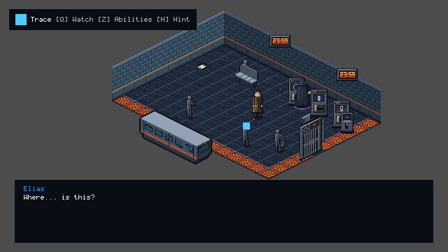

# TLF-058 Handoff Report: Operator Sighting on Arrival Platform

**Task:** TLF-058 — Operator sighting on the Arrival Platform (Story Bible Ch1 event 7)  
**Owner:** Flash  
**Worktree:** `tlf-implementation-qa`  
**Branch:** `adityadaffa522/tlf-058-operator-sighting`  
**Base Commit:** `6ae6455` (merge of TLF-055) + `e40e54e` (docs cleanup)  
**Implementation Commit:** `3b46ccc`  
**Status:** COMPLETE / VALIDATION GREEN (411 passed, 0 failed, 0 leaks)

---

## 1. Executive Summary

This handoff implements Story Bible Chapter 1 Event 7 (ADR-022 D3): the mysterious Operator sighting at the far eastern end of the Arrival Platform.
After Elias awakens and retrieves the pocket watch (`ch01.flag.pocket_watch_acquired`), a silent hooded figure stands at the far end of the platform facing away into the subterranean darkness, lifting and checking an identical pocket watch. When Elias approaches along the platform, the figure vanishes into thin air over 0.5 s (or an immediate static cut under `reduced_effects`), recording journal observation `JRN_CH1_FIGURE` and setting `ch01.flag.operator_sighting_seen`.

Key deliverables:
- **Canonical Art & Node Structure:** Integrated final TLF-062 Operator sprite sheet (`assets/characters/ch01/ch01_char_operator_sighting_ne_sheet.png`, 128x48, 4 frames, NE facing, scarf hidden in shipped frames) and ground ring VFX (`assets/props/ch01/ch01_fx_operator_sighting_trace_ring_idle.png`, 32x48) with foot pivot `(16, 44)`.
- **Exact Composition Proposal:** Placed at tile `(9, 2)` -> px `(432, 152)`. Matches canonical generator line `tools/art/gen/tlf062_operator_city.py:1203` and Sol's approved mockup `M11` (`cb2acbd`). Proposing this tile for Lead approval for reuse in Ending 3.
- **Windowed Composition Proof:** Rendered 640x360 windowed composition proof (`doc_operator_sighting_arrival.png`).
- **Mystery Guidelines Invariants:** Zero dialogue popups, zero player input lock, zero collision obstruction (`StaticBody2D` count = 0), face obscured, no biographical or identity reveals.
- **Accessibility:** Full `reduced_effects` support (static pose on Frame 2 / F3, ground ring suppressed, instant vanish cut).
- **Audio Hook:** Dedicated `AudioStreamPlayer2D` (`AudioSting`) + `audio_sting_requested` signal for TLF-064.
- **Save / Load Determinism:** Complete persistence across all 3 phases (pre-pickup dormant, post-pickup active, post-approach permanently dormant).
- **Validation:** 411 passed, 0 failed across all tests including real-input playthroughs and art integration collision freeze. Clean leak check.

---

## 2. Proposed Placement & Composition (For Lead Approval)

> **Lead Decision Request:** The Lead's approval is requested for the exact placement at tile `(9, 2)` -> px `(432, 152)`. Ending 3 will reuse this exact composition framing.

### Tile & Pixel Coordinates
- **Room:** `arrival_platform` (`res://scenes/chapters/ch01/rooms/arrival_platform.tscn`)
- **Tile Coordinates:** `(9, 2)`
- **Global Room Position:** `Vector2(432, 152)`
- **Foot Pivot:** `offset = Vector2(-16, -44)`, `centered = false` (anchors the contact point of the boots precisely at `(432, 152)`)
- **YSort Layers:**
  - `GroundRing`: `z_index = 8` (`YSort_Props`)
  - `FigureSprite`: `z_index = 10` (`YSort_Actors`)
- **Clearance & Framing:**
  - Watch pickup location is at tile `(8, 5)` -> px `(368, 168)`.
  - Euclidean distance from pickup spot to Operator: sqrt((432 - 368)^2 + (152 - 168)^2) = sqrt(4096 + 256) ≈ 65.97 px (~4.1 tiles).
  - Approach trigger center is at `(420, 160)` with radius `32.0 px`.
  - Closest trigger boundary distance to pickup spot: ≈ 14.6 px, providing ample clearance so picking up the pocket watch does not prematurely trigger the vanish sequence.
  - The trigger circle completely spans the platform corridor (Y: 128 to 192), ensuring Elias cannot bypass it when moving towards the release lever, ticket validator, or east door.

### Windowed Composition Screenshot
Below is the captured composition rendered from the running game at 640x360:



*Figure 1: Composition framing on Arrival Platform with Elias at the pocket watch pickup spot (368, 168) looking towards the Operator figure checking his watch at (432, 152).*

---

## 3. Architecture & Implementation

### 3.1 OperatorSighting Controller (`scripts/chapters/ch01/operator_sighting.gd`)
`OperatorSighting` extends `Node2D` and manages the visual lifecycle, animation cadence, approach detection, and save persistence:
- **Dormancy:** Starts hidden (`visible = false`, `set_process(false)`). When `ch01.flag.pocket_watch_acquired` is set to `true`, it awakens, resets modulate to `1.0`, and begins the animation loop.
- **Animation Cadence:** 4-frame NE-facing sheet cycling over 1.75 s:
  - `Frame 0 (F1)`: Looking NE into distance (0.25 s).
  - `Frame 1 (F2)`: Lifts pocket watch to chest (0.25 s).
  - `Frame 2 (F3)`: Checks watch face (1.00 s hold).
  - `Frame 3 (F4)`: Lowers pocket watch (0.25 s).
- **Approach Detection (`TriggerZone`):**
  - Uses `TriggerZone` (`accepts_echoes = false`, `collision_layer = 4`, `collision_mask = 2`).
  - Listens to both `actor_entered` and `body_entered` for maximum compatibility with both `InteractionService` routing and direct physics engine events.
  - Zero `StaticBody2D` nodes: non-blocking collision.
- **Vanish Sequence:**
  - Calls `play_audio_sting()` and emits `audio_sting_requested` signal (for TLF-064 audio sting hook).
  - Sets `ch01.flag.operator_sighting_seen = true`.
  - Appends journal entry `JRN_CH1_FIGURE` under category `"observation"`.
  - Standard mode: 0.5 s fadeout tween via modulate alpha to 0.0, then freed from processing and hidden.
  - Reduced effects mode: Instant cut (0.0 s), figure hidden immediately.
- **Accessibility (`reduced_effects`):**
  - Listens to `Settings.setting_changed` for `reduced_effects`.
  - When enabled: ground ring VFX is hidden, sprite frame is pinned to Frame 2 (`F3`), and vanish is an instant cut.
- **Save / Load Determinism:**
  - `refresh_state()` inspects `NarrativeState` flags on room load or save restore:
    1. If `ch01.flag.operator_sighting_seen == true`: permanently hidden.
    2. Else if `ch01.flag.pocket_watch_acquired == true`: active and visible.
    3. Else: dormant and hidden.

### 3.2 Room Scene Integration (`arrival_platform.tscn`)
```text
arrival_platform (Node2D, y_sort_enabled = true)
└── operator_sighting (Node2D @ Vector2(432, 152))
    ├── GroundRing (Sprite2D, z_index = 8, offset = (-16, -44))
    ├── FigureSprite (Sprite2D, z_index = 10, offset = (-16, -44), hframes = 4)
    ├── ApproachTrigger (TriggerZone, offset = (-12, 8), layer = 4, mask = 2, accepts_echoes = false)
    │   └── CollisionShape2D (CircleShape2D, radius = 32.0)
    └── AudioSting (AudioStreamPlayer2D)
```

---

## 4. Collision Fingerprint Delta

In accordance with ADR-022 and `docs/tasks/TLF-058.md`, the existing room collision geometry was strictly preserved:

| Room Metric | Pre-TLF-058 Baseline | Post-TLF-058 Baseline | Delta | Notes |
|---|---|---|---|---|
| `arrival_platform` Collisions | 20 | 21 | +1 | `operator_sighting/ApproachTrigger/CollisionShape2D` |
| `arrival_platform` Zones | 4 | 5 | +1 | `operator_sighting/ApproachTrigger` |
| `arrival_platform` Interactables | 15 | 16 | +1 | `operator_sighting/ApproachTrigger` |
| StaticBody2D (Physical Blockers) | 0 | 0 | 0 | Zero physical blocking colliders added |
| Other 9 Chapter 1 Rooms | Unchanged | Unchanged | 0 | All fingerprints verified identical |

Compressed GZIP baseline in `tests/chapters/ch01/test_ch01_art_integration.gd` re-baselined and verified passing (6/6 tests green).

---

## 5. Operator Mystery Guidelines Review Checklist

Mandatory gate per `docs/OPERATOR_MYSTERY_GUIDELINES.md` §6:

| Checklist Item | Status | Verification & Evidence |
|---|---|---|
| **1. Is his identity revealed directly?** | **NO (Pass)** | No real name is used or referenced anywhere in code, scenes, or localization. The figure is referred to only as "a silent figure" in `JRN_CH1_FIGURE`. |
| **2. Does any character confirm it?** | **NO (Pass)** | Elias does not speak or remark upon who the figure is. No monologue, PA announcement, or NPC confirms anything. |
| **3. Is a line too explicit?** | **NO (Pass)** | Zero dialogue lines are played or triggered. The encounter is completely silent. |
| **4. Does any visual show his face or a feature that removes the mystery?** | **NO (Pass)** | The sprite sheet depicts a back-facing silhouette looking NE away from the camera. The cowl/hood is up, mask is worn, and the scarf is hidden in the shipped frames. |
| **5. Does Ending 3 still leave room for interpretation?** | **YES (Pass)** | The composition establishes the initial visual link (the watch and the checking gesture at the end of the platform) without providing biographical closure, preserving all three canonical interpretations. |

---

## 6. Automated Tests (`test_operator_sighting.gd`)

Implemented comprehensive unit, integration, and lifecycle test suite (`tests/chapters/ch01/test_operator_sighting.gd`):
1. `test_operator_sighting_node_and_visual_properties`: Verifies exact placement at `(432, 152)`, sprite offsets `(-16, -44)`, z-indices (8 and 10), trigger radius (32.0 px), and confirms zero physical `StaticBody2D` colliders.
2. `test_operator_sighting_dormant_before_pickup_and_appears_on_watch`: Proves figure is completely hidden before watch pickup, ignores approach triggers before pickup, and becomes visible and active upon setting `ch01.flag.pocket_watch_acquired`.
3. `test_operator_sighting_animation_cadence`: Verifies exact frame progression: F1 (0.00-0.25 s), F2 (0.25-0.50 s), F3 (0.50-1.50 s hold), F4 (1.50-1.75 s), and seamless loop back to F1.
4. `test_operator_sighting_reduced_effects_mode`: Verifies accessibility mode pins pose to static Frame 2 (F3), suppresses ground ring VFX, and executes instant static cut on vanish.
5. `test_operator_sighting_vanishes_on_approach`: Verifies player entering approach trigger emits `audio_sting_requested`, sets `ch01.flag.operator_sighting_seen`, adds `JRN_CH1_FIGURE` observation, executes 0.5 s fadeout, and behaves idempotently on repeat entry.
6. `test_operator_sighting_save_load_lifecycle`: Verifies save/load persistence across 3 saves:
   - Save A (before pickup): loads dormant.
   - Save B (watch acquired, before approach): loads active and visible.
   - Save C (after approach): loads permanently dormant.
7. `test_operator_mystery_guidelines_invariants`: Verifies zero player input lock (`player._input_blocked == false`), zero dialogue popups (`hud.dialogue_box.is_active == false`), and confirms `JRN_CH1_FIGURE` is localized.

---

## 7. Raw Validation Log

Validation executed on a clean scratch archive (`C:\temp\tlf_val_058`) with `config/name = "TLF Validation 058"` (no BOM) using Godot 4.7.2 stable (`D:\Godot\Godot_v4.7.2-stable_win64_console.exe`).

### Summary Counts
- **Import Check:** Passed (0 errors).
- **Script Parse Check:** 148 scripts checked, 0 failed. Clean leaks.
- **Automated Test Suite:** **411 passed, 0 failed**. Clean leaks.
- **Overall Result:** **ALL VALIDATION CHECKS PASSED SUCCESSFULLY (Exit Code 0)**.

### Complete Raw Output (`tools/validate.ps1`)
```text
=== Validating The Last Frame Project ===
Using Godot executable: D:\Godot\Godot_v4.7.2-stable_win64_console.exe
Project root: C:\temp\tlf_val_058

[1/3] Running headless import check...
Godot Engine v4.7.2.stable.official.ed1daf0bf - https://godotengine.org

[   0% ] first_scan_filesystem | Started Project initialization (5 steps)
[   0% ] first_scan_filesystem | Scanning file structure...
[  16% ] first_scan_filesystem | Loading global class names...
[  33% ] first_scan_filesystem | Verifying GDExtensions...
[  50% ] first_scan_filesystem | Creating autoload scripts...
[  66% ] first_scan_filesystem | Initializing plugins...
[  83% ] first_scan_filesystem | Starting file scan...
[ DONE ] first_scan_filesystem

[   0% ] loading_editor_layout | Started Loading editor (5 steps)
[   0% ] loading_editor_layout | Loading editor layout...
[  16% ] loading_editor_layout | Loading docks...
[ DONE ] loading_editor_layout

Import check passed with zero errors.

[2/3] Checking that every GDScript parses...
Godot Engine v4.7.2.stable.official.ed1daf0bf - https://godotengine.org

Script check: 148 scripts, 0 failed.
Settings: headless, path = user://headless/settings.cfg (C:/Users/adity/AppData/Roaming/Godot/app_userdata/TLF Validation 058/headless/settings.cfg)
SaveStore: headless, root = user://headless/saves (C:/Users/adity/AppData/Roaming/Godot/app_userdata/TLF Validation 058/headless/saves)
Leak check: clean (script check)

[3/3] Running headless automated test suite...
Godot Engine v4.7.2.stable.official.ed1daf0bf - https://godotengine.org

Settings: headless, path = user://headless/settings.cfg (C:/Users/adity/AppData/Roaming/Godot/app_userdata/TLF Validation 058/headless/settings.cfg)
SaveStore: headless, root = user://headless/saves (C:/Users/adity/AppData/Roaming/Godot/app_userdata/TLF Validation 058/headless/saves)
--- Running Test Suite ---
Test file: res://tests/chapters/ch01/test_ch01_art_integration.gd
  PASS: test_collision_freeze_all_10_rooms
  PASS: test_intercom_reach_walkable
  PASS: test_no_greybox_nodes_remain_across_all_rooms
  PASS: test_puzzle_prop_presenter_state_mappings
  PASS: test_real_save_unmodified
  PASS: test_room1_arrival_platform_kit_complete
Test file: res://tests/chapters/ch01/test_ch01_narrative_beats.gd
  PASS: test_all_narrative_text_keys_localized_and_ascii
  PASS: test_beat01_platform_awakening_and_watch_pickup
  PASS: test_beat01_player_moves_immediately_and_dialogue_auto_advances
  PASS: test_beat03_call_box_09
  PASS: test_beat05_security_crossing_pa_speaker_echo
  PASS: test_beat06_waiting_lounge_trace_bench_and_mira_audio
  PASS: test_beat07_signal_control_intercom_warning_once
  PASS: test_beat08_upper_vestibule_loop_detection
  PASS: test_beat09_dispatch_terminal_revelation
  PASS: test_beat10_outro_and_chapter_complete
  PASS: test_clocks_2359_are_reusable
  PASS: test_movement_hint_lifecycle
Test file: res://tests/chapters/ch01/test_ch01_playthrough.gd
  PASS: test_chapter01_scene_initialization_and_graph_validation
  PASS: test_doorways_match_chapter_graph_def
  PASS: test_every_door_has_spawn_outside_presenter_shape
  PASS: test_gate_blockers_cover_door_triggers_from_all_approach_vectors
  PASS: test_intercom_adds_operator_warning_after_pz004
  PASS: test_interior_apertures_walkable_with_real_player_capsule
  PASS: test_object_specific_feedback_deferred_flow
  PASS: test_passage_blockers_toggle_with_puzzle_state
  PASS: test_puzzle_objects_configured_with_correct_exports
  PASS: test_pz004_route_is_at_least_600_px
  PASS: test_pz005_levers_and_resetter_configuration
  PASS: test_readables_apply_flags_fragments_and_journal
  PASS: test_room_object_ids_are_valid_and_unique
  PASS: test_room_scenes_exist_and_instantiate
  PASS: test_safe_anchors_and_checkpoints_match_specs
  PASS: test_scripted_playthrough_full_chapter_rooms_1_to_10
  PASS: test_scripted_playthrough_rooms_1_to_4
  PASS: test_street_exit_trigger_outro_completes_chapter
  PASS: test_watch_pickup_shows_unlock_trace_toast_without_regrant
Test file: res://tests/chapters/ch01/test_ch01_pz004_layout.gd
  PASS: test_breaker_b_unreachable_from_south_of_north_railing
  PASS: test_exit_trigger_unskippable_on_path_to_door_exit_north
  PASS: test_north_barrier_visual_and_collision_match
  PASS: test_railings_physically_seal_lanes_at_walls
  PASS: test_shortest_walkable_path_between_breakers_exceeds_600_px
Test file: res://tests/chapters/ch01/test_ch01_real_playthrough.gd
  INFO: real-input playthrough took 935 physics frames (15.6 s game time, 15.63 s wall)
  PASS: test_real_input_playthrough_pz001_to_pz003
Test file: res://tests/chapters/ch01/test_ch01_real_playthrough_late.gd
  INFO: no-Echo run: B pulled 418 ticks after A from (516.3919, 181.4689); grid_online=false
  PASS: test_pz004_cannot_be_solved_without_echo
  INFO: late playthrough | 5 lounge (audio log, exit)           97 frames (1.62 s)
  INFO: late playthrough | 6a PZ-004 step 1 (Rewind+Freeze)     16 frames (0.27 s)
  INFO: late playthrough | 6b PZ-004 step 2 (Echo + Z-route)   441 frames (7.35 s)
  INFO: late playthrough | 6c PZ-004 exit                       62 frames (1.03 s)
  INFO: late playthrough | 7 vestibule PZ-005 (levers)         242 frames (4.03 s)
  INFO: late playthrough | 9 atrium terminal (Beat 09)         138 frames (2.30 s)
  INFO: late playthrough | 10 street exit outro (Beat 10)       56 frames (0.93 s)
  INFO: late playthrough | total                              1052 frames (17.53 s)
  INFO: late playthrough wall time 17.35 s
  PASS: test_real_input_playthrough_rooms_5_to_10
Test file: res://tests/chapters/ch01/test_operator_sighting.gd
  PASS: test_operator_mystery_guidelines_invariants
  PASS: test_operator_sighting_animation_cadence
  PASS: test_operator_sighting_dormant_before_pickup_and_appears_on_watch
  PASS: test_operator_sighting_node_and_visual_properties
  PASS: test_operator_sighting_reduced_effects_mode
  PASS: test_operator_sighting_save_load_lifecycle
  PASS: test_operator_sighting_vanishes_on_approach
Test file: res://tests/core/test_scene_router.gd
  PASS: test_boot_routes_to_the_title_screen
  PASS: test_confirm_after_chapter_complete_returns_to_title
  PASS: test_router_is_an_autoload_without_class_name
  PASS: test_start_chapter_remembers_the_restore_slot_once
Test file: res://tests/echo/test_echo_service.gd
  PASS: test_completion_trigger_ignores_echo
  PASS: test_determinism_chunked_and_per_tick_playback_match
  PASS: test_ghost_follows_samples_and_holds_final_position
  PASS: test_missing_target_is_skipped_and_playback_continues
  PASS: test_pz003_02_echo_keeps_holding_switch_after_playback
  PASS: test_pz003_03_reset_releases_occupancy
  PASS: test_pz003_04_echo_cannot_take_progression_items
  PASS: test_pz004_04_echo_pull_lands_on_its_recorded_offset
  PASS: test_pz004_05_unpowered_replay_fails_gracefully
  PASS: test_recording_auto_stops_at_max_length
  PASS: test_recording_captures_player_events_with_relative_ticks
  PASS: test_restarting_playback_releases_then_reacquires_occupancy
  PASS: test_room_change_stops_recording
  PASS: test_state_machine_guards
  PASS: test_triggers_occupied_at_record_start_are_seeded_at_rel_zero
  PASS: test_watch_abilities_and_non_player_actors_are_not_recorded
Test file: res://tests/interaction/test_interactable_lifecycle.gd
ERROR: IdRegistry: Duplicate ID 'ch01.test_lever' already registered to OriginalLever:<Area2D#1102195985106>.
   at: push_error (core/variant/variant_utility.cpp:1023)
   GDScript backtrace (most recent call first):
       [0] register (res://scripts/session/id_registry.gd:40)
       [1] _register_with_session (res://scripts/interaction/interactable.gd:75)
       [2] _ready (res://scripts/interaction/interactable.gd:39)
       [3] test_duplicate_interactable_removal_preserves_original (res://tests/interaction/test_interactable_lifecycle.gd:61)
       [4] run_test (res://tests/run_tests.gd:158)
       [5] _run_all (res://tests/run_tests.gd:131)
       [6] run_test (res://tests/run_tests.gd:183)
  PASS: test_duplicate_interactable_removal_preserves_original
ERROR: Interactable 'EmptyIdLever' has an empty object_id.
   at: push_error (core/variant/variant_utility.cpp:1023)
   GDScript backtrace (most recent call first):
       [0] _ready (res://scripts/interaction/interactable.gd:37)
       [1] test_empty_id_interactable_does_not_register (res://tests/interaction/test_interactable_lifecycle.gd:102)
       [2] run_test (res://tests/run_tests.gd:158)
       [3] _run_all (res://tests/run_tests.gd:131)
       [4] run_test (res://tests/run_tests.gd:183)
  PASS: test_empty_id_interactable_does_not_register
ERROR: Interactable 'OrphanLever' (ch01.orphan_lever) could not find GameSession with IdRegistry.
   at: push_error (core/variant/variant_utility.cpp:1023)
   GDScript backtrace (most recent call first):
       [0] _register_with_session (res://scripts/interaction/interactable.gd:73)
       [1] _ready (res://scripts/interaction/interactable.gd:39)
       [2] test_interactable_handles_missing_game_session (res://tests/interaction/test_interactable_lifecycle.gd:125)
       [3] run_test (res://tests/run_tests.gd:158)
       [4] _run_all (res://tests/run_tests.gd:131)
       [5] run_test (res://tests/run_tests.gd:183)
  PASS: test_interactable_handles_missing_game_session
Test file: res://tests/interaction/test_targeting.gd
  PASS: test_targeting_nearest_interactable
  PASS: test_targeting_tie_break_lexicographical
Test file: res://tests/narrative/test_ch01_text.gd
  PASS: test_documents_reference_existing_keys_and_load
  PASS: test_every_feedback_key_in_the_specs_has_text
  PASS: test_multiline_pages_survive_godot_import
  PASS: test_revelation_document_applies_its_effects
  PASS: test_text_is_ascii_and_within_limits
Test file: res://tests/narrative/test_documents_journal.gd
  PASS: test_echo_cannot_read_documents
  PASS: test_invalid_document_is_refused
  PASS: test_journal_categories_and_promotion
  PASS: test_journal_survives_save_and_load
  PASS: test_reading_applies_flag_fragment_and_journal_once
Test file: res://tests/narrative/test_trace_memory.gd
  PASS: test_one_shot_dialogue_and_use_rules
  PASS: test_revealed_state_survives_a_save
  PASS: test_trace_with_real_input_reveals_the_memory_once
Test file: res://tests/player/test_ability_unlocks.gd
  PASS: test_continue_restores_unlocks
  PASS: test_default_start_keeps_all_four_abilities
  PASS: test_locked_selected_ability_falls_back_when_the_set_shrinks
  PASS: test_trace_only_start_and_locked_feedback
WARNING: AbilityUnlocks: unknown ability 'teleport'.
   at: push_warning (core/variant/variant_utility.cpp:1033)
   GDScript backtrace (most recent call first):
       [0] unlock (res://scripts/narrative/ability_unlocks.gd:43)
       [1] test_unlock_triggers_flag_pickup_and_puzzle_solved (res://tests/player/test_ability_unlocks.gd:160)
       [2] tap (res://tests/support/base_test.gd:80)
       [3] physics_frames (res://tests/support/base_test.gd:38)
  PASS: test_unlock_triggers_flag_pickup_and_puzzle_solved
Test file: res://tests/player/test_player_movement.gd
  PASS: test_cardinal_movement_vectors
  PASS: test_diagonal_movement_vectors_2_to_1
  PASS: test_zero_movement_on_no_input
Test file: res://tests/player/test_pocket_watch.gd
  PASS: test_ability_cycling_order_and_wrap
  PASS: test_echo_watch_state_machine_and_reset
  PASS: test_ghost_node_freed_on_watch_cleanup_no_leaks
  PASS: test_player_interact_failure_shows_hud_feedback
  PASS: test_targeting_echo_clears_target
  PASS: test_targeting_fallback_to_nearest
  PASS: test_targeting_out_of_radius_rejected
  PASS: test_targeting_preference_for_supporting_object
  PASS: test_targeting_tie_break_lexicographical
  PASS: test_watch_dispatches_correct_interaction_id
Test file: res://tests/player/test_spawn_targeting.gd
  PASS: test_spawn_targeting_ignores_checkpoint_and_picks_up_watch
Test file: res://tests/player/test_targeting_selection.gd
  PASS: test_adr006_tie_break_unchanged
  PASS: test_blocked_but_supported_use_stays_targetable
  PASS: test_fallback_pool_contains_no_trigger
  PASS: test_trigger_and_checkpoint_only_returns_null
  PASS: test_trigger_closer_than_usable_picks_usable
Test file: res://tests/puzzle/test_ch01_puzzles.gd
  PASS: test_pz001_01_use_on_collapsed_turnstile_is_jammed
  PASS: test_pz001_02_pillar_rewind_unsupported
  PASS: test_pz001_03_rewind_restores_open_at_tick_10
  PASS: test_pz001_04_second_rewind_no_history
  PASS: test_pz001_05_exit_trigger_solves
  PASS: test_pz001_adr016_reset_after_solve_keeps_passage_open
  PASS: test_pz001_reset_collapses_and_relocates_player_in_footprint
  PASS: test_pz001_solved_before_load_latches_open_on_ready
  PASS: test_pz002_01_raised_for_180_ticks_then_closes
  PASS: test_pz002_02_freezing_gear_halts_countdown
  PASS: test_pz002_03_frozen_gear_blocks_rewind
  PASS: test_pz002_04_safety_clutch_relocates_player
  PASS: test_pz002_05_rewind_again_after_slipping
  PASS: test_pz002_accessibility_assist_extends_window_to_300
  PASS: test_pz002_reset_and_solved_latch
  PASS: test_pz003_01_plate_toggles_gate_and_bridge_on_the_same_tick
  PASS: test_pz003_02_echo_holds_the_plate_after_playback
  PASS: test_pz003_03_reset_releases_echo_and_relocates_player_on_bridge
  PASS: test_pz003_04_echo_cannot_take_the_transit_pass
  PASS: test_pz003_05_gate_is_chrono_shielded
  PASS: test_pz003_solved_bridge_survives_echo_reset
  PASS: test_pz004_01_breakers_unpowered_before_step_1
  PASS: test_pz004_02_rewind_then_freeze_locks_the_bus
  PASS: test_pz004_03_single_breaker_expires_after_180
  PASS: test_pz004_04_echo_a_plus_player_b_brings_the_grid_online
  PASS: test_pz004_04b_echo_window_equals_player_window
  PASS: test_pz004_05_unpowered_replay_fails_with_reason
  PASS: test_pz004_06_exit_trigger_solves
  PASS: test_pz004_rewinding_frozen_capacitor_is_refused_and_reset_restores
  PASS: test_pz005_01_state0_north_loops_to_west
  PASS: test_pz005_02_lever_b_first_is_invalid_graph
  PASS: test_pz005_03_lever_a_then_b_routes_north_to_atrium
  PASS: test_pz005_04_severing_the_entry_is_critical_path_unreachable
  PASS: test_pz005_05_player_in_niche_is_relocated_when_sealed
  PASS: test_pz005_06_atrium_entry_solves_and_latches_levers
  PASS: test_pz005_levers_and_route_board_abilities
  PASS: test_pz005_reset_restores_state0_atomically
Test file: res://tests/puzzle/test_hint_service.gd
  PASS: test_ch01_puzzle_data_is_complete_and_translated
  PASS: test_hint_levels_survive_save_and_load
  PASS: test_hints_escalate_after_cooldown_and_stop_at_level_three
  PASS: test_hints_refused_for_unknown_or_solved_puzzles
ERROR: HintService: invalid PuzzleDef 'CH1-PZ-T01'.
   at: push_error (core/variant/variant_utility.cpp:1023)
   GDScript backtrace (most recent call first):
       [0] register_def (res://scripts/puzzle/hint_service.gd:31)
       [1] test_invalid_defs_are_rejected (res://tests/puzzle/test_hint_service.gd:74)
       [2] run_test (res://tests/run_tests.gd:158)
       [3] _run_all (res://tests/run_tests.gd:131)
       [4] run_test (res://tests/run_tests.gd:183)
ERROR: HintService: invalid PuzzleDef '<null>'.
   at: push_error (core/variant/variant_utility.cpp:1023)
   GDScript backtrace (most recent call first):
       [0] register_def (res://scripts/puzzle/hint_service.gd:31)
       [1] test_invalid_defs_are_rejected (res://tests/puzzle/test_hint_service.gd:75)
       [2] run_test (res://tests/run_tests.gd:158)
       [3] _run_all (res://tests/run_tests.gd:131)
       [4] run_test (res://tests/run_tests.gd:183)
  PASS: test_invalid_defs_are_rejected
  PASS: test_room_hint_follows_play_order_in_shared_rooms
  PASS: test_room_hint_targets_first_unsolved_puzzle
Test file: res://tests/puzzle/test_puzzle_service.gd
  PASS: test_completion_zone_solves_for_player_only
WARNING: PuzzleService: ignoring invalid state 'BANANA' for 'CH1-PZ-004'.
   at: push_warning (core/variant/variant_utility.cpp:1033)
   GDScript backtrace (most recent call first):
       [0] import_state (res://scripts/puzzle/puzzle_service.gd:90)
       [1] test_export_import_never_downgrades_and_ignores_garbage (res://tests/puzzle/test_puzzle_service.gd:48)
       [2] run_test (res://tests/run_tests.gd:158)
       [3] _run_all (res://tests/run_tests.gd:131)
       [4] run_test (res://tests/run_tests.gd:183)
  PASS: test_export_import_never_downgrades_and_ignores_garbage
  PASS: test_reset_anchor_resets_its_puzzle_through_the_contract
  PASS: test_reset_clears_echo_and_tells_members_whether_solved
  PASS: test_unknown_puzzles_are_unsolved_and_solving_is_idempotent
  PASS: test_watch_focus_hook_emits_once_per_change
Test file: res://tests/puzzle/test_step1_r1_deltas.gd
  PASS: test_pz001_r01_the_courier_unlocks_rewind
  PASS: test_pz001_r02_anchor_memory_journals_once
  PASS: test_pz001_r03_fallen_conduit_pins_the_turnstile
  PASS: test_pz001_r04_conduit_rewinds_once
  PASS: test_pz001_r05_full_solution_and_latch
  PASS: test_pz001_r06_order_independence
  PASS: test_pz001_r08_empty_pinned_by_is_the_base_turnstile
  PASS: test_pz001_r09_reset_while_unsolved
  PASS: test_pz002_r01_inner_shutter_is_unanchored_while_the_gear_is_free
  PASS: test_pz002_r02_anchored_inner_shutter_holds
  PASS: test_pz002_r03_freeze_is_required_assist_off
  PASS: test_pz002_r03_freeze_is_required_assist_on
  PASS: test_pz002_r04_late_freeze_from_the_pocket_solves
  PASS: test_pz002_r05_full_solution_survives_save_and_load
  PASS: test_pz002_r07_clutch_when_the_gear_is_unfrozen_later
  PASS: test_pz002_r08_base_shutter_rule_unchanged
  PASS: test_pz002_r09_old_trigger_is_inert
  PASS: test_pz002_r10_reset_closes_both_and_unfreezes
  PASS: test_pz003_r01_pedestal_unlocks_echo
  PASS: test_pz003_r02_guard_memory_journals_once
  PASS: test_pz003_r03_echo_cannot_take_the_pass
  PASS: test_pz003_r04_reader_without_the_pass
  PASS: test_pz003_r05_reader_with_the_pass_latches
  PASS: test_pz003_r06_alarm_plate_does_not_open_the_gate
  PASS: test_pz003_r09_full_solution_survives_save_and_load
  PASS: test_pz004_r01_breaker_c_browns_the_capacitor_out
  PASS: test_pz004_r02_dead_bus
  PASS: test_pz004_r03_c_is_not_an_input
  PASS: test_pz004_r04_brownout_is_recoverable
  PASS: test_pz004_r05_c_does_nothing_once_the_grid_is_online
  PASS: test_pz004_r06_engineer_and_chart_name_c_as_the_lamp_ring
  PASS: test_pz005_r01_dead_relay_without_the_standby_plate
  PASS: test_pz005_r02_echo_on_the_plate_powers_the_relays
  PASS: test_pz005_r02_relay_is_checked_at_pull_time
  PASS: test_pz005_r04_order_rule_unchanged
  PASS: test_pz005_r05_lever_c_is_a_dead_relay
  PASS: test_pz005_r06_echo_reset_keeps_state_2
  PASS: test_pz005_r07_empty_requires_plate_is_the_base_lever
  PASS: test_pz005_r08_memo_and_tourist_do_not_state_the_lever_order
Test file: res://tests/puzzle/test_step1_solo_and_ticket.gd
  PASS: test_pz006_01_correct_ticket_solves
  PASS: test_pz006_02_rewind_steps_the_dial_back
  PASS: test_pz006_03_use_on_a_dial_is_jammed
  PASS: test_pz006_04_initial_state_is_wrong
  PASS: test_pz006_05_every_wrong_triple_gives_the_same_answer
  PASS: test_pz006_06_no_constant_triple_and_tickets_match_the_memories
  PASS: test_pz006_07_the_fathers_ticket_is_rejected
  PASS: test_pz006_08_ticket_values_live_only_in_trace_memories
  PASS: test_pz006_10_reset_restores_index_5_and_the_history
  PASS: test_pz006_11_latch_after_solved_survives_save_and_load
  PASS: test_pz006_12_save_keeps_the_dial_history
  PASS: test_pz006_13_no_hidden_prerequisite
  PASS: test_pz006_14_rewind_needs_the_unlock
  PASS: test_so01_01_correct_code_opens_the_gate_and_solves
  PASS: test_so01_02_initial_position_is_wrong
  PASS: test_so01_03_every_wrong_code_gives_the_same_answer
  PASS: test_so01_04_lockout_360_ticks_assist_off
  PASS: test_so01_04_lockout_600_ticks_assist_on
  PASS: test_so01_06_answer_lives_only_in_trace_memories_and_labels
  PASS: test_so01_07_latest_statement_per_field_is_the_answer
  PASS: test_so01_08_statues_are_trace_only
  PASS: test_so01_09_latch_after_solved_survives_save_and_load
  PASS: test_so01_lockout_is_not_saved
  PASS: test_so01_lockout_is_not_started_by_prompt_queries
  PASS: test_so02_01_tracing_the_technician_unlocks_freeze
  PASS: test_so02_02_plate_opens_and_closes_the_hatch_on_the_same_tick
  PASS: test_so02_03_freeze_holds_the_hatch_open
  PASS: test_so02_06_other_abilities_are_unsupported
  PASS: test_so02_07_bell_plate_is_a_decoy
  PASS: test_so02_09_freeze_closed_is_recoverable
  PASS: test_so02_10_clutch_moves_the_player_before_closing
  PASS: test_so02_11_latch_after_solved_survives_save_and_load
  PASS: test_so02_12_security_crossing_gate_defaults_unchanged
  PASS: test_so02_frozen_open_state_survives_save_and_load_unsolved
  PASS: test_so02_unfreeze_on_an_occupied_plate_stays_open
Test file: res://tests/rooms/test_room_router.gd
  PASS: test_arrival_grace_ignores_immediate_traversal
  PASS: test_checkpoint_autosave_and_restore_into_fresh_session
  PASS: test_doorway_moves_player_to_other_room_and_unloads_old_one
ERROR: RoomRouter: unknown room 'ch01.nowhere'.
   at: push_error (core/variant/variant_utility.cpp:1023)
   GDScript backtrace (most recent call first):
       [0] enter_room (res://scripts/rooms/room_router.gd:91)
       [1] test_enter_room_loads_scene_registers_objects_and_places_player (res://tests/rooms/test_room_router.gd:130)
       [2] run_test (res://tests/run_tests.gd:158)
       [3] _run_all (res://tests/run_tests.gd:131)
       [4] run_test (res://tests/run_tests.gd:183)
  PASS: test_enter_room_loads_scene_registers_objects_and_places_player
  PASS: test_relocation_to_anchor_in_another_room_loads_that_room
  PASS: test_restore_places_player_at_checkpoint_spawn_anchor
  PASS: test_restore_with_unknown_room_is_refused
  PASS: test_room_change_resets_echo
  PASS: test_same_room_loop_repositions_without_reload
  PASS: test_world_memory_keeps_consumed_rewind_across_rooms
Test file: res://tests/save/test_headless_save_root.gd
  PASS: test_env_override_resolves_to_real_root
  PASS: test_headless_resolves_to_headless_root
  PASS: test_new_store_uses_the_resolved_root_and_assignment_wins
  PASS: test_this_headless_run_never_targets_the_real_saves
  PASS: test_windowed_resolves_to_real_root
Test file: res://tests/save/test_save_service.gd
  PASS: test_capture_and_apply_round_trip_ability_unlocks
  PASS: test_capture_contains_every_section_and_temporal_history
  PASS: test_disk_round_trip_preserves_types_and_leaves_no_temp_file
  PASS: test_full_loop_consumed_pre_history_stays_consumed_after_load
ERROR: SaveService: refusing to write invalid save (invalid).
   at: push_error (core/variant/variant_utility.cpp:1023)
   GDScript backtrace (most recent call first):
       [0] write_slot (res://scripts/save/save_service.gd:145)
       [1] test_invalid_structure_is_refused_for_read_and_write (res://tests/save/test_save_service.gd:235)
       [2] run_test (res://tests/run_tests.gd:158)
       [3] _run_all (res://tests/run_tests.gd:131)
       [4] run_test (res://tests/run_tests.gd:183)
  PASS: test_invalid_structure_is_refused_for_read_and_write
  PASS: test_migrations_run_in_order_up_to_current_version
ERROR: Parse JSON failed. Error at line 0: Expected key
   at: parse_string (core/io/json.cpp:629)
   GDScript backtrace (most recent call first):
       [0] read_slot (res://scripts/save/save_service.gd:172)
       [1] test_missing_and_corrupt_files_fail_gracefully (res://tests/save/test_save_service.gd:121)
       [2] run_test (res://tests/run_tests.gd:158)
       [3] _run_all (res://tests/run_tests.gd:131)
       [4] run_test (res://tests/run_tests.gd:183)
  PASS: test_missing_and_corrupt_files_fail_gracefully
  PASS: test_missing_optional_fields_get_defaults
  PASS: test_newer_version_is_rejected
  PASS: test_unknown_temporal_ids_are_skipped_not_fatal
  PASS: test_v1_save_migrates_to_v2_with_an_empty_playtest_log
  PASS: test_v2_save_migrates_to_v3_with_all_four_abilities
Test file: res://tests/session/test_id_registry.gd
ERROR: IdRegistry: Duplicate ID 'ch01.test_node' already registered to <Node#1512768014877>.
   at: push_error (core/variant/variant_utility.cpp:1023)
   GDScript backtrace (most recent call first):
       [0] register (res://scripts/session/id_registry.gd:40)
       [1] test_duplicate_id_rejected (res://tests/session/test_id_registry.gd:90)
       [2] run_test (res://tests/run_tests.gd:158)
       [3] _run_all (res://tests/run_tests.gd:131)
       [4] run_test (res://tests/run_tests.gd:183)
  PASS: test_duplicate_id_rejected
ERROR: IdRegistry: Cannot register node with empty ID.
   at: push_error (core/variant/variant_utility.cpp:1023)
   GDScript backtrace (most recent call first):
       [0] register (res://scripts/session/id_registry.gd:32)
       [1] test_empty_id_rejected (res://tests/session/test_id_registry.gd:51)
       [2] run_test (res://tests/run_tests.gd:158)
       [3] _run_all (res://tests/run_tests.gd:131)
       [4] run_test (res://tests/run_tests.gd:183)
  PASS: test_empty_id_rejected
ERROR: IdRegistry: ID 'ch1.gate' does not match ADR-005 pattern '^(ch\d\d|global)\.[a-z0-9_]+(\.[a-z0-9_]+)*$'.
   at: push_error (core/variant/variant_utility.cpp:1023)
   GDScript backtrace (most recent call first):
       [0] register (res://scripts/session/id_registry.gd:36)
       [1] test_malformed_ids_rejected (res://tests/session/test_id_registry.gd:75)
       [2] run_test (res://tests/run_tests.gd:158)
       [3] _run_all (res://tests/run_tests.gd:131)
       [4] run_test (res://tests/run_tests.gd:183)
ERROR: IdRegistry: ID 'platform.gate' does not match ADR-005 pattern '^(ch\d\d|global)\.[a-z0-9_]+(\.[a-z0-9_]+)*$'.
   at: push_error (core/variant/variant_utility.cpp:1023)
   GDScript backtrace (most recent call first):
       [0] register (res://scripts/session/id_registry.gd:36)
       [1] test_malformed_ids_rejected (res://tests/session/test_id_registry.gd:75)
       [2] run_test (res://tests/run_tests.gd:158)
       [3] _run_all (res://tests/run_tests.gd:131)
       [4] run_test (res://tests/run_tests.gd:183)
ERROR: IdRegistry: ID 'ch01.' does not match ADR-005 pattern '^(ch\d\d|global)\.[a-z0-9_]+(\.[a-z0-9_]+)*$'.
   at: push_error (core/variant/variant_utility.cpp:1023)
   GDScript backtrace (most recent call first):
       [0] register (res://scripts/session/id_registry.gd:36)
       [1] test_malformed_ids_rejected (res://tests/session/test_id_registry.gd:75)
       [2] run_test (res://tests/run_tests.gd:158)
       [3] _run_all (res://tests/run_tests.gd:131)
       [4] run_test (res://tests/run_tests.gd:183)
ERROR: IdRegistry: ID 'ch01..gate' does not match ADR-005 pattern '^(ch\d\d|global)\.[a-z0-9_]+(\.[a-z0-9_]+)*$'.
   at: push_error (core/variant/variant_utility.cpp:1023)
   GDScript backtrace (most recent call first):
       [0] register (res://scripts/session/id_registry.gd:36)
       [1] test_malformed_ids_rejected (res://tests/session/test_id_registry.gd:75)
       [2] run_test (res://tests/run_tests.gd:158)
       [3] _run_all (res://tests/run_tests.gd:131)
       [4] run_test (res://tests/run_tests.gd:183)
ERROR: IdRegistry: ID 'CH01.gate' does not match ADR-005 pattern '^(ch\d\d|global)\.[a-z0-9_]+(\.[a-z0-9_]+)*$'.
   at: push_error (core/variant/variant_utility.cpp:1023)
   GDScript backtrace (most recent call first):
       [0] register (res://scripts/session/id_registry.gd:36)
       [1] test_malformed_ids_rejected (res://tests/session/test_id_registry.gd:75)
       [2] run_test (res://tests/run_tests.gd:158)
       [3] _run_all (res://tests/run_tests.gd:131)
       [4] run_test (res://tests/run_tests.gd:183)
ERROR: IdRegistry: ID 'global.Gate' does not match ADR-005 pattern '^(ch\d\d|global)\.[a-z0-9_]+(\.[a-z0-9_]+)*$'.
   at: push_error (core/variant/variant_utility.cpp:1023)
   GDScript backtrace (most recent call first):
       [0] register (res://scripts/session/id_registry.gd:36)
       [1] test_malformed_ids_rejected (res://tests/session/test_id_registry.gd:75)
       [2] run_test (res://tests/run_tests.gd:158)
       [3] _run_all (res://tests/run_tests.gd:131)
       [4] run_test (res://tests/run_tests.gd:183)
ERROR: IdRegistry: ID 'global.pocket-watch' does not match ADR-005 pattern '^(ch\d\d|global)\.[a-z0-9_]+(\.[a-z0-9_]+)*$'.
   at: push_error (core/variant/variant_utility.cpp:1023)
   GDScript backtrace (most recent call first):
       [0] register (res://scripts/session/id_registry.gd:36)
       [1] test_malformed_ids_rejected (res://tests/session/test_id_registry.gd:75)
       [2] run_test (res://tests/run_tests.gd:158)
       [3] _run_all (res://tests/run_tests.gd:131)
       [4] run_test (res://tests/run_tests.gd:183)
ERROR: IdRegistry: ID 'global' does not match ADR-005 pattern '^(ch\d\d|global)\.[a-z0-9_]+(\.[a-z0-9_]+)*$'.
   at: push_error (core/variant/variant_utility.cpp:1023)
   GDScript backtrace (most recent call first):
       [0] register (res://scripts/session/id_registry.gd:36)
       [1] test_malformed_ids_rejected (res://tests/session/test_id_registry.gd:75)
       [2] run_test (res://tests/run_tests.gd:158)
       [3] _run_all (res://tests/run_tests.gd:131)
       [4] run_test (res://tests/run_tests.gd:183)
  PASS: test_malformed_ids_rejected
  PASS: test_unregister_and_resolve
  PASS: test_unregister_requires_matching_node
  PASS: test_valid_id_registration
Test file: res://tests/session/test_interaction_service.gd
  PASS: test_interaction_can_interact_rejection
  PASS: test_interaction_echo_forbidden_on_progression
  PASS: test_interaction_missing_target
  PASS: test_interaction_success_and_signal
  PASS: test_trigger_signals
Test file: res://tests/session/test_sim_clock.gd
  PASS: test_sim_clock_pause
  PASS: test_sim_clock_step
Test file: res://tests/settings/test_headless_settings_path.gd
  PASS: test_env_override_resolves_to_real_settings
  PASS: test_headless_resolves_to_headless_settings
  PASS: test_new_settings_use_the_resolved_path_and_assignment_wins
  PASS: test_this_headless_run_never_targets_the_real_settings
  PASS: test_windowed_resolves_to_real_settings
Test file: res://tests/settings/test_settings.gd
  PASS: test_ability_wheel_remap_and_conflict
  PASS: test_bus_volumes_applied
ERROR: ConfigFile parse error at user://test_settings_corrupt.cfg:0: Unexpected EOF while parsing simple tag.
   at: _parse (core/io/config_file.cpp:293)
   GDScript backtrace (most recent call first):
       [0] load_settings (res://scripts/settings/settings.gd:177)
       [1] test_corrupt_file_handling (res://tests/settings/test_settings.gd:167)
       [2] run_test (res://tests/run_tests.gd:158)
       [3] _run_all (res://tests/run_tests.gd:131)
       [4] run_test (res://tests/run_tests.gd:183)
WARNING: Settings file 'user://test_settings_corrupt.cfg' exists but failed to parse (error 43). Resetting to defaults.
   at: push_warning (core/variant/variant_utility.cpp:1033)
   GDScript backtrace (most recent call first):
       [0] load_settings (res://scripts/settings/settings.gd:180)
       [1] test_corrupt_file_handling (res://tests/settings/test_settings.gd:167)
       [2] run_test (res://tests/run_tests.gd:158)
       [3] _run_all (res://tests/run_tests.gd:131)
       [4] run_test (res://tests/run_tests.gd:183)
  PASS: test_corrupt_file_handling
  PASS: test_default_settings
  PASS: test_echo_reset_present_and_no_conflicts
  PASS: test_joypad_device_minus_one_preserved
  PASS: test_remap_allow_list_interact_confirm
  PASS: test_remap_conflict_rejected
  PASS: test_remap_persisted_and_reapplied
  PASS: test_remap_success
  PASS: test_reset_action
  PASS: test_save_load_round_trip
  PASS: test_timing_window_assist
  PASS: test_unknown_action_and_invalid_event
  PASS: test_value_clamping
Test file: res://tests/spatial/test_ch01_graph.gd
  PASS: test_apply_to_configures_the_session_and_relocates_from_the_sealed_niche
  PASS: test_cutting_the_start_off_the_vestibule_is_refused
  PASS: test_definition_builds_a_valid_graph
  PASS: test_every_door_sits_on_its_boundary_wall
  PASS: test_every_room_fits_the_fixed_camera
  PASS: test_relocation_anchors_are_declared_safe_anchors
  PASS: test_solving_pz005_opens_the_rest_of_the_chapter_and_backtracking_works
  PASS: test_state0_reachability_and_the_grille
  PASS: test_static_edges_connect_opposite_sides
Test file: res://tests/spatial/test_spatial_graph.gd
  PASS: test_doorway_presenter_reports_destination_and_blocks_grille
  PASS: test_i2_relooping_while_routed_to_atrium_is_rejected
  PASS: test_i3_unknown_duplicate_and_dangling_are_invalid
  PASS: test_levers_reverse_back_to_state0
  PASS: test_player_in_vestibule_is_not_relocated
  PASS: test_pz005_01_state0_north_loops_to_west
  PASS: test_pz005_02_lever_b_first_is_rejected_without_side_effects
  PASS: test_pz005_03_lever_a_then_b_reaches_atrium
  PASS: test_pz005_04_severing_the_entry_is_critical_path_unreachable
  PASS: test_pz005_05_player_stranded_in_niche_is_relocated
  PASS: test_reachability_respects_non_traversable_edges
  PASS: test_spatial_state_survives_save_and_load
Test file: res://tests/support/test_test_runner_async.gd
  PASS: test_async_failure_is_reported
  PASS: test_async_pass_steps_physics_frames
  PASS: test_async_timeout_fails_with_clear_message_and_detaches
  PASS: test_input_released_after_failing_async_test
  PASS: test_input_released_when_sync_test_fails_before_flush
  NOTE: case_leaves_node_and_hangs left 1 node(s) under the root; freed them.
  PASS: test_nodes_left_by_timed_out_test_are_freed
Test file: res://tests/telemetry/test_playtest_log.gd
  PASS: test_chapter_complete_writes_json_to_the_headless_folder_and_shows_a_summary
  PASS: test_continue_from_a_v1_save_marks_solved_puzzles_untracked
  PASS: test_flag_defaults_on_in_debug_off_in_export_and_output_paths
  PASS: test_flag_off_means_no_log_no_file_no_summary
  PASS: test_hints_resets_and_failures_are_counted_per_puzzle
  PASS: test_pauses_are_counted_separately_not_as_puzzle_time
  INFO: playtest log of the TLF-030 route: total 15.60 s active, 0 dialogue ticks; CH1-PZ-001 1.55 s (93 ticks); CH1-PZ-002 3.70 s (222 ticks); CH1-PZ-003 4.97 s (298 ticks); ch01.arrival_platform 1.95 s; ch01.concourse_west 4.53 s; ch01.maintenance_bay 3.90 s; 
ch01.security_crossing 5.22 s; ch01.waiting_lounge 0.00 s
  PASS: test_real_input_rooms_1_to_4_times_match_the_sim_clock
  PASS: test_save_and_continue_keep_the_log
Test file: res://tests/temporal/test_temporal_abilities.gd
  PASS: test_determinism_step_chunking_is_irrelevant
  PASS: test_echo_actor_may_use_abilities_on_non_progression_objects
  PASS: test_frozen_object_rejects_use_until_unfrozen
  PASS: test_pz001_01_use_on_collapsed_gate_is_jammed
  PASS: test_pz001_02_static_pillar_rejects_every_ability
  PASS: test_pz001_03_rewind_restores_pre_arrival_open_state_and_signals_tick
  PASS: test_pz001_04_second_rewind_reports_no_history
  PASS: test_pz002_01_rewound_shutter_holds_180_ticks_then_closes
  PASS: test_pz002_02_freezing_gear_halts_countdown
  PASS: test_pz002_03_frozen_gear_blocks_shutter_rewind
  PASS: test_pz002_05_shutter_can_be_rewound_again_after_slipping
  PASS: test_trace_on_traceable_object_emits_traced
  PASS: test_wrong_ability_on_coupled_objects_is_unsupported
Test file: res://tests/temporal/test_temporal_component.gd
  PASS: test_commit_after_rewind_truncates_future
  PASS: test_counter_changes_do_not_commit
  PASS: test_export_import_round_trip
  PASS: test_fast_forward_calls_parent_advance
  PASS: test_freeze_is_a_toggle_and_blocks_rewind
  PASS: test_initial_history_seeds_before_current_state
ERROR: TemporalComponent on '@Node@637': capture_state() keys ["phase", "counter"] do not match state_fields ["phase"].
   at: push_error (core/variant/variant_utility.cpp:1023)
   GDScript backtrace (most recent call first):
       [0] _is_valid_snapshot (res://scripts/temporal/temporal_component.gd:234)
       [1] commit_history (res://scripts/temporal/temporal_component.gd:89)
       [2] test_invalid_snapshot_is_rejected (res://tests/temporal/test_temporal_component.gd:119)
       [3] run_test (res://tests/run_tests.gd:158)
       [4] _run_all (res://tests/run_tests.gd:131)
       [5] run_test (res://tests/run_tests.gd:183)
  PASS: test_invalid_snapshot_is_rejected
  PASS: test_missing_capabilities_are_unsupported
  PASS: test_reset_to_initial_restores_tick0_and_history
  PASS: test_rewind_steps_back_then_reports_no_history
  PASS: test_ring_capacity_evicts_oldest
  PASS: test_sim_clock_step_emits_every_tick
Test file: res://tests/test_project_settings.gd
  PASS: test_autoloads
  PASS: test_controller_device_configuration
  PASS: test_custom_theme_registered
  PASS: test_input_actions
  PASS: test_main_scene
  PASS: test_no_input_binding_conflicts
  PASS: test_viewport_and_display_settings
Test file: res://tests/ui/test_ability_wheel.gd
  PASS: test_aiming_locked_segment_refused_no_change
  PASS: test_controller_lt_axis_and_stick_selection
  PASS: test_hold_z_aim_right_down_selects_freeze
  PASS: test_issue_041_hud_elements_hidden_during_chapter_complete
  PASS: test_modal_priority_blocks_wheel_opening
  PASS: test_reduced_effects_prevents_pulse
  PASS: test_release_does_not_trigger_watch_action
  PASS: test_release_in_dead_zone_no_change
  PASS: test_segment_positions_stay_identical_after_unlock
  PASS: test_toggle_mode_open_confirm_cancel
Test file: res://tests/ui/test_chapter_complete_overlay.gd
  PASS: test_overlay_compat_title_label
  PASS: test_overlay_layout_and_safe_margins
  PASS: test_overlay_text_scale_2
  PASS: test_overlay_without_summary
Test file: res://tests/ui/test_dialogue_box.gd
  PASS: test_blocking_dialogue_continue_cue_and_reduced_effects
  NOTE: test_dialogue_box_advance_does_not_trigger_interactable left 1 node(s) under the root; freed them.
  PASS: test_dialogue_box_advance_does_not_trigger_interactable
  PASS: test_dialogue_box_auto_advance
  PASS: test_dialogue_box_blocking_stops_player_movement
  PASS: test_dialogue_box_sequencing_and_advancement
  PASS: test_dialogue_one_shot_flag_and_save_load
  NOTE: test_non_blocking_dialogue_does_not_consume_interact left 1 node(s) under the root; freed them.
  PASS: test_non_blocking_dialogue_does_not_consume_interact
Test file: res://tests/ui/test_document_viewer.gd
  NOTE: test_document_viewer_interact_does_not_reopen_on_close left 1 node(s) under the root; freed them.
  PASS: test_document_viewer_interact_does_not_reopen_on_close
  PASS: test_document_viewer_multipage_paging_and_beat09_journal
  PASS: test_document_viewer_single_page_and_simclock_pause
Test file: res://tests/ui/test_hint_ui.gd
  PASS: test_hint_action_binding
  PASS: test_hint_hud_request_and_escalation
Test file: res://tests/ui/test_hud_feedback.gd
  PASS: test_feedback_text_resolves_all_standard_reasons
  PASS: test_hud_feedback_toast_display_and_dismissal
  PASS: test_prompt_glyphs_keyboard_vs_joypad
ERROR: Interactable '@Area2D@771' (ch01.test_target) could not find GameSession with IdRegistry.
   at: push_error (core/variant/variant_utility.cpp:1023)
   GDScript backtrace (most recent call first):
       [0] _register_with_session (res://scripts/interaction/interactable.gd:73)
       [1] _ready (res://scripts/interaction/interactable.gd:39)
       [2] test_target_marker_camera_offset_conversion (res://tests/ui/test_hud_feedback.gd:114)
       [3] run_test (res://tests/run_tests.gd:158)
       [4] _run_all (res://tests/run_tests.gd:131)
       [5] run_test (res://tests/run_tests.gd:183)
  PASS: test_target_marker_camera_offset_conversion
  PASS: test_translations_registered_in_project_settings
  PASS: test_use_vs_watch_unsupported_feedback
Test file: res://tests/ui/test_journal_screen.gd
  PASS: test_journal_screen_empty_state
  PASS: test_journal_screen_grouping_by_category
Test file: res://tests/ui/test_title_screen.gd
ERROR: Parse JSON failed. Error at line 0: Expected key
   at: parse_string (core/io/json.cpp:629)
   GDScript backtrace (most recent call first):
       [0] read_slot (res://scripts/save/save_service.gd:172)
       [1] _ready (res://scripts/chapters/ch01/chapter01.gd:66)
  PASS: test_broken_save_starts_fresh_with_feedback
  PASS: test_continue_disabled_without_a_save
  PASS: test_continue_enabled_with_a_save_and_menu_navigation
  PASS: test_continue_restores_the_signal_control_checkpoint
  PASS: test_new_game_starts_chapter_1_in_the_arrival_platform
  PASS: test_new_game_with_a_save_asks_once
  PASS: test_title_text_is_translated_ascii
Test file: res://tests/ui/test_ui_theme.gd
  PASS: test_action_glyph_first_key_and_confirm
  PASS: test_font_scan_ui_and_chapter01
  PASS: test_panel_clipping_dialogue_and_documents
  PASS: test_static_scene_font_size_overrides
WARNING: UITheme: TLF Pixel Mono not available, using default font
   at: push_warning (core/variant/variant_utility.cpp:1033)
   GDScript backtrace (most recent call first):
       [0] _setup_font (res://scripts/ui/ui_theme.gd:74)
       [1] _setup_theme (res://scripts/ui/ui_theme.gd:50)
       [2] _init (res://scripts/ui/ui_theme.gd:25)
       [3] test_theme_fallback_when_font_unavailable (res://tests/ui/test_ui_theme.gd:273)
       [4] run_test (res://tests/run_tests.gd:158)
       [5] _run_all (res://tests/run_tests.gd:131)
       [6] run_test (res://tests/run_tests.gd:183)
  PASS: test_theme_fallback_when_font_unavailable
---------------------------
TESTS: 411 passed, 0 failed
Leak check: clean (test suite)

=== All validation checks passed successfully! ===
```
