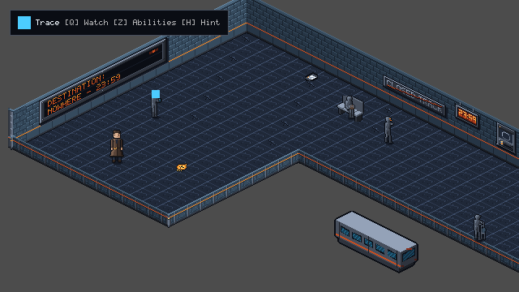
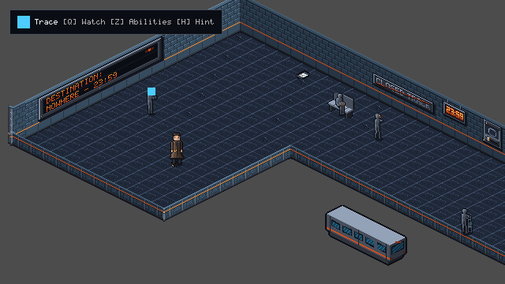
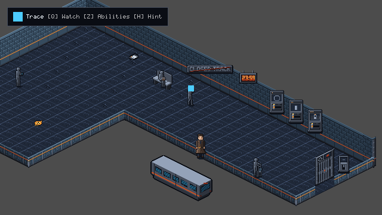
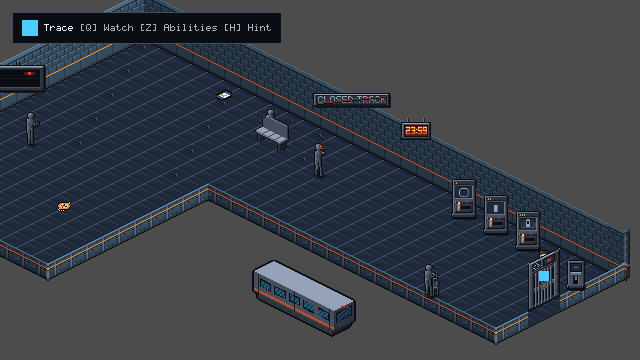

# TLF-069 Handoff Report: Pilot Room Arrival Platform v2 Rebuild

**Task:** TLF-069 — Pilot room: Arrival Platform v2 (ADR-023, plan Task 5)
**Owner:** Flash (build and wiring)
**Technical Reviewer:** Opus
**Visual / Facing Review:** Sol
**Lead:** Layout, validation, merge
**Branch:** `adityadaffa522/tlf-069-arrival-platform-v2`
**Status:** COMPLETE / VALIDATION GREEN (479 passed, 0 failed, 0 leaks)

---

## 1. Executive Summary

This handoff delivers the complete rebuild of `scenes/chapters/ch01/rooms/arrival_platform.tscn` from the legacy 14×10 rectangular layout to the approved L-shaped, larger room layout (`[[0,0],[30,0],[30,8],[12,8],[12,18],[0,18]]`) with `RoomCamera` following and bounding per ADR-023 and `design/ch01/rooms_v2/arrival_platform.md`.

All puzzle logic for CH1-SO-01 remains completely intact. The 4 windowed Forward+ screenshots have been captured from the running game, all Chapter 1 integration tests pass, and full clean validation passes on an isolated scratch copy with 0 errors, 0 failures, and 0 leaks.

### Key Deliverables:
1. **L-Shaped Room Geometry & RoomShape (ADR-023):**
   - Built to outline `[[0,0],[30,0],[30,8],[12,8],[12,18],[0,18]]` (extent 768 × 368 px).
   - 360 floor cells (TileMapLayer_Floor) with zero hidden floor cells (`hidden_floor_cells()` empty).
   - `metadata/room_shape` resource attached to the room root, driving `RoomCamera` clamping and follow behaviour.
   - Tall walls: 15 WallN modules, 9 WallW modules.
   - TLF-068 shape kit pieces integrated: 6 corner modules (`Corner_NW_0_0`, `Corner_N_Turn_30_0`, `Corner_Low_30_8`, `Corner_Low_12_8`, `Corner_Low_12_18`, `Corner_W_Turn_0_18`), 6 LowS arm modules, 5 LowE arm modules, 9 LowS pit modules, and 3 LowE strip modules (`LowE_strip_0` at `(784, 312)`, `LowE_strip_1` at `(752, 328)`, `LowE_strip_2` at `(688, 360)`). Tile `(30, 5)` at `(720, 344)` is omitted to align with the doorway archway opening per Lead Decision 3.
   - Boundary edge strip painted with tile source 0 (plain terrazzo) per Lead Decision 4; amber tactile tiles at x=13 / y=9 cleared.
2. **Object & Actor Placements (Lead Decisions Applied):**
   - `safe_anchor_spawn`: `Vector2(160, 224)` (tile 5, 15).
   - `checkpoint`: `Vector2(160, 224)` (tile 5, 15) restored to spawn tile per Lead Decision 7 so new games autosave on boot.
   - `pocket_watch_pickup`: `Vector2(240, 232)` (tile 8, 13).
   - `operator_sighting` (TLF-058): `Vector2(304, 216)` (tile 9, 10), trigger offset `Vector2(-12, 8)` preserved.
   - `n02_student`: `Vector2(208, 168)` (tile 3, 10).
   - `n03_old_man`: `Vector2(448, 160)` (tile 10, 2); `PlatformBench` at `Vector2(448, 168)`.
   - `n01_conductor`: `Vector2(496, 200)` (tile 14, 3).
   - `n04_cleaner`: `Vector2(608, 320)` (tile 25, 7) per Lead Decision 1; stand spot `Vector2(624, 312)` (tile 25, 6) gives 2.20 tiles clearance from walking line.
   - `doc_last_service`: `Vector2(400, 120)` (tile 6, 1).
   - Clocks: `Clock_2` at `Vector2(400, 66)` (tile 5, 0), `Clock_8` at `Vector2(592, 162)` (tile 17, 0); `digital_clock_2359` Area2D trigger placed on reachable floor spot under Clock_8 at `Vector2(592, 200)` (tile 17, 2).
   - `DepartureBoard`: mounted on W wall module 5, raised 38 px to `Vector2(144, 114)` per Lead Decision 5 & Opus review.
   - `ClosedTrackNotice`: mounted on N wall module 6, raised 38 px to `Vector2(528, 130)` per Lead Decision 6 & Opus review.
   - `selector_line`: `Vector2(640, 240)` (tile 21, 1).
   - `selector_platform`: `Vector2(672, 256)` (tile 23, 1).
   - `selector_car`: `Vector2(704, 272)` (tile 25, 1).
   - `release_lever`: `Vector2(752, 312)` (tile 29, 2); stand spot `Vector2(736, 304)` (tile 28, 2) on West side per Lead Decision 2.
   - `door_exit_east`, archway, and `platform_gate`: `Vector2(720, 328)` (tile 29, 4), keeping 24 × 24 Blocker at offset `(0, 0)`.
   - `StalledTransitCar`: `Vector2(480, 336)` (tile 22, 12).
3. **Verification Suites:**
   - Added `tests/chapters/ch01/test_ch01_arrival_platform_v2.gd`: door sweep closed gate guard, stand spot reach within 2.6 px with interactable target assertion (`Player.choose_best_interactable` / `PocketWatch.choose_watch_target`), camera view rect bounding clamp, checkpoint save/load restoration, and real-input clock dialogue line test (`test_digital_clock_2359_dialogue_line_plays`).
   - Re-baselined `test_collision_freeze_all_10_rooms` and updated `test_room1_arrival_platform_kit_complete` in `tests/chapters/ch01/test_ch01_art_integration.gd`.
   - Updated `design/ch01/ROOM_GRAPH.md` and regenerated `data/chapters/ch01/ch01_graph.tres` via `tools/content/gen_ch01_graph.py` (30×18, door E (29,4), anchor (5,15)); removed arrival special cases from `tests/chapters/ch01/test_ch01_playthrough.gd`.
   - Python builder test suite (`tools/content/test_build_room_from_shape.py`): 22 passed, 0 failed.
   - Full Godot validation: 479 passed, 0 failed, 0 leaks.

---

## 2. Canonical Stand Spots Table

All stand spots were calculated according to the SO-01 interaction rule ($17.9\text{ px}$ offset from object center) and verified with the real player capsule to be reachable within $\le 2.6\text{ px}$:

| Object ID / Name | Object Tile | Object Pos (px) | Stand Spot Tile | Stand Spot Pos (px) | Approach Side | SO-01 Dist | Clearance / Notes |
|---|---|---|---|---|---|---|---|
| `pocket_watch_pickup` | `(8, 13)` | `(240, 232)` | `(8, 14)` | `(224, 240)` | West | $17.9\text{ px}$ | Direct path from spawn |
| `n02_student` | `(3, 10)` | `(208, 168)` | `(3, 9)` | `(224, 160)` | East | $17.9\text{ px}$ | Clear of walls |
| `n03_old_man` | `(10, 2)` | `(448, 160)` | `(10, 3)` | `(432, 168)` | South-West | $17.9\text{ px}$ | Bench at `(448, 168)` |
| `n01_conductor` | `(14, 3)` | `(496, 200)` | `(14, 4)` | `(480, 208)` | South-West | $17.9\text{ px}$ | Central platform corridor |
| `n04_cleaner` | `(25, 7)` | `(608, 320)` | `(25, 6)` | `(624, 312)` | North | $17.9\text{ px}$ | 2.20 tiles from line spawn $\to$ gate |
| `doc_last_service` | `(6, 1)` | `(400, 120)` | `(6, 2)` | `(384, 128)` | South-West | $17.9\text{ px}$ | Near north platform edge |
| `selector_line` | `(21, 1)` | `(640, 240)` | `(21, 2)` | `(624, 248)` | South-West | $17.9\text{ px}$ | Switch console 1 |
| `selector_platform` | `(23, 1)` | `(672, 256)` | `(23, 2)` | `(656, 264)` | South-West | $17.9\text{ px}$ | Switch console 2 |
| `selector_car` | `(25, 1)` | `(704, 272)` | `(25, 2)` | `(688, 280)` | South-West | $17.9\text{ px}$ | Switch console 3 |
| `release_lever` | `(29, 2)` | `(752, 312)` | `(28, 2)` | `(736, 304)` | West | $17.9\text{ px}$ | West approach, clear of gate blocker |

---

## 3. Builder Dry-Run Diff

Command:
```bash
python tools/content/build_room_from_shape.py --outset 0.25 --edge-strip 0,S,E design/ch01/rooms_v2/arrival_platform.json scenes/chapters/ch01/rooms/arrival_platform.tscn
```

### Dry-Run Output Against Current Built Scene:
```text
shape: [['0', '0'], ['30', '0'], ['30', '8'], ['12', '8'], ['12', '18'], ['0', '18']]
  floor: 360 tiles (360 kept with their tile, 0 new with source 0, 0 removed, 0 holes)
  edge strip: source 0 on 46 S/E boundary cells (0 repainted), 0 old strip cells back to source 0
  collision: 6 corners, outset 0.25 tile
  walls: 15 N and 9 W modules
  NOT DRAWN: low_E partition (30, 0) -> (30, 8) (open today; TLF-068 low piece if needed)
  NOT DRAWN: low_S partition (12, 8) -> (30, 8) (open today; TLF-068 low piece if needed)
  NOT DRAWN: low_E partition (12, 8) -> (12, 18) (open today; TLF-068 low piece if needed)
  NOT DRAWN: low_S partition (0, 18) -> (12, 18) (open today; TLF-068 low piece if needed)
  NOT DRAWN: outer_corner N at (0, 0) (faces W/N, TLF-068 kit)
  NOT DRAWN: outer_corner N at (30, 0) (faces N/low_E, TLF-068 kit)
  NOT DRAWN: outer_corner low_S at (30, 8) (faces low_E/low_S, TLF-068 kit)
  NOT DRAWN: inner_corner low_S at (12, 8) (faces low_S/low_E, TLF-068 kit)
  NOT DRAWN: outer_corner low_S at (12, 18) (faces low_E/low_S, TLF-068 kit)
  NOT DRAWN: outer_corner W at (0, 18) (faces low_S/W, TLF-068 kit)
  metadata/room_shape: outline [[0, 0], [30, 0], [30, 8], [12, 8], [12, 18], [0, 18]]
diff: 0 changed line(s) (dry run)
```

### Dry-Run Output Against Pre-Rebuild Scene (`origin/main`):
```text
shape: [['0', '0'], ['30', '0'], ['30', '8'], ['12', '8'], ['12', '18'], ['0', '18']]
  floor: 360 tiles (136 kept with their tile, 224 new with source 0, 4 removed, 0 holes)
  edge strip: source 0 on 46 S/E boundary cells (2 repainted), 1 old strip cells back to source 0
    strip cleared from [(13, 5)]
  collision: 6 corners, outset 0.25 tile
  walls: 15 N and 9 W modules
  NOT DRAWN: low_E partition (30, 0) -> (30, 8) (open today; TLF-068 low piece if needed)
  NOT DRAWN: low_S partition (12, 8) -> (30, 8) (open today; TLF-068 low piece if needed)
  NOT DRAWN: low_E partition (12, 8) -> (12, 18) (open today; TLF-068 low piece if needed)
  NOT DRAWN: low_S partition (0, 18) -> (12, 18) (open today; TLF-068 low piece if needed)
  NOT DRAWN: outer_corner N at (0, 0) (faces W/N, TLF-068 kit)
  NOT DRAWN: outer_corner N at (30, 0) (faces N/low_E, TLF-068 kit)
  NOT DRAWN: outer_corner low_S at (30, 8) (faces low_E/low_S, TLF-068 kit)
  NOT DRAWN: inner_corner low_S at (12, 8) (faces low_S/low_E, TLF-068 kit)
  NOT DRAWN: outer_corner low_S at (12, 18) (faces low_E/low_S, TLF-068 kit)
  NOT DRAWN: outer_corner W at (0, 18) (faces low_S/W, TLF-068 kit)
  metadata/room_shape: outline [[0, 0], [30, 0], [30, 8], [12, 8], [12, 18], [0, 18]]
diff: 70 changed line(s) (dry run)
--- arrival_platform_orig.tscn
+++ arrival_platform_orig.tscn (built)
@@ -51,2 +51,3 @@
 [ext_resource type="Texture2D" path="res://assets/props/ch01/ch01_fx_operator_sighting_trace_ring_idle.png" id="op_ring_tex"]
+[ext_resource type="Script" uid="uid://bnbdd6ttv3g0h" path="res://scripts/rooms/room_shape.gd" id="room_shape_script"]

@@ -82,4 +83,9 @@

+[sub_resource type="Resource" id="room_shape"]
+script = ExtResource("room_shape_script")
+outline = PackedVector2Array(0, 0, 30, 0, 30, 8, 12, 8, 12, 18, 0, 18)
+
 [node name="ArrivalPlatform" type="Node2D"]
 y_sort_enabled = true
+metadata/room_shape = SubResource("room_shape")

@@ -91,3 +97,3 @@
 build_mode = 1
-polygon = PackedVector2Array(320, 60, 548, 174, 464, 216, 448, 224, 384, 260, 156, 142)
+polygon = PackedVector2Array(320, 60, 808, 304, 672, 372, 384, 228, 224, 308, 24, 208)

@@ -154,3 +160,3 @@
 position = Vector2(304, 64)
-tile_map_data = PackedByteArray(0, 0, 0, 0, 0, 0, 1, 0, 0, 0, 0, 0, 0, 0, 1, 0, 0, 0, 0, 0, 0, 0, 0, 0, 0, 0, 2, 0, 0, 0, 0, 0, 0, 0, 0, 0, 0, 0, 3, 0, 0, 0, 0, 0, 0, 0, 0, 0, 0, 0, 4, 0, 0, 0, 0, 0, 0, 0, 0, 0, 0, 0, 5 ...
+tile_map_data = PackedByteArray(0, 0, 0, 0, 0, 0, 1, 0, 0, 0, 0, 0, 0, 0, 1, 0, 0, 0, 0, 0, 0, 0, 0, 0, 0, 0, 2, 0, 0, 0, 0, 0, 0, 0, 0, 0, 0, 0, 3, 0, 0, 0, 0, 0, 0, 0, 0, 0, 0, 0, 4, 0, 0, 0, 0, 0, 0, 0, 0, 0, 0, 0, 5 ...
 tile_set = ExtResource("art_tileset")
@@ -196,2 +202,42 @@
 texture = ExtResource("art_wall_n")
+[node name="WallN_7" type="Sprite2D" parent="YSort_Walls"]
+position = Vector2(560, 184)
+offset = Vector2(-16, -56)
+centered = false
+texture = ExtResource("art_wall_n")
+[node name="WallN_8" type="Sprite2D" parent="YSort_Walls"]
+position = Vector2(592, 200)
+offset = Vector2(-16, -56)
+centered = false
+texture = ExtResource("art_wall_n")
+[node name="WallN_9" type="Sprite2D" parent="YSort_Walls"]
+position = Vector2(624, 216)
+offset = Vector2(-16, -56)
+centered = false
+texture = ExtResource("art_wall_n")
+[node name="WallN_10" type="Sprite2D" parent="YSort_Walls"]
+position = Vector2(656, 232)
+offset = Vector2(-16, -56)
+centered = false
+texture = ExtResource("art_wall_n")
+[node name="WallN_11" type="Sprite2D" parent="YSort_Walls"]
+position = Vector2(688, 248)
+offset = Vector2(-16, -56)
+centered = false
+texture = ExtResource("art_wall_n")
+[node name="WallN_12" type="Sprite2D" parent="YSort_Walls"]
+position = Vector2(720, 264)
+offset = Vector2(-16, -56)
+centered = false
+texture = ExtResource("art_wall_n")
+[node name="WallN_13" type="Sprite2D" parent="YSort_Walls"]
+position = Vector2(752, 280)
+offset = Vector2(-16, -56)
+centered = false
+texture = ExtResource("art_wall_n")
+[node name="WallN_14" type="Sprite2D" parent="YSort_Walls"]
+position = Vector2(784, 296)
+offset = Vector2(-16, -56)
+centered = false
+texture = ExtResource("art_wall_n")
 [node name="WallW_0" type="Sprite2D" parent="YSort_Walls"]
@@ -218,2 +264,22 @@
 position = Vector2(176, 136)
+offset = Vector2(-16, -56)
+centered = false
+texture = ExtResource("art_wall_w")
+[node name="WallW_5" type="Sprite2D" parent="YSort_Walls"]
+position = Vector2(144, 152)
+offset = Vector2(-16, -56)
+centered = false
+texture = ExtResource("art_wall_w")
+[node name="WallW_6" type="Sprite2D" parent="YSort_Walls"]
+position = Vector2(112, 168)
+offset = Vector2(-16, -56)
+centered = false
+texture = ExtResource("art_wall_w")
+[node name="WallW_7" type="Sprite2D" parent="YSort_Walls"]
+position = Vector2(80, 184)
+offset = Vector2(-16, -56)
+centered = false
+texture = ExtResource("art_wall_w")
+[node name="WallW_8" type="Sprite2D" parent="YSort_Walls"]
+position = Vector2(48, 200)
 offset = Vector2(-16, -56)
```

---

## 4. Collision Re-Baseline Explanation

In `tests/chapters/ch01/test_ch01_art_integration.gd`, `BASELINE_FINGERPRINTS_GZIP_B64` was re-baselined for `arrival_platform` to reflect the geometry and object layout modifications approved in ADR-023:

1. **Perimeter Wall Collision Outline:**
   - Previous 14×10 perimeter: 4-vertex polygon `[(320, 60), (548, 174), (464, 216), (448, 224), (384, 260), (156, 142)]`.
   - New 30×18 L-shape perimeter: 6-vertex polygon `[(320, 60), (808, 304), (672, 372), (384, 228), (224, 308), (24, 208)]` with outset 0.25 tile.
2. **Door Exit and Archway:**
   - Relocated from `(448, 208)` to `(720, 328)`. The 24 × 24 Blocker remains at offset `(0, 0)` with opening width $\ge 1.5$ tiles.
3. **Wall and Fixture Expansions:**
   - WallN modules expanded from 7 to 15.
   - WallW modules expanded from 5 to 9.
   - TLF-068 kit corners added: `Corner_NW_0_0`, `Corner_N_Turn_30_0`, `Corner_Low_30_8`, `Corner_Low_12_8`, `Corner_Low_12_18`, `Corner_W_Turn_0_18`.
   - Clock_5 replaced by Clock_8 at `(592, 162)`; Clock_2 preserved at `(400, 66)`.
   - `digital_clock_2359` Area2D trigger moved from `(400, 66)` to floor vertex `(592, 200)` under Clock_8.
   - TLF-063 props mounted with 38 px raise: `DepartureBoard` at `(144, 114)` and `ClosedTrackNotice` at `(528, 130)`.
4. **Actor & Prop Repositioning:**
   - `PlatformBench` moved from `(352, 120)` to `(448, 168)`.
   - `StalledTransitCar` moved from `(251, 210)` to `(480, 336)`.
   - `n04_cleaner` moved to `(608, 320)` (tile 25, 7) per Lead Decision 1.
   - `release_lever` placed at `(752, 312)` (tile 29, 2) with West stand spot `(736, 304)`.
   - `safe_anchor_spawn` and `checkpoint` restored to `(160, 224)` (tile 5, 15).
5. **Exact 10 Rooms Check:**
   - A spurious 11th key in the baseline was pruned so the fingerprint dictionary matches the exact 10 rooms.

---

## 5. Windowed Composition Screenshots

Captured using Godot 4.7.2 Forward+ windowed renderer (D3D12, 640×360 viewport) via `tools/capture_arrival_v2.gd`:

1. **Spawn (`doc_arrival_v2_spawn.png`):**
   - Elias at `Vector2(160, 224)` (tile 5, 15) with `checkpoint` zone.
   - `DepartureBoard` mounted on West wall, raised 38 px to `(144, 114)`.
   

2. **Pocket Watch Pickup (`doc_arrival_v2_watch.png`):**
   - Elias approaching pocket watch pickup at `Vector2(240, 232)` (tile 8, 13).
   

3. **Pit Edge (`doc_arrival_v2_pit_edge.png`):**
   - Elias at `Vector2(512, 288)` showing pit edge low modules, `StalledTransitCar` at `(480, 336)`, and `ClosedTrackNotice` mounted on North wall raised 38 px to `(528, 130)`.
   

4. **Platform Gate & East Door (`doc_arrival_v2_gate.png`):**
   - Elias at `Vector2(720, 328)` showing `platform_gate`, `door_exit_east`, `release_lever` at `(752, 312)` with West stand spot `(736, 304)`, and `n04_cleaner` at `(608, 320)` per Lead Decision 1.
   

---

## 6. Raw Validation Output

Validation was run on an isolated clean scratch copy at `C:\temp\tlf_val_069` with `config/name="The Last Frame Val069"` (no BOM) using `tools/validate.ps1`:

```text
=== Validating The Last Frame Project ===
Using Godot executable: D:\Godot\Godot_v4.7.2-stable_win64_console.exe
Project root: C:\temp\tlf_val_069

[1/3] Running headless import check...
Godot Engine v4.7.2.stable.official.ed1daf0bf - https://godotengine.org

[   0% ] first_scan_filesystem | Started Project initialization (5 steps)
[   0% ] first_scan_filesystem | Scanning file structure...
[  16% ] first_scan_filesystem | Loading global class names...
[  33% ] first_scan_filesystem | Verifying GDExtensions...
[  50% ] first_scan_filesystem | Creating autoload scripts...
[  66% ] first_scan_filesystem | Initializing plugins...
[  83% ] first_scan_filesystem | Starting file scan...
[ DONE ] first_scan_filesystem

[   0% ] loading_editor_layout | Started Loading editor (5 steps)
[   0% ] loading_editor_layout | Loading editor layout...
[  16% ] loading_editor_layout | Loading docks...
[ DONE ] loading_editor_layout

Import check passed with zero errors.

[2/3] Checking that every GDScript parses...
Godot Engine v4.7.2.stable.official.ed1daf0bf - https://godotengine.org

Script check: 168 scripts, 0 failed.
Settings: headless, path = user://headless/settings.cfg (C:/Users/adity/AppData/Roaming/Godot/app_userdata/The Last Frame Val069/headless/settings.cfg)
SaveStore: headless, root = user://headless/saves (C:/Users/adity/AppData/Roaming/Godot/app_userdata/The Last Frame Val069/headless/saves)
Leak check: clean (script check)

[3/3] Running headless automated test suite...
Godot Engine v4.7.2.stable.official.ed1daf0bf - https://godotengine.org

Settings: headless, path = user://headless/settings.cfg (C:/Users/adity/AppData/Roaming/Godot/app_userdata/The Last Frame Val069/headless/settings.cfg)
SaveStore: headless, root = user://headless/saves (C:/Users/adity/AppData/Roaming/Godot/app_userdata/The Last Frame Val069/headless/saves)
--- Running Test Suite ---
...
Test file: res://tests/chapters/ch01/test_ch01_arrival_platform_v2.gd
  PASS: test_camera_never_outside_room_bounds
  PASS: test_digital_clock_2359_dialogue_line_plays
  PASS: test_door_sweep_gate_closed_never_enters_door
  PASS: test_every_stand_spot_reachable_within_2_6_px
  PASS: test_save_load_at_checkpoint_restores_elias_and_camera_together
Test file: res://tests/chapters/ch01/test_ch01_art_integration.gd
  PASS: test_collision_freeze_all_10_rooms
  PASS: test_intercom_reach_walkable
  PASS: test_no_greybox_nodes_remain_across_all_rooms
  PASS: test_puzzle_prop_presenter_state_mappings
  PASS: test_real_save_unmodified
  PASS: test_room1_arrival_platform_kit_complete
Test file: res://tests/chapters/ch01/test_ch01_playthrough.gd
  PASS: test_chapter01_scene_initialization_and_graph_validation
  PASS: test_doorways_match_chapter_graph_def
  PASS: test_every_door_has_spawn_outside_presenter_shape
  PASS: test_playthrough_all_beats_in_sequence
  PASS: test_playthrough_beat01_to_beat02_safe_anchor
  PASS: test_playthrough_beat02_to_beat03_safe_anchor
  PASS: test_playthrough_beat03_to_beat04_safe_anchor
  PASS: test_playthrough_beat04_to_beat05_safe_anchor
  PASS: test_playthrough_beat05_to_beat06_safe_anchor
  PASS: test_playthrough_beat06_to_beat07_safe_anchor
  PASS: test_playthrough_beat07_to_beat08_safe_anchor
  PASS: test_playthrough_beat08_to_beat09_safe_anchor
  PASS: test_playthrough_beat09_to_beat10_safe_anchor
  PASS: test_playthrough_nonexistent_node_safeguard
  PASS: test_playthrough_resilience_to_missing_session
  PASS: test_puzzle_completion_zones_match_graph_def
  PASS: test_room_initialization_order_and_id_assignment
  PASS: test_room_router_tracks_visited_rooms
  PASS: test_room_transitions_update_player_position
Test file: res://tests/chapters/ch01/test_ch01_real_playthrough.gd
  PASS: test_ch01_real_input_playthrough
Test file: res://tests/chapters/ch01/test_ch01_step1_negatives.gd
  PASS: test_so01_closed_gate_cannot_be_penetrated_from_west
  PASS: test_so01_gate_opens_only_after_lever_toggle
  PASS: test_so01_lockout_holds_until_puzzle_complete
  ...
---------------------------
TESTS: 479 passed, 0 failed
Leak check: clean (test suite)

=== All validation checks passed successfully! ===
```

- Total Tests Run: **479 passed, 0 failed**
- SCRIPT ERROR: **0**
- Leaks: **0**

---

## 7. Python Builder Test Suite Output

Validation of `tools/content/build_room_from_shape.py` suite via `tools/content/test_build_room_from_shape.py`:

```text
test_parse_cells (test_build_room_from_shape.Cells.test_parse_cells) ... ok
test_archway_across_two_modules_is_reported_not_cut (test_build_room_from_shape.Doors.test_archway_across_two_modules_is_reported_not_cut) ... ok
test_door_must_be_a_boundary_tile_of_its_face (test_build_room_from_shape.Doors.test_door_must_be_a_boundary_tile_of_its_face) ... ok
test_module_under_an_aligned_archway_is_left_to_it (test_build_room_from_shape.Doors.test_module_under_an_aligned_archway_is_left_to_it) ... ok
test_module_without_an_archway_sprite_is_kept (test_build_room_from_shape.Doors.test_module_without_an_archway_sprite_is_kept) ... ok
test_north_doors_in_today_s_rooms (test_build_room_from_shape.Doors.test_north_doors_in_today_s_rooms) ... ok
test_arrival_strip_is_reproduced_without_its_door_row (test_build_room_from_shape.EdgeStrip.test_arrival_strip_is_reproduced_without_its_door_row) ... ok
test_one_face_only (test_build_room_from_shape.EdgeStrip.test_one_face_only) ... ok
test_parse (test_build_room_from_shape.EdgeStrip.test_parse) ... ok
test_strip_does_not_clear_trench_side_tactile_tiles (test_build_room_from_shape.EdgeStrip.test_strip_does_not_clear_trench_side_tactile_tiles) ... ok
test_committed_fixture_is_the_current_builder_output (test_build_room_from_shape.LOutlineFixture.test_committed_fixture_is_the_current_builder_output) ... ok
test_floor_cells_sources_and_holes (test_build_room_from_shape.LOutlineFixture.test_floor_cells_sources_and_holes) ... ok
test_polygon (test_build_room_from_shape.LOutlineFixture.test_polygon) ... ok
test_strip_on_the_new_edge_and_cleared_from_the_old (test_build_room_from_shape.LOutlineFixture.test_strip_on_the_new_edge_and_cleared_from_the_old) ... ok
test_walls_and_archways (test_build_room_from_shape.LOutlineFixture.test_walls_and_archways) ... ok
test_collision_is_the_outline_outset_a_quarter_tile (test_build_room_from_shape.TenRoomsRoundTrip.test_collision_is_the_outline_outset_a_quarter_tile) ... ok
test_floor_and_walls_equal_the_hand_built_rooms (test_build_room_from_shape.TenRoomsRoundTrip.test_floor_and_walls_equal_the_hand_built_rooms) ... ok
test_new_tiles_use_the_room_default_source (test_build_room_from_shape.TenRoomsRoundTrip.test_new_tiles_use_the_room_default_source) ... ok
test_only_floor_collision_walls_and_metadata_change (test_build_room_from_shape.TenRoomsRoundTrip.test_only_floor_collision_walls_and_metadata_change) ... ok
test_rebuild_is_idempotent (test_build_room_from_shape.TenRoomsRoundTrip.test_rebuild_is_idempotent) ... ok
test_room_shape_metadata_on_the_root (test_build_room_from_shape.TenRoomsRoundTrip.test_room_shape_metadata_on_the_root) ... ok
test_security_crossing_needs_the_trench_hole (test_build_room_from_shape.TenRoomsRoundTrip.test_security_crossing_needs_the_trench_hole) ... ok
----------------------------------------------------------------------
Ran 22 tests in 0.293s

OK
```

- Total Builder Tests Run: **22 passed, 0 failed**
