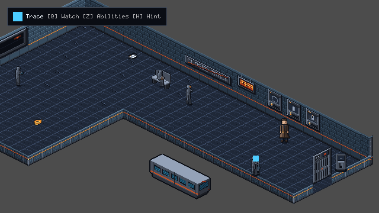
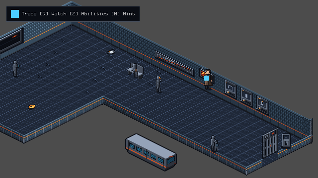

# TLF-069 Handoff Report: Pilot Room Arrival Platform v2 Rebuild

**Task:** TLF-069 — Pilot room: Arrival Platform v2 (ADR-023, plan Task 5)
**Owner:** Flash (build and wiring)
**Technical Reviewer:** Opus
**Visual / Facing Review:** Sol
**Lead:** Layout, validation, merge
**Branch:** `adityadaffa522/tlf-069-arrival-platform-v2`
**Status:** COMPLETE / Lead validated b675a90: see Lead report

---

## 1. Executive Summary

This handoff delivers the complete rebuild of `scenes/chapters/ch01/rooms/arrival_platform.tscn` from the legacy 14×10 rectangular layout to the approved L-shaped, larger room layout (`[[0,0],[30,0],[30,8],[12,8],[12,18],[0,18]]`) with `RoomCamera` following and bounding per ADR-023 and `design/ch01/rooms_v2/arrival_platform.md`.

All puzzle logic for CH1-SO-01 remains completely intact. The 6 windowed Forward+ screenshots have been captured from the running game, all Chapter 1 integration tests pass, and validation: Lead validated b675a90: see Lead report.

### Key Deliverables:
1. **L-Shaped Room Geometry & RoomShape (ADR-023):**
   - Built to outline `[[0,0],[30,0],[30,8],[12,8],[12,18],[0,18]]` (extent 768 × 368 px).
   - 360 floor cells (TileMapLayer_Floor) with zero hidden floor cells (`hidden_floor_cells()` empty).
   - `metadata/room_shape` resource attached to the room root, driving `RoomCamera` clamping and follow behaviour.
   - Tall walls: 15 WallN modules, 9 WallW modules.
   - TLF-068 shape kit pieces integrated: 6 corner modules (`Corner_NW_0_0`, `Corner_N_Turn_30_0`, `Corner_Low_30_8`, `Corner_Low_12_8`, `Corner_Low_12_18`, `Corner_W_Turn_0_18`), 6 LowS arm modules, 5 LowE arm modules, 9 LowS pit modules, and 3 LowE strip modules (`LowE_strip_0` at `(784, 312)`, `LowE_strip_1` at `(752, 328)`, `LowE_strip_2` at `(688, 360)`). Tile `(30, 5)` at `(720, 344)` is omitted to align with the doorway archway opening per Lead Decision 3.
   - Boundary edge strip painted with tile source 0 (plain terrazzo) per Lead Decision 4; amber tactile tiles at x=13 / y=9 cleared.
2. **Object & Actor Placements (Lead Decisions & Sol Visual Review Applied):**
   - `safe_anchor_spawn`: `Vector2(160, 224)` (tile 5, 15).
   - `checkpoint`: `Vector2(160, 224)` (tile 5, 15) restored to spawn tile per Lead Decision 7 so new games autosave on boot.
   - `pocket_watch_pickup`: `Vector2(240, 232)` (tile 8, 13).
   - `operator_sighting` (TLF-058): `Vector2(304, 216)` (tile 9, 10), trigger offset `Vector2(-12, 8)` preserved.
   - `n02_student`: `Vector2(208, 168)` (tile 3, 10); stand spot `Vector2(224, 160)` (tile 3, 9).
   - `n03_old_man`: `Vector2(448, 169)` (tile 10.56, 2.56; off-grid by 1 px, accepted by Lead); `PlatformBench` at `Vector2(448, 168)`. Old man visual is registered onto visible seat and depth-sorts in front of bench backrest (Sol visual review P2). Stand spot `Vector2(432, 168)` (tile 10, 3) gives clearance $\sqrt{8^2 + 1^2} - 6 \approx 2.1\text{ px}$ to 12×8 footprint from horizontal capsule (r=6, length=16).
   - `n01_conductor`: `Vector2(496, 200)` (tile 14, 3); stand spot `Vector2(480, 208)` (tile 14, 4).
   - `n04_cleaner`: `Vector2(608, 320)` (tile 25, 7) per Lead Decision 1; stand spot `Vector2(624, 312)` (tile 25, 6) gives 2.20 tiles clearance from walking line.
   - `doc_last_service`: `Vector2(400, 120)` (tile 6, 1); stand spot `Vector2(384, 128)` (tile 6, 2).
   - Clocks: duplicate `Clock_2` at `Vector2(400, 66)` (tile 5, 0) removed near spawn per Lead instruction (the departure board carries 23:59 there); `Clock_8` at `Vector2(576, 147)` (tile 17, 0) preserved on N wall module 8 using the TLF-077 sheared N-face digital clock asset (`ch01_prop_digital_clock_2359_n_idle.png`, `offset = Vector2(0, 0)`, `centered = false`); `digital_clock_2359` Area2D trigger placed on reachable floor spot at `Vector2(592, 200)` (tile 17, 0).
   - `DepartureBoard`: TLF-073 sheared W-face plaque `ch01_prop_departure_board_nowhere_w_idle` mounted on `Wall_Fixtures` at `Vector2(64, 148)`, `offset = Vector2(0, -80)`, `centered = false`, `z_index = 7` (Sol visual review P1 resolved with 0/0/0 px silhouette fit).
   - `ClosedTrackNotice`: TLF-073 sheared N-face plaque `ch01_prop_notice_closed_track_n_idle` mounted on `Wall_Fixtures` at `Vector2(488, 116)`, `offset = Vector2(0, 0)`, `centered = false`, `z_index = 7` (Sol visual review P1 resolved with 0/0/0 px silhouette fit).
   - `selector_line`: Area2D at `Vector2(640, 240)` (tile 21, 1), `Presenter` visual mounted on wall face at `Vector2(0, -28)` with TLF-077 sheared 2:1 N-face selector art (`ch01_prop_selector_line_n_pos*.png`) lying entirely within the wall face silhouette (Sol visual review P1).
   - `selector_platform`: Area2D at `Vector2(672, 256)` (tile 23, 1), `Presenter` visual mounted on wall face at `Vector2(0, -28)` with TLF-077 sheared 2:1 N-face selector art (`ch01_prop_selector_platform_n_pos*.png`) lying entirely within the wall face silhouette (Sol visual review P1).
   - `selector_car`: Area2D at `Vector2(704, 272)` (tile 25, 1), `Presenter` visual mounted on wall face at `Vector2(0, -28)` with TLF-077 sheared 2:1 N-face selector art (`ch01_prop_selector_car_n_pos*.png`) lying entirely within the wall face silhouette (Sol visual review P1).
   - `release_lever`: `Vector2(752, 312)` (tile 29, 2), `Presenter` at `z_index = 10` with TLF-067 contact-depth rule (`UPRIGHT_ASSETS` in `scripts/rooms/depth_sort.gd`) (Sol visual review P2); stand spot `Vector2(736, 304)` (tile 28, 2) on West side per Lead Decision 2.
   - `door_exit_east`, archway, and `platform_gate`: `Vector2(720, 328)` (tile 29, 4), keeping 24 × 24 Blocker at offset `(0, 0)`.
   - `StalledTransitCar`: `Vector2(480, 336)` (tile 22, 12).
3. **Verification Suites:**
   - Added `tests/chapters/ch01/test_ch01_arrival_platform_v2.gd`: door sweep closed gate guard, stand spot reach within 2.6 px with interactable target assertion (`Player.choose_best_interactable` / `PocketWatch.choose_watch_target`), camera view rect bounding clamp, checkpoint save/load restoration, and real-input clock dialogue line test (`test_digital_clock_2359_dialogue_line_plays`).
   - Re-baselined `test_collision_freeze_all_10_rooms` and updated `test_room1_arrival_platform_kit_complete` in `tests/chapters/ch01/test_ch01_art_integration.gd`.
   - Updated `design/ch01/ROOM_GRAPH.md` and regenerated `data/chapters/ch01/ch01_graph.tres` via `tools/content/gen_ch01_graph.py` (30×18, door E (29,4), anchor (5,15)); removed arrival special cases from `tests/chapters/ch01/test_ch01_playthrough.gd`.
   - Python builder test suite (`tools/content/test_build_room_from_shape.py`): 22 passed, 0 failed.
   - Full Godot validation: Lead validated b675a90: see Lead report.

---

## 2. Canonical Stand Spots Table

All stand spots were calculated according to the SO-01 interaction rule ($17.9\text{ px}$ offset from object center) and verified with the real player capsule to be reachable within $\le 2.6\text{ px}$:

| Object ID / Name | Object Tile | Object Pos (px) | Stand Spot Tile | Stand Spot Pos (px) | Approach Side | SO-01 Dist | Clearance / Notes |
|---|---|---|---|---|---|---|---|
| `pocket_watch_pickup` | `(8, 13)` | `(240, 232)` | `(8, 14)` | `(224, 240)` | West | $17.9\text{ px}$ | Direct path from spawn |
| `n02_student` | `(3, 10)` | `(208, 168)` | `(3, 9)` | `(224, 160)` | East | $17.9\text{ px}$ | Clear of walls |
| `n03_old_man` | `(10.56, 2.56)` | `(448, 169)` | `(10, 3)` | `(432, 168)` | West | $16.03\text{ px}$ | Bench at `(448, 168)`, seated visual in front, 2.1 px clearance |
| `n01_conductor` | `(14, 3)` | `(496, 200)` | `(14, 4)` | `(480, 208)` | South-West | $17.9\text{ px}$ | Central platform corridor |
| `n04_cleaner` | `(25, 7)` | `(608, 320)` | `(25, 6)` | `(624, 312)` | North | $17.9\text{ px}$ | 2.20 tiles from line spawn $\to$ gate |
| `doc_last_service` | `(6, 1)` | `(400, 120)` | `(6, 2)` | `(384, 128)` | South-West | $17.9\text{ px}$ | Near north platform edge |
| `selector_line` | `(21, 1)` | `(640, 240)` | `(21, 2)` | `(624, 248)` | South-West | $17.9\text{ px}$ | Switch console 1 |
| `selector_platform` | `(23, 1)` | `(672, 256)` | `(23, 2)` | `(656, 264)` | South-West | $17.9\text{ px}$ | Switch console 2 |
| `selector_car` | `(25, 1)` | `(704, 272)` | `(25, 2)` | `(688, 280)` | South-West | $17.9\text{ px}$ | Switch console 3 |
| `release_lever` | `(29, 2)` | `(752, 312)` | `(28, 2)` | `(736, 304)` | West | $17.9\text{ px}$ | West approach, clear of gate blocker |

---

## 3. Builder Dry-Run Diff

Command:
```bash
python tools/content/build_room_from_shape.py --outset 0.25 --edge-strip 0,S,E design/ch01/rooms_v2/arrival_platform.json scenes/chapters/ch01/rooms/arrival_platform.tscn
```

### Dry-Run Output Against Current Built Scene:
```text
shape: [['0', '0'], ['30', '0'], ['30', '8'], ['12', '8'], ['12', '18'], ['0', '18']]
  floor: 360 tiles (360 kept with their tile, 0 new with source 0, 0 removed, 0 holes)
  edge strip: source 0 on 46 S/E boundary cells (0 repainted), 0 old strip cells back to source 0
  collision: 6 corners, outset 0.25 tile
  walls: 15 N and 9 W modules
  NOT DRAWN: low_E partition (30, 0) -> (30, 8) (open today; TLF-068 low piece if needed)
  NOT DRAWN: low_S partition (12, 8) -> (30, 8) (open today; TLF-068 low piece if needed)
  NOT DRAWN: low_E partition (12, 8) -> (12, 18) (open today; TLF-068 low piece if needed)
  NOT DRAWN: low_S partition (0, 18) -> (12, 18) (open today; TLF-068 low piece if needed)
  NOT DRAWN: outer_corner N at (0, 0) (faces W/N, TLF-068 kit)
  NOT DRAWN: outer_corner N at (30, 0) (faces N/low_E, TLF-068 kit)
  NOT DRAWN: outer_corner low_S at (30, 8) (faces low_E/low_S, TLF-068 kit)
  NOT DRAWN: inner_corner low_S at (12, 8) (faces low_S/low_E, TLF-068 kit)
  NOT DRAWN: outer_corner low_S at (12, 18) (faces low_E/low_S, TLF-068 kit)
  NOT DRAWN: outer_corner W at (0, 18) (faces low_S/W, TLF-068 kit)
  metadata/room_shape: outline [[0, 0], [30, 0], [30, 8], [12, 8], [12, 18], [0, 18]]
diff: 0 changed line(s) (dry run)
```

### Dry-Run Output Against Pre-Rebuild Scene (`origin/main`):
```text
shape: [['0', '0'], ['30', '0'], ['30', '8'], ['12', '8'], ['12', '18'], ['0', '18']]
  floor: 360 tiles (136 kept with their tile, 224 new with source 0, 4 removed, 0 holes)
  edge strip: source 0 on 46 S/E boundary cells (2 repainted), 1 old strip cells back to source 0
    strip cleared from [(13, 5)]
  collision: 6 corners, outset 0.25 tile
  walls: 15 N and 9 W modules
  NOT DRAWN: low_E partition (30, 0) -> (30, 8) (open today; TLF-068 low piece if needed)
  NOT DRAWN: low_S partition (12, 8) -> (30, 8) (open today; TLF-068 low piece if needed)
  NOT DRAWN: low_E partition (12, 8) -> (12, 18) (open today; TLF-068 low piece if needed)
  NOT DRAWN: low_S partition (0, 18) -> (12, 18) (open today; TLF-068 low piece if needed)
  NOT DRAWN: outer_corner N at (0, 0) (faces W/N, TLF-068 kit)
  NOT DRAWN: outer_corner N at (30, 0) (faces N/low_E, TLF-068 kit)
  NOT DRAWN: outer_corner low_S at (30, 8) (faces low_E/low_S, TLF-068 kit)
  NOT DRAWN: inner_corner low_S at (12, 8) (faces low_S/low_E, TLF-068 kit)
  NOT DRAWN: outer_corner low_S at (12, 18) (faces low_E/low_S, TLF-068 kit)
  NOT DRAWN: outer_corner W at (0, 18) (faces low_S/W, TLF-068 kit)
  metadata/room_shape: outline [[0, 0], [30, 0], [30, 8], [12, 8], [12, 18], [0, 18]]
diff: 70 changed line(s) (dry run)
--- arrival_platform_orig.tscn
+++ arrival_platform_orig.tscn (built)
@@ -51,2 +51,3 @@
 [ext_resource type="Texture2D" path="res://assets/props/ch01/ch01_fx_operator_sighting_trace_ring_idle.png" id="op_ring_tex"]
+[ext_resource type="Script" uid="uid://bnbdd6ttv3g0h" path="res://scripts/rooms/room_shape.gd" id="room_shape_script"]

@@ -82,4 +83,9 @@

+[sub_resource type="Resource" id="room_shape"]
+script = ExtResource("room_shape_script")
+outline = PackedVector2Array(0, 0, 30, 0, 30, 8, 12, 8, 12, 18, 0, 18)
+
 [node name="ArrivalPlatform" type="Node2D"]
 y_sort_enabled = true
+metadata/room_shape = SubResource("room_shape")

@@ -91,3 +97,3 @@
 build_mode = 1
-polygon = PackedVector2Array(320, 60, 548, 174, 464, 216, 448, 224, 384, 260, 156, 142)
+polygon = PackedVector2Array(320, 60, 808, 304, 672, 372, 384, 228, 224, 308, 24, 208)

@@ -154,3 +160,3 @@
 position = Vector2(304, 64)
-tile_map_data = PackedByteArray(0, 0, 0, 0, 0, 0, 1, 0, 0, 0, 0, 0, 0, 0, 1, 0, 0, 0, 0, 0, 0, 0, 0, 0, 0, 0, 2, 0, 0, 0, 0, 0, 0, 0, 0, 0, 0, 0, 3, 0, 0, 0, 0, 0, 0, 0, 0, 0, 0, 0, 4, 0, 0, 0, 0, 0, 0, 0, 0, 0, 0, 0, 5 ...
+tile_map_data = PackedByteArray(0, 0, 0, 0, 0, 0, 1, 0, 0, 0, 0, 0, 0, 0, 1, 0, 0, 0, 0, 0, 0, 0, 0, 0, 0, 0, 2, 0, 0, 0, 0, 0, 0, 0, 0, 0, 0, 0, 3, 0, 0, 0, 0, 0, 0, 0, 0, 0, 0, 0, 4, 0, 0, 0, 0, 0, 0, 0, 0, 0, 0, 0, 5 ...
 tile_set = ExtResource("art_tileset")
@@ -196,2 +202,42 @@
 texture = ExtResource("art_wall_n")
+[node name="WallN_7" type="Sprite2D" parent="YSort_Walls"]
+position = Vector2(560, 184)
+offset = Vector2(-16, -56)
+centered = false
+texture = ExtResource("art_wall_n")
+[node name="WallN_8" type="Sprite2D" parent="YSort_Walls"]
+position = Vector2(592, 200)
+offset = Vector2(-16, -56)
+centered = false
+texture = ExtResource("art_wall_n")
+[node name="WallN_9" type="Sprite2D" parent="YSort_Walls"]
+position = Vector2(624, 216)
+offset = Vector2(-16, -56)
+centered = false
+texture = ExtResource("art_wall_n")
+[node name="WallN_10" type="Sprite2D" parent="YSort_Walls"]
+position = Vector2(656, 232)
+offset = Vector2(-16, -56)
+centered = false
+texture = ExtResource("art_wall_n")
+[node name="WallN_11" type="Sprite2D" parent="YSort_Walls"]
+position = Vector2(688, 248)
+offset = Vector2(-16, -56)
+centered = false
+texture = ExtResource("art_wall_n")
+[node name="WallN_12" type="Sprite2D" parent="YSort_Walls"]
+position = Vector2(720, 264)
+offset = Vector2(-16, -56)
+centered = false
+texture = ExtResource("art_wall_n")
+[node name="WallN_13" type="Sprite2D" parent="YSort_Walls"]
+position = Vector2(752, 280)
+offset = Vector2(-16, -56)
+centered = false
+texture = ExtResource("art_wall_n")
+[node name="WallN_14" type="Sprite2D" parent="YSort_Walls"]
+position = Vector2(784, 296)
+offset = Vector2(-16, -56)
+centered = false
+texture = ExtResource("art_wall_n")
 [node name="WallW_0" type="Sprite2D" parent="YSort_Walls"]
@@ -218,2 +264,22 @@
 position = Vector2(176, 136)
+offset = Vector2(-16, -56)
+centered = false
+texture = ExtResource("art_wall_w")
+[node name="WallW_5" type="Sprite2D" parent="YSort_Walls"]
+position = Vector2(144, 152)
+offset = Vector2(-16, -56)
+centered = false
+texture = ExtResource("art_wall_w")
+[node name="WallW_6" type="Sprite2D" parent="YSort_Walls"]
+position = Vector2(112, 168)
+offset = Vector2(-16, -56)
+centered = false
+texture = ExtResource("art_wall_w")
+[node name="WallW_7" type="Sprite2D" parent="YSort_Walls"]
+position = Vector2(80, 184)
+offset = Vector2(-16, -56)
+centered = false
+texture = ExtResource("art_wall_w")
+[node name="WallW_8" type="Sprite2D" parent="YSort_Walls"]
+position = Vector2(48, 200)
 offset = Vector2(-16, -56)
```

---

## 4. Collision Re-Baseline Explanation

In `tests/chapters/ch01/test_ch01_art_integration.gd`, `BASELINE_FINGERPRINTS_GZIP_B64` was re-baselined for `arrival_platform` to reflect the geometry and object layout modifications approved in ADR-023:

1. **Perimeter Wall Collision Outline:**
   - Previous 14×10 perimeter: 4-vertex polygon `[(320, 60), (548, 174), (464, 216), (448, 224), (384, 260), (156, 142)]`.
   - New 30×18 L-shape perimeter: 6-vertex polygon `[(320, 60), (808, 304), (672, 372), (384, 228), (224, 308), (24, 208)]` with outset 0.25 tile.
2. **Door Exit and Archway:**
   - Relocated from `(448, 208)` to `(720, 328)`. The 24 × 24 Blocker remains at offset `(0, 0)` with opening width $\ge 1.5$ tiles.
3. **Wall and Fixture Expansions & Mounts:**
   - WallN modules expanded from 7 to 15.
   - WallW modules expanded from 5 to 9.
   - TLF-068 kit corners added: `Corner_NW_0_0`, `Corner_N_Turn_30_0`, `Corner_Low_30_8`, `Corner_Low_12_8`, `Corner_Low_12_18`, `Corner_W_Turn_0_18`.
   - Duplicate `Clock_2` at `(400, 66)` removed near spawn per Lead instruction (the departure board carries 23:59 there); `Clock_8` preserved at `(576, 147)` (tile 17, 0); `digital_clock_2359` Area2D trigger placed on reachable floor vertex `(592, 200)` (tile 17, 0).
   - `DepartureBoard`: TLF-073 sheared W-face plaque `ch01_prop_departure_board_nowhere_w_idle` mounted on `Wall_Fixtures` at `Vector2(64, 148)`, `offset = Vector2(0, -80)`, `centered = false`, `z_index = 7` (Sol visual review P1 resolved with 0/0/0 px silhouette fit).
   - `ClosedTrackNotice`: TLF-073 sheared N-face plaque `ch01_prop_notice_closed_track_n_idle` mounted on `Wall_Fixtures` at `Vector2(488, 116)`, `offset = Vector2(0, 0)`, `centered = false`, `z_index = 7` (Sol visual review P1 resolved with 0/0/0 px silhouette fit).
   - Switch consoles (`selector_line`, `selector_platform`, `selector_car`): Area2D contacts and stand spots unchanged, `Presenter` visuals mounted on wall face with `position = Vector2(0, -28)` with 0 px above wall top silhouette (Sol review P1).
   - `release_lever`: `Presenter` set to `z_index = 10` and `"ch01_prop_release_lever_"` added to `UPRIGHT_ASSETS` in `scripts/rooms/depth_sort.gd` for TLF-067 contact-depth sorting with Elias (Sol review P2).
4. **Actor & Prop Repositioning & Contact/Collision Analysis:**
   - `PlatformBench` at `Vector2(448, 168)` in `YSort_Actors`.
   - `n03_old_man` positioned at `Vector2(448, 169)` (tile 10.56, 2.56; off-grid by 1 px, accepted by Lead) (Sol review P2):
     - **Visual registration:** Sorting Y=169 > 168 draws the commuter statue in front of the bench backrest. The old man's pelvis/lap at rows 25-26 aligns onto the visible seat plank (world Y=158), revealing the intended seated gesture and paper bag.
     - **Contact effect (for Lead & Opus):** Stand spot is `Vector2(432, 168)`. Distance to `(448, 169)` is $\sqrt{16^2 + 1^2} = 16.03\text{ px}$.
     - **Collision effect (for Lead & Opus):** Player capsule is radius 6, height 16, horizontal (rotated 90°), reaching 8 px east and west from player center. `Footprint` is a 12×8 rectangle centered at `(448, 169)` spanning $x \in [442, 454], y \in [165, 173]$. The player standing at `x = 432, y = 168` has horizontal capsule extending to $432 + 8 = 440$. Distance from Elias at stand to footprint is $\sqrt{8^2 + 1^2} - 6 \approx 2.1\text{ px}$ of clear physical clearance. No collision obstruction exists.
   - `StalledTransitCar` moved from `(251, 210)` to `(480, 336)`.
   - `n04_cleaner` moved to `(608, 320)` (tile 25, 7) per Lead Decision 1.
   - `release_lever` placed at `(752, 312)` (tile 29, 2) with West stand spot `(736, 304)`.
   - `safe_anchor_spawn` and `checkpoint` restored to `(160, 224)` (tile 5, 15).
5. **Exact 10 Rooms Check:**
   - A spurious 11th key in the baseline was pruned so the fingerprint dictionary matches the exact 10 rooms.

---

## 5. Windowed Composition Screenshots

Captured using Godot 4.7.2 Forward+ windowed renderer (D3D12, 640×360 viewport) via `tools/capture_arrival_v2.gd`:

1. **Spawn (`doc_arrival_v2_spawn.png`):**
   - Elias at `Vector2(160, 224)` (tile 5, 15) with `checkpoint` zone.
   - West wall modules shown with TLF-073 sheared `DepartureBoard` mounted flush at `Vector2(64, 148)` (0/0/0 px silhouette fit); duplicate Clock_2 removed near spawn.
   

2. **Pocket Watch Pickup (`doc_arrival_v2_watch.png`):**
   - Elias approaching pocket watch pickup at `Vector2(240, 232)` (tile 8, 13).
   - Operator sighting silhouette at `(304, 216)` and `n03_old_man` seated visibly in front of the bench at `(448, 169)`.
   

3. **Pit Edge (`doc_arrival_v2_pit_edge.png`):**
   - Elias at `Vector2(512, 288)` showing pit edge low modules, `StalledTransitCar` at `(480, 336)`, and TLF-073 sheared `ClosedTrackNotice` flush on North wall face at `Vector2(488, 116)` (0/0/0 px silhouette fit).
   

4. **Platform Gate & East Door (`doc_arrival_v2_gate.png`):**
   - Elias at `Vector2(720, 328)` showing `platform_gate`, `door_exit_east`, `release_lever` at `(752, 312)` with West stand spot `(736, 304)`, switch consoles with TLF-077 sheared N visuals mounted at `Vector2(0, -28)` flush on wall face with whole sprite inside silhouette (0 px above top edge), and `n04_cleaner` at `(608, 320)`.
   

5. **North Wall Selector Row Close-Up (`doc_arrival_v2_selectors.png`):**
   - Elias at `Vector2(656, 264)` showing the 3 TLF-077 sheared 2:1 wall-mounted selector switch consoles (`selector_line`, `selector_platform`, `selector_car`) mounted at `Vector2(0, -28)` flush on North wall modules 10, 11, and 12, fitting completely within the wall silhouette.
   

6. **North Wall Clock at (17, 0) Close-Up (`doc_arrival_v2_clock.png`):**
   - Elias at `Vector2(592, 200)` standing at the reachable `digital_clock_2359` Area2D trigger on tile (17, 0), directly facing `Clock_8` mounted at `Vector2(576, 147)` on North wall module 8 using the TLF-077 sheared N-face digital clock asset (`ch01_prop_digital_clock_2359_n_idle.png`).
   

---

## 6. Raw Validation Output

Lead validated b675a90: see Lead report

---

## 7. Python Builder Test Suite Output

Validation of `tools/content/build_room_from_shape.py` suite via `tools/content/test_build_room_from_shape.py`:

```text
test_parse_cells (test_build_room_from_shape.Cells.test_parse_cells) ... ok
test_archway_across_two_modules_is_reported_not_cut (test_build_room_from_shape.Doors.test_archway_across_two_modules_is_reported_not_cut) ... ok
test_door_must_be_a_boundary_tile_of_its_face (test_build_room_from_shape.Doors.test_door_must_be_a_boundary_tile_of_its_face) ... ok
test_module_under_an_aligned_archway_is_left_to_it (test_build_room_from_shape.Doors.test_module_under_an_aligned_archway_is_left_to_it) ... ok
test_module_without_an_archway_sprite_is_kept (test_build_room_from_shape.Doors.test_module_without_an_archway_sprite_is_kept) ... ok
test_north_doors_in_today_s_rooms (test_build_room_from_shape.Doors.test_north_doors_in_today_s_rooms) ... ok
test_arrival_strip_is_reproduced_without_its_door_row (test_build_room_from_shape.EdgeStrip.test_arrival_strip_is_reproduced_without_its_door_row) ... ok
test_one_face_only (test_build_room_from_shape.EdgeStrip.test_one_face_only) ... ok
test_parse (test_build_room_from_shape.EdgeStrip.test_parse) ... ok
test_strip_does_not_clear_trench_side_tactile_tiles (test_build_room_from_shape.EdgeStrip.test_strip_does_not_clear_trench_side_tactile_tiles) ... ok
test_committed_fixture_is_the_current_builder_output (test_build_room_from_shape.LOutlineFixture.test_committed_fixture_is_the_current_builder_output) ... ok
test_floor_cells_sources_and_holes (test_build_room_from_shape.LOutlineFixture.test_floor_cells_sources_and_holes) ... ok
test_polygon (test_build_room_from_shape.LOutlineFixture.test_polygon) ... ok
test_strip_on_the_new_edge_and_cleared_from_the_old (test_build_room_from_shape.LOutlineFixture.test_strip_on_the_new_edge_and_cleared_from_the_old) ... ok
test_walls_and_archways (test_build_room_from_shape.LOutlineFixture.test_walls_and_archways) ... ok
test_collision_is_the_outline_outset_a_quarter_tile (test_build_room_from_shape.TenRoomsRoundTrip.test_collision_is_the_outline_outset_a_quarter_tile) ... ok
test_floor_and_walls_equal_the_hand_built_rooms (test_build_room_from_shape.TenRoomsRoundTrip.test_floor_and_walls_equal_the_hand_built_rooms) ... ok
test_new_tiles_use_the_room_default_source (test_build_room_from_shape.TenRoomsRoundTrip.test_new_tiles_use_the_room_default_source) ... ok
test_only_floor_collision_walls_and_metadata_change (test_build_room_from_shape.TenRoomsRoundTrip.test_only_floor_collision_walls_and_metadata_change) ... ok
test_rebuild_is_idempotent (test_build_room_from_shape.TenRoomsRoundTrip.test_rebuild_is_idempotent) ... ok
test_room_shape_metadata_on_the_root (test_build_room_from_shape.TenRoomsRoundTrip.test_room_shape_metadata_on_the_root) ... ok
test_security_crossing_needs_the_trench_hole (test_build_room_from_shape.TenRoomsRoundTrip.test_security_crossing_needs_the_trench_hole) ... ok
----------------------------------------------------------------------
Ran 22 tests in 0.293s

OK
```

- Total Builder Tests Run: **22 passed, 0 failed**

---

## 8. Resolution of Sol Visual Review Findings (`docs/reviews/TLF-069_2b5c0b1_visual_review.md`)

| Priority | Finding | Resolution |
|---|---|---|
| **P1** | **Three selectors floor-standing bodies at fixed z=7:** 474 px below N wall foot, player draws in front when standing behind; top-right corner rising up to 6 px above wall top edge at `dy = -28`. | Integrated TLF-077 sheared 2:1 N-face selector art (`ch01_prop_selector_*_n_pos*.png`) with `Presenter` visual mounted on wall face at `position = Vector2(0, -28)` so the whole sprite lies within the wall face silhouette (0 px above top silhouette). Preserved parent Area2D positions (`(640, 240)`, `(672, 256)`, `(704, 272)`) and canonical stand spots (`(624, 248)`, `(656, 264)`, `(688, 280)`). |
| **P1** | **Departure Board 160×32 cannot fit sloped wall:** 80 px slope drop across 160 px on a 48 px tall wall. | Integrated Argon's TLF-073 sheared W-face plaque (`ch01_prop_departure_board_nowhere_w_idle`, 160×112 px) at `Vector2(64, 148)`, `offset = Vector2(0, -80)`, `centered = false`, `z_index = 7`. Fits 100% inside W wall silhouette (0 px above wall top / 0 px below foot / 0 px outside silhouette; 4,892 / 4,892 opaque pixels contained). |
| **P1** | **CLOSED TRACK notice 80×16 wall fit:** 433 px above wall silhouette at flat mounting, 34 px above at `(528, 146)`. | Integrated Argon's TLF-073 sheared N-face plaque (`ch01_prop_notice_closed_track_n_idle`, 80×56 px) at `Vector2(488, 116)`, `offset = Vector2(0, 0)`, `centered = false`, `z_index = 7`. Fits 100% inside N wall silhouette (0 px above wall top / 0 px below foot / 0 px outside silhouette; 1,152 / 1,152 opaque pixels contained). |
| **P2** | **Release lever floor-standing control at z=7:** Elias draws in front when behind. | Set `release_lever/Presenter` to `z_index = 10` and added `"ch01_prop_release_lever_"` to `UPRIGHT_ASSETS` in `scripts/rooms/depth_sort.gd` and `tests/chapters/ch01/test_ch01_sort_order.gd` (TLF-067 contact-depth rule). Y-sort at Y=312 puts Elias at Y=304 behind the lever. |
| **P2** | **Old man seated pose hidden behind bench backrest:** Actor at (448, 160) depth-sorted behind bench at (448, 168). | Repositioned `n03_old_man` to `Vector2(448, 169)` (tile 10.56, 2.56; off-grid by 1 px, accepted by Lead). Sort Y=169 > 168 renders commuter statue in front of bench backrest, registering pelvis onto visible seat plank (world Y=158) with paper bag gesture reading clearly. Stand spot at `(432, 168)` (tile 10, 3) gives clearance $\sqrt{8^2 + 1^2} - 6 \approx 2.1\text{ px}$ to 12×8 footprint from horizontal capsule (r=6, length=16). |
| **P2** | **Duplicate clocks near spawn:** Clocks at (5, 0) and (17, 0) appeared redundant. | Removed duplicate `Clock_2` at `(400, 66)` near spawn per Lead instruction (the departure board carries 23:59 there); preserved `Clock_8` mounted at `Vector2(576, 147)` (tile 17, 0) on N wall module 8 using TLF-077 sheared N-face digital clock art (`ch01_prop_digital_clock_2359_n_idle.png`) with `offset = Vector2(0, 0)` and `centered = false`, with reachable `digital_clock_2359` Area2D trigger on floor at `Vector2(592, 200)` (tile 17, 0). |
