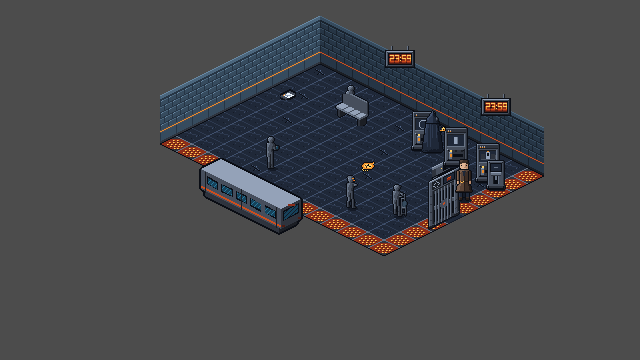

# TLF-066: Chapter 1 facing and overlap audit

**Verdict: CHANGES REQUIRED on audited main `9ca9759cd5b877e6c82a772210d10476ac1874a0`.**

Sol / 2026-11-07. Review branch: `adityadaffa522/tlf-066-facing-overlap-audit`. This is the read-only baseline for TLF-067, under ADR-023 and [large-room plan Task 2](../superpowers/plans/2026-11-07-ch1-large-rooms.md). The branch changes review evidence only. No scene, script, project configuration, source art, export, generator or ART_BIBLE changes are proposed here. Lead integrates; Sol does not merge.

## Findings and handoff

There are **45 actionable rows: 9 high, 36 medium**. Primary routing is **39 data (Opus), 6 placement (Flash), 0 art (Argon)**. Two of the 39 data rows are inferred bench-facing recommendations requiring a layout decision; the other 43 actionable rows have pivot, depth or mounting/seating evidence. No current defect proves that Argon must redraw an asset. The current axis-run sprites can already be mirrored under Bible A.4.

**216 visual rows have no defect observed in these probes**, and 74 registered IDs have no drawable descendant and are inventoried as `not_visual`. This is not a claim that every animation, puzzle state, collision approach or room transition passes. The audit contains 335 rows covering 261 visible object groups plus those 74 IDs.

### Worst defects, in priority order

| Rank | Defect and evidence | Required follow-up | Primary owner |
|---|---|---|---|
| 1 | R1 `platform_gate`, R2 `staff_door`, R3 `hatch_01` / `inner_shutter`, R4 `staff_barrier_01`: upright bodies are fixed at effective z=7 while Elias is z=10. N/W probes keep Elias in front when his contact is behind the body. At the platform gate, 83 N and 236 W discriminating intersection pixels all resolve to Elias; at the shutter, 241 N and 237 W do. | Reconcile free-standing sorting with Bible A.1: shared actor depth and correct contact pivot, or genuinely mount the visual on a wall. Verify both sides again; changing facing alone cannot repair this. Gate and staff door also use a copied offset that shifts their canonical contact by (-4,+14) px. | data / Opus |
| 2 | R1 three selectors: canonical pivot (16,40) on a 32x48 canvas, but runtime rectangle begins at (-8,-20), putting the intended contact at (+8,+20). They read as slabs floating in front of the wall. | Correct the presenter offset, then coordinate the mounted visual and floor interaction stand spot with Flash. Preserve IDs, puzzle reach and existing art. These three rows are high priority. | data / Opus, then placement / Flash |
| 3 | R2 `visual:YSort_Walls/PillarSprite`: interior pillar at (384,184), effective z=5. Elias stays in front from N/W (152 / 158 discriminating pixels), despite standing behind its body. | Classify this interior obstruction by its floor contact and actor sort. Do not apply a blanket wall-layer change to the perimeter. | data / Opus |
| 4 | R4 ten trench railings and R6 thirteen lane railings are upright silhouettes at effective z=8. Back-side probes keep Elias in front; R6 Railing_4 has a confirmed W failure only after excluding its out-of-floor N probe. R2 ticket validator has the same z=7 pattern. | Resolve upright railing depth with Lead/Opus under ADR-023 R7. The existing generic layer table lists railings among Props (8), while A.1 distinguishes floor surfaces from upright free-standing bodies. Do not raise floor plates, trench fills or bridges along with the railings. | data / Opus |
| 5 | R2 three dials, R4 card reader and R10 payphone lack a convincing wall/post mount at their present floor stand spots. R1 seated old man sits behind/above the bench rather than on it. | Flash reconciles visual mount/seating positions while preserving interaction, NPC memory and collision contracts. The audit does not authorize changing those contracts. | placement / Flash |
| 6 | Smaller copied pivot mismatches: R1 release lever (0,+4), R2 ticket-terms notice (0,+4), R3 bell plate (-12,-8), R3 hatch plate (0,-4). | Match runtime contact to the metadata pivot and rerender. | data / Opus |
| 7 | R9 `AtriumBenchE` and `AtriumBenchW` both use the native +x/down-right run. Their flank placement suggests the +y/down-left run instead. | **Inferred recommendation:** use approved `flip_h`, or Lead explicitly retains the present diagonal seating. Interior bench placement has no uniquely mandated yaw in canon; these are not proven art defects. | data / Opus after Lead layout decision |

Native examples: [gate N](TLF-066/arrival_platform/007_N.png), [gate W](TLF-066/arrival_platform/007_W.png), [selector N](TLF-066/arrival_platform/009_N.png), [pillar N](TLF-066/concourse_west/023_N.png), [shutter N](TLF-066/maintenance_bay/009_N.png), [barrier W](TLF-066/security_crossing/010_W.png). Every row below links its full four-side proof.



### Facing rule applied

The source is [ART_BIBLE Appendix A.1/A.3/A.4](../../design/art/ART_BIBLE.md), checked against the room geometry and each runtime `flip_h`, not a global requirement that every prop face the camera. N-boundary wall runs and N/S arch frames use +x/down-right; W-boundary wall runs and E/W arch frames use +y/down-left. R4 railings correctly mirror along the trench; R6 railings follow the native lane run. Existing gates, transit car, shutter and platform/concourse bench runs match their established axes. Frontal wall fixtures are explicitly accepted by A.3; lack of mounting is a placement/pivot issue, not proof of a bad art projection. Free interior mechanisms and commuter poses have no single boundary-derived facing requirement, so the table says so instead of inventing one. The two atrium bench suggestions are the only inferred directional changes.

## Coverage and capture method

All captures came from a **fresh archive of exact main 9ca9759**, using Godot **4.7.2 stable**, Windows display server, D3D12 Forward+, **windowed 640x360**. They are engine-rendered viewport PNGs, not headless approximations or assembled room mockups. There are **1,044 primary screenshots (261 x four sides), 26 supplemental commuter centerline shots, and 24 derived contact sheets**. Sprite subparts sharing an object ID are tested together. Unkeyed visual nodes use `visual:<scene-relative path>`; this includes each wall module and each archway. TileMap floor cells are terrain, not hundreds of separate object rows.

| Room | Visible object groups | IDs with no drawable descendant | Four-side screenshots | Contact sheets |
|---|---:|---:|---:|---|
| ch01.arrival_platform | 29 | 6 | 116 | [1](TLF-066/contact_arrival_platform_1.png), [2](TLF-066/contact_arrival_platform_2.png), [3](TLF-066/contact_arrival_platform_3.png) |
| ch01.concourse_west | 37 | 12 | 148 | [1](TLF-066/contact_concourse_west_1.png), [2](TLF-066/contact_concourse_west_2.png), [3](TLF-066/contact_concourse_west_3.png), [4](TLF-066/contact_concourse_west_4.png) |
| ch01.maintenance_bay | 27 | 14 | 108 | [1](TLF-066/contact_maintenance_bay_1.png), [2](TLF-066/contact_maintenance_bay_2.png), [3](TLF-066/contact_maintenance_bay_3.png) |
| ch01.security_crossing | 41 | 8 | 164 | [1](TLF-066/contact_security_crossing_1.png), [2](TLF-066/contact_security_crossing_2.png), [3](TLF-066/contact_security_crossing_3.png), [4](TLF-066/contact_security_crossing_4.png) |
| ch01.waiting_lounge | 16 | 5 | 64 | [1](TLF-066/contact_waiting_lounge_1.png) |
| ch01.signal_control | 40 | 8 | 160 | [1](TLF-066/contact_signal_control_1.png), [2](TLF-066/contact_signal_control_2.png), [3](TLF-066/contact_signal_control_3.png), [4](TLF-066/contact_signal_control_4.png) |
| ch01.upper_vestibule | 27 | 8 | 108 | [1](TLF-066/contact_upper_vestibule_1.png), [2](TLF-066/contact_upper_vestibule_2.png) |
| ch01.vestibule_niche | 10 | 3 | 40 | [1](TLF-066/contact_vestibule_niche_1.png) |
| ch01.station_atrium | 21 | 6 | 84 | [1](TLF-066/contact_station_atrium_1.png) |
| ch01.street_exit | 13 | 4 | 52 | [1](TLF-066/contact_street_exit_1.png) |

`N/S/E/W` mean **room/tile cardinal sides**, not screen up/down/left/right. The four displacements from each object's contact are N=(+16,-8), S=(-16,+8), E=(+16,+8), W=(-16,-8). Thus N/W have smaller screen y and S/E have larger screen y. The additional commuter probes use screen-centerline (0,-12)/(0,+12) because narrow bodies sometimes have no intersecting pixels on a one-tile diagonal. All thirteen commuter centerline pairs show the expected back/front exchange. Positions and per-side in-floor flags are in the manifest. Procedural trench/barrier polygons have baked world-space vertices; their diagnostic contact is the bottom-centre of their rendered bounds, not their empty (0,0) node origin.

The scratch harness instantiates the **unmodified production ChapterRoot/RoomContainer/Player hierarchy** and the ten production room scenes. `_ready` builds the actual presenters. Simulation is then frozen; HUD is hidden; Elias uses the authored `idle_s` frame 0 at z=10. No production sprite pivot, z, flip or texture is changed. The conditional Operator is made visible at authored F3 with his ground ring hidden solely for the sighting-body probe. This is not a normal story progression screenshot. Room entry/default presenter states are covered; alternate mechanism animations, completed puzzles and the later city plate/broadcast are outside this room-object baseline.

Probes deliberately teleport the diagnostic actor, including outside-room sides of boundary objects. A footpoint outside the room's **PerimeterWalls collision polygon** is excluded from defect counting. This in-floor check does not establish that every inside-floor probe is reachable or collision-free: walking paths and collision sweeps remain Opus/Flash validation. Wall clocks and perimeter wall frames can therefore have diagnostic actor poses on/outside the wall without being marked as sorting failures. The gray outside-room background is the existing baseline scene, not a new camera regression. Black padding in a contact-sheet crop extending beyond the viewport is a crop artifact; inspect the native PNG to judge the actual frame.

### Overlap evidence and interpretation

For each visual group the scratch run also captured a no-player baseline B, neither-player-nor-target D, player-without-target C, and the full frame A. The target mask is B != D; the actor mask is C != D. Their intersection excludes B == C pixels so equal-colored pixels cannot falsely decide depth. A == B indicates target in front; A == C indicates Elias in front. The manifest records those discriminating pixel counts for each side. The committed native PNG is always A, with the object visible. Comparator frames remain in the isolated scratch capture folder; the included read-only [pixel verifier](TLF-066/verify_overlap_pixels.py) reproduces the recorded counts against them and checks every published frame matches the scratch original.

Expected depth depends on **role**, not just y. Floor surfaces remain below Elias; genuine wall fixtures remain in their wall layer. Upright floor-standing props should exchange depth with him at their contact. `overlaps_elias_from` lists only confirmed wrong-side exchanges on inside-floor probes, not every geometric sprite intersection. `none observed` means no defect demonstrated by these poses, including cases with zero discriminating intersection. `effective_z` honours `z_as_relative=false`: the archway sprites resolve to **6**, not parent 5 + child 6. They are not reported as z=11 failures. Legacy root `ArchwayEast/West` copies coincide with their YSort_Walls counterparts; a duplicated frame cannot yield an isolated target mask. Their duplicate limitation is recorded in the per-row notes, not counted as a proven facing/sorting defect.

Pivot checks use **Sprite2D.get_rect()**, centered state, scale and the canonical [ASSET_METADATA](../../design/art/ASSET_METADATA.md) pivot. Raw `offset` alone is insufficient for centered sprites. The known bridge art offset is retained as the existing documented exception. Corrected runtime pivots must still be verified against collision and interaction in TLF-067.

### Severity and routing

- `high`: large or interaction-critical misplaced body/contact, or a major interior obstruction with proven wrong depth.
- `medium`: smaller contact error, upright railing/validator depth, mounting/seating mismatch, or the two explicitly inferred bench-facing recommendations.
- `none`: no defect observed in the sampled state; no fix requested.
- `not_visual`: registered node has no drawable descendant to pose against. A separate visual (for example the wall-clock sprite) can have its own visual row; this does not declare the logical object absent from the scene.

`fix_owner` uses the required closed vocabulary `art`, `data`, `placement`. It names the primary next owner, not every collaborator. On `none` / `not_visual` rows, `data` is only the scene-data contact placeholder and **does not request a fix**. TLF-067 must filter actionable severity before generating regression cases; mounting recommendations and absent-drawable IDs cannot be converted into blanket sorting assertions.

## Save isolation and reproduction

The real game save directory was not used. Before the first engine invocation, the archive's scratch-only project name was changed to `TLF Audit 066 9ca9759`, custom user directory enabled with the same name, and window override set to 640x360. The engine reports `C:/Users/adity/AppData/Roaming/TLF Audit 066 9ca9759`. SaveService is redirected to `user://tlf066_saves`. The harness refuses a headless display or the real project name. The real `%APPDATA%/Godot/app_userdata/The Last Frame/saves` tree and settings were compared by file inventory, SHA-256, size and modification time before/after: **identical**, as recorded in [save-isolation.json](TLF-066/save-isolation.json). No save contents are committed.

To reproduce, extract `git archive 9ca9759cd5b877e6c82a772210d10476ac1874a0` to a **new scratch directory**. Before opening Godot, apply the scratch-only project name/custom-user-directory/window settings above. Copy [capture_scratch.gd](TLF-066/capture_scratch.gd) to that archive as `audit_capture.gd`. Import that renamed archive headless once, then use the windowed renderer (never point these commands at a checkout named The Last Frame):

```powershell
$godot = 'D:/Godot/Godot_v4.7.2-stable_win64_console.exe'
$auditScratch = '<renamed scratch archive absolute path>'
& $godot --headless --path $auditScratch --editor --import --quit
& $godot --path $auditScratch --windowed --resolution 640x360 --position 20,20 -s res://audit_capture.gd
& $godot --path $auditScratch --windowed --resolution 640x360 --position 20,20 -s res://audit_capture.gd -- --procedural
& $godot --path $auditScratch --windowed --resolution 640x360 --position 20,20 -s res://audit_capture.gd -- --centerline
python docs/reviews/TLF-066/verify_overlap_pixels.py "$auditScratch/audit_output"
```

All three capture passes exited 0, completed ten-room traversal, and contain no `SCRIPT ERROR`, `ERROR:` or assertion failure. Console logs are normalized to UTF-8/LF; message text is unchanged. Logs: [primary](TLF-066/capture.txt), [procedural bounds probes](TLF-066/capture-procedural.txt), [commuter centerline](TLF-066/capture-centerline.txt). Capture comparators are not game assets. No asset regeneration gate or gameplay-suite rerun is needed for this docs-only audit; full validation belongs to the actual TLF-067 fixes. [Verification output](TLF-066/verification.txt) records the evidence/schema/link checks before committing.

## Full object table

Machine-readable source: [audit.csv](TLF-066/audit.csv). Exact node paths, sprite paths, runtime rectangles, inherited sort state, probe positions, floor flags and overlap counts: [render_manifest.json](TLF-066/render_manifest.json). Detailed per-defect and duplicate-arch notes: [row_notes.md](TLF-066/row_notes.md). Counts: [summary.json](TLF-066/summary.json).

The following table has the same eight columns and 335 records as the CSV. Object cells add links to the four native proof frames; supplemental centerline links appear only for commuters. IDs without drawable descendants have no sprite to screenshot.

| room | object_id | sprite | expected_facing | actual_facing | overlaps_elias_from | fix_owner | severity |
|---|---|---|---|---|---|---|---|
| ch01.arrival_platform | `ch01.arrival_platform.doc_last_service` [N](TLF-066/arrival_platform/001_N.png) [S](TLF-066/arrival_platform/001_S.png) [E](TLF-066/arrival_platform/001_E.png) [W](TLF-066/arrival_platform/001_W.png) | ch01_prop_document_clipboard_idle.png | frontal allowed by Bible A.3; mounting role governs | frontal fixture / compact prop | none observed | data | none |
| ch01.arrival_platform | `ch01.arrival_platform.n01_conductor` [N](TLF-066/arrival_platform/002_N.png) [S](TLF-066/arrival_platform/002_S.png) [E](TLF-066/arrival_platform/002_E.png) [W](TLF-066/arrival_platform/002_W.png) [N_center](TLF-066/arrival_platform/002_N_center.png) [S_center](TLF-066/arrival_platform/002_S_center.png) | ch01_char_statue_commuter_n01_conductor_idle.png | free pose; COMMUTERS/Operator direction (not boundary-dependent) | authored character pose | none observed | data | none |
| ch01.arrival_platform | `ch01.arrival_platform.n02_student` [N](TLF-066/arrival_platform/003_N.png) [S](TLF-066/arrival_platform/003_S.png) [E](TLF-066/arrival_platform/003_E.png) [W](TLF-066/arrival_platform/003_W.png) [N_center](TLF-066/arrival_platform/003_N_center.png) [S_center](TLF-066/arrival_platform/003_S_center.png) | ch01_char_statue_commuter_n02_student_idle.png | free pose; COMMUTERS/Operator direction (not boundary-dependent) | authored character pose | none observed | data | none |
| ch01.arrival_platform | `ch01.arrival_platform.n03_old_man` [N](TLF-066/arrival_platform/004_N.png) [S](TLF-066/arrival_platform/004_S.png) [E](TLF-066/arrival_platform/004_E.png) [W](TLF-066/arrival_platform/004_W.png) [N_center](TLF-066/arrival_platform/004_N_center.png) [S_center](TLF-066/arrival_platform/004_S_center.png) | ch01_char_statue_commuter_n03_old_man_idle.png | seated on existing bench; authored pose | authored character pose | none observed | placement | medium |
| ch01.arrival_platform | `ch01.arrival_platform.n04_cleaner` [N](TLF-066/arrival_platform/005_N.png) [S](TLF-066/arrival_platform/005_S.png) [E](TLF-066/arrival_platform/005_E.png) [W](TLF-066/arrival_platform/005_W.png) [N_center](TLF-066/arrival_platform/005_N_center.png) [S_center](TLF-066/arrival_platform/005_S_center.png) | ch01_char_statue_commuter_n04_cleaner_idle.png | free pose; COMMUTERS/Operator direction (not boundary-dependent) | authored character pose | none observed | data | none |
| ch01.arrival_platform | `ch01.arrival_platform.operator_sighting` [N](TLF-066/arrival_platform/006_N.png) [S](TLF-066/arrival_platform/006_S.png) [E](TLF-066/arrival_platform/006_E.png) [W](TLF-066/arrival_platform/006_W.png) | ch01_char_operator_sighting_ne_sheet.png | free pose; COMMUTERS/Operator direction (not boundary-dependent) | authored character pose | none observed | data | none |
| ch01.arrival_platform | `ch01.arrival_platform.platform_gate` [N](TLF-066/arrival_platform/007_N.png) [S](TLF-066/arrival_platform/007_S.png) [E](TLF-066/arrival_platform/007_E.png) [W](TLF-066/arrival_platform/007_W.png) | ch01_prop_platform_gate_closed.png | +y / down-left | +y / down-left | N;W | data | high |
| ch01.arrival_platform | `ch01.arrival_platform.release_lever` [N](TLF-066/arrival_platform/008_N.png) [S](TLF-066/arrival_platform/008_S.png) [E](TLF-066/arrival_platform/008_E.png) [W](TLF-066/arrival_platform/008_W.png) | ch01_prop_release_lever_idle.png | frontal allowed by Bible A.3; mounting role governs | frontal fixture / compact prop | none observed | data | medium |
| ch01.arrival_platform | `ch01.arrival_platform.selector_car` [N](TLF-066/arrival_platform/009_N.png) [S](TLF-066/arrival_platform/009_S.png) [E](TLF-066/arrival_platform/009_E.png) [W](TLF-066/arrival_platform/009_W.png) | ch01_prop_selector_car_pos0.png | wall-mounted; interior-readable frontal panel | frontal fixture / compact prop | none observed | data | high |
| ch01.arrival_platform | `ch01.arrival_platform.selector_line` [N](TLF-066/arrival_platform/010_N.png) [S](TLF-066/arrival_platform/010_S.png) [E](TLF-066/arrival_platform/010_E.png) [W](TLF-066/arrival_platform/010_W.png) | ch01_prop_selector_line_pos0.png | wall-mounted; interior-readable frontal panel | frontal fixture / compact prop | none observed | data | high |
| ch01.arrival_platform | `ch01.arrival_platform.selector_platform` [N](TLF-066/arrival_platform/011_N.png) [S](TLF-066/arrival_platform/011_S.png) [E](TLF-066/arrival_platform/011_E.png) [W](TLF-066/arrival_platform/011_W.png) | ch01_prop_selector_platform_pos0.png | wall-mounted; interior-readable frontal panel | frontal fixture / compact prop | none observed | data | high |
| ch01.arrival_platform | `global.pocket_watch` [N](TLF-066/arrival_platform/012_N.png) [S](TLF-066/arrival_platform/012_S.png) [E](TLF-066/arrival_platform/012_E.png) [W](TLF-066/arrival_platform/012_W.png) | ch01_prop_pocket_watch_idle.png | frontal allowed by Bible A.3; mounting role governs | frontal fixture / compact prop | none observed | data | none |
| ch01.arrival_platform | `visual:Wall_Fixtures/Clock_2` [N](TLF-066/arrival_platform/013_N.png) [S](TLF-066/arrival_platform/013_S.png) [E](TLF-066/arrival_platform/013_E.png) [W](TLF-066/arrival_platform/013_W.png) | ch01_prop_digital_clock_2359_idle.png | frontal allowed by Bible A.3; mounting role governs | frontal fixture / compact prop | none observed | data | none |
| ch01.arrival_platform | `visual:Wall_Fixtures/Clock_5` [N](TLF-066/arrival_platform/014_N.png) [S](TLF-066/arrival_platform/014_S.png) [E](TLF-066/arrival_platform/014_E.png) [W](TLF-066/arrival_platform/014_W.png) | ch01_prop_digital_clock_2359_idle.png | frontal allowed by Bible A.3; mounting role governs | frontal fixture / compact prop | none observed | data | none |
| ch01.arrival_platform | `visual:YSort_Actors/PlatformBench` [N](TLF-066/arrival_platform/015_N.png) [S](TLF-066/arrival_platform/015_S.png) [E](TLF-066/arrival_platform/015_E.png) [W](TLF-066/arrival_platform/015_W.png) | ch01_prop_station_bench_idle.png | +x / down-right (N-side seating) | +x / down-right | none observed | data | none |
| ch01.arrival_platform | `visual:YSort_Actors/StalledTransitCar` [N](TLF-066/arrival_platform/016_N.png) [S](TLF-066/arrival_platform/016_S.png) [E](TLF-066/arrival_platform/016_E.png) [W](TLF-066/arrival_platform/016_W.png) | ch01_prop_transit_car_stalled_idle.png | +x / down-right (S-side platform track) | +x / down-right | none observed | data | none |
| ch01.arrival_platform | `visual:YSort_Walls/Archway_door_exit_east` [N](TLF-066/arrival_platform/017_N.png) [S](TLF-066/arrival_platform/017_S.png) [E](TLF-066/arrival_platform/017_E.png) [W](TLF-066/arrival_platform/017_W.png) | ch01_env_archway_frame_e_idle.png | +y / down-left (E/W opening) | +y / down-left | none observed | data | none |
| ch01.arrival_platform | `visual:YSort_Walls/WallN_0` [N](TLF-066/arrival_platform/018_N.png) [S](TLF-066/arrival_platform/018_S.png) [E](TLF-066/arrival_platform/018_E.png) [W](TLF-066/arrival_platform/018_W.png) | ch01_env_wall_subterranean_n_idle.png | N boundary plane / +x down-right | +x / down-right | none observed | data | none |
| ch01.arrival_platform | `visual:YSort_Walls/WallN_1` [N](TLF-066/arrival_platform/019_N.png) [S](TLF-066/arrival_platform/019_S.png) [E](TLF-066/arrival_platform/019_E.png) [W](TLF-066/arrival_platform/019_W.png) | ch01_env_wall_subterranean_n_idle.png | N boundary plane / +x down-right | +x / down-right | none observed | data | none |
| ch01.arrival_platform | `visual:YSort_Walls/WallN_2` [N](TLF-066/arrival_platform/020_N.png) [S](TLF-066/arrival_platform/020_S.png) [E](TLF-066/arrival_platform/020_E.png) [W](TLF-066/arrival_platform/020_W.png) | ch01_env_wall_subterranean_n_idle.png | N boundary plane / +x down-right | +x / down-right | none observed | data | none |
| ch01.arrival_platform | `visual:YSort_Walls/WallN_3` [N](TLF-066/arrival_platform/021_N.png) [S](TLF-066/arrival_platform/021_S.png) [E](TLF-066/arrival_platform/021_E.png) [W](TLF-066/arrival_platform/021_W.png) | ch01_env_wall_subterranean_n_idle.png | N boundary plane / +x down-right | +x / down-right | none observed | data | none |
| ch01.arrival_platform | `visual:YSort_Walls/WallN_4` [N](TLF-066/arrival_platform/022_N.png) [S](TLF-066/arrival_platform/022_S.png) [E](TLF-066/arrival_platform/022_E.png) [W](TLF-066/arrival_platform/022_W.png) | ch01_env_wall_subterranean_n_idle.png | N boundary plane / +x down-right | +x / down-right | none observed | data | none |
| ch01.arrival_platform | `visual:YSort_Walls/WallN_5` [N](TLF-066/arrival_platform/023_N.png) [S](TLF-066/arrival_platform/023_S.png) [E](TLF-066/arrival_platform/023_E.png) [W](TLF-066/arrival_platform/023_W.png) | ch01_env_wall_subterranean_n_idle.png | N boundary plane / +x down-right | +x / down-right | none observed | data | none |
| ch01.arrival_platform | `visual:YSort_Walls/WallN_6` [N](TLF-066/arrival_platform/024_N.png) [S](TLF-066/arrival_platform/024_S.png) [E](TLF-066/arrival_platform/024_E.png) [W](TLF-066/arrival_platform/024_W.png) | ch01_env_wall_subterranean_n_idle.png | N boundary plane / +x down-right | +x / down-right | none observed | data | none |
| ch01.arrival_platform | `visual:YSort_Walls/WallW_0` [N](TLF-066/arrival_platform/025_N.png) [S](TLF-066/arrival_platform/025_S.png) [E](TLF-066/arrival_platform/025_E.png) [W](TLF-066/arrival_platform/025_W.png) | ch01_env_wall_subterranean_w_idle.png | W boundary plane / +y down-left | +y / down-left | none observed | data | none |
| ch01.arrival_platform | `visual:YSort_Walls/WallW_1` [N](TLF-066/arrival_platform/026_N.png) [S](TLF-066/arrival_platform/026_S.png) [E](TLF-066/arrival_platform/026_E.png) [W](TLF-066/arrival_platform/026_W.png) | ch01_env_wall_subterranean_w_idle.png | W boundary plane / +y down-left | +y / down-left | none observed | data | none |
| ch01.arrival_platform | `visual:YSort_Walls/WallW_2` [N](TLF-066/arrival_platform/027_N.png) [S](TLF-066/arrival_platform/027_S.png) [E](TLF-066/arrival_platform/027_E.png) [W](TLF-066/arrival_platform/027_W.png) | ch01_env_wall_subterranean_w_idle.png | W boundary plane / +y down-left | +y / down-left | none observed | data | none |
| ch01.arrival_platform | `visual:YSort_Walls/WallW_3` [N](TLF-066/arrival_platform/028_N.png) [S](TLF-066/arrival_platform/028_S.png) [E](TLF-066/arrival_platform/028_E.png) [W](TLF-066/arrival_platform/028_W.png) | ch01_env_wall_subterranean_w_idle.png | W boundary plane / +y down-left | +y / down-left | none observed | data | none |
| ch01.arrival_platform | `visual:YSort_Walls/WallW_4` [N](TLF-066/arrival_platform/029_N.png) [S](TLF-066/arrival_platform/029_S.png) [E](TLF-066/arrival_platform/029_E.png) [W](TLF-066/arrival_platform/029_W.png) | ch01_env_wall_subterranean_w_idle.png | W boundary plane / +y down-left | +y / down-left | none observed | data | none |
| ch01.arrival_platform | ch01.arrival_platform.door_exit_east | none (logic/trigger/anchor) | N/A - no drawable | N/A - no drawable | N/A | data | not_visual |
| ch01.arrival_platform | ch01.arrival_platform.safe_anchor_spawn | none (logic/trigger/anchor) | N/A - no drawable | N/A - no drawable | N/A | data | not_visual |
| ch01.arrival_platform | ch01.arrival_platform.checkpoint | none (logic/trigger/anchor) | N/A - no drawable | N/A - no drawable | N/A | data | not_visual |
| ch01.arrival_platform | ch01.arrival_platform.digital_clock_2359 | none (logic/trigger/anchor) | N/A - no drawable | N/A - no drawable | N/A | data | not_visual |
| ch01.arrival_platform | ch01.arrival_platform.release_lock | none (logic/trigger/anchor) | N/A - no drawable | N/A - no drawable | N/A | data | not_visual |
| ch01.arrival_platform | ch01.arrival_platform.operator_approach_trigger | none (logic/trigger/anchor) | N/A - no drawable | N/A - no drawable | N/A | data | not_visual |
| ch01.concourse_west | `ch01.concourse_west.conduit_01` [N](TLF-066/concourse_west/001_N.png) [S](TLF-066/concourse_west/001_S.png) [E](TLF-066/concourse_west/001_E.png) [W](TLF-066/concourse_west/001_W.png) | ch01_prop_conduit_fallen.png | floor-plane / 2:1 | floor-plane / 2:1 | none observed | data | none |
| ch01.concourse_west | `ch01.concourse_west.dial_line` [N](TLF-066/concourse_west/002_N.png) [S](TLF-066/concourse_west/002_S.png) [E](TLF-066/concourse_west/002_E.png) [W](TLF-066/concourse_west/002_W.png) | ch01_prop_flap_dial_line_idle.png | wall-mounted; interior-readable frontal panel | frontal fixture / compact prop | none observed | placement | medium |
| ch01.concourse_west | `ch01.concourse_west.dial_platform` [N](TLF-066/concourse_west/003_N.png) [S](TLF-066/concourse_west/003_S.png) [E](TLF-066/concourse_west/003_E.png) [W](TLF-066/concourse_west/003_W.png) | ch01_prop_flap_dial_platform_idle.png | wall-mounted; interior-readable frontal panel | frontal fixture / compact prop | none observed | placement | medium |
| ch01.concourse_west | `ch01.concourse_west.dial_time` [N](TLF-066/concourse_west/004_N.png) [S](TLF-066/concourse_west/004_S.png) [E](TLF-066/concourse_west/004_E.png) [W](TLF-066/concourse_west/004_W.png) | ch01_prop_flap_dial_time_idle.png | wall-mounted; interior-readable frontal panel | frontal fixture / compact prop | none observed | placement | medium |
| ch01.concourse_west | `ch01.concourse_west.doc_evac_notice` [N](TLF-066/concourse_west/005_N.png) [S](TLF-066/concourse_west/005_S.png) [E](TLF-066/concourse_west/005_E.png) [W](TLF-066/concourse_west/005_W.png) | ch01_prop_document_clipboard_idle.png | frontal allowed by Bible A.3; mounting role governs | frontal fixture / compact prop | none observed | data | none |
| ch01.concourse_west | `ch01.concourse_west.doc_ticket_terms` [N](TLF-066/concourse_west/006_N.png) [S](TLF-066/concourse_west/006_S.png) [E](TLF-066/concourse_west/006_E.png) [W](TLF-066/concourse_west/006_W.png) | ch01_prop_ticket_terms_notice_idle.png | frontal allowed by Bible A.3; mounting role governs | frontal fixture / compact prop | none observed | data | medium |
| ch01.concourse_west | `ch01.concourse_west.n05_courier` [N](TLF-066/concourse_west/007_N.png) [S](TLF-066/concourse_west/007_S.png) [E](TLF-066/concourse_west/007_E.png) [W](TLF-066/concourse_west/007_W.png) [N_center](TLF-066/concourse_west/007_N_center.png) [S_center](TLF-066/concourse_west/007_S_center.png) | ch01_char_statue_commuter_n05_courier_idle.png | free pose; COMMUTERS/Operator direction (not boundary-dependent) | authored character pose | none observed | data | none |
| ch01.concourse_west | `ch01.concourse_west.n06_red_coat` [N](TLF-066/concourse_west/008_N.png) [S](TLF-066/concourse_west/008_S.png) [E](TLF-066/concourse_west/008_E.png) [W](TLF-066/concourse_west/008_W.png) [N_center](TLF-066/concourse_west/008_N_center.png) [S_center](TLF-066/concourse_west/008_S_center.png) | ch01_char_statue_commuter_n06_red_coat_idle.png | free pose; COMMUTERS/Operator direction (not boundary-dependent) | authored character pose | none observed | data | none |
| ch01.concourse_west | `ch01.concourse_west.n07_briefcase` [N](TLF-066/concourse_west/009_N.png) [S](TLF-066/concourse_west/009_S.png) [E](TLF-066/concourse_west/009_E.png) [W](TLF-066/concourse_west/009_W.png) [N_center](TLF-066/concourse_west/009_N_center.png) [S_center](TLF-066/concourse_west/009_S_center.png) | ch01_char_statue_commuter_n07_briefcase_idle.png | free pose; COMMUTERS/Operator direction (not boundary-dependent) | authored character pose | none observed | data | none |
| ch01.concourse_west | `ch01.concourse_west.n08_father` [N](TLF-066/concourse_west/010_N.png) [S](TLF-066/concourse_west/010_S.png) [E](TLF-066/concourse_west/010_E.png) [W](TLF-066/concourse_west/010_W.png) [N_center](TLF-066/concourse_west/010_N_center.png) [S_center](TLF-066/concourse_west/010_S_center.png) | ch01_char_statue_commuter_n08_father_idle.png | free pose; COMMUTERS/Operator direction (not boundary-dependent) | authored character pose | none observed | data | none |
| ch01.concourse_west | `ch01.concourse_west.n09_teen` [N](TLF-066/concourse_west/011_N.png) [S](TLF-066/concourse_west/011_S.png) [E](TLF-066/concourse_west/011_E.png) [W](TLF-066/concourse_west/011_W.png) [N_center](TLF-066/concourse_west/011_N_center.png) [S_center](TLF-066/concourse_west/011_S_center.png) | ch01_char_statue_commuter_n09_teen_idle.png | free pose; COMMUTERS/Operator direction (not boundary-dependent) | authored character pose | none observed | data | none |
| ch01.concourse_west | `ch01.concourse_west.reset_anchor_01` [N](TLF-066/concourse_west/012_N.png) [S](TLF-066/concourse_west/012_S.png) [E](TLF-066/concourse_west/012_E.png) [W](TLF-066/concourse_west/012_W.png) | ch01_prop_reset_console_idle.png | free-standing access face; no unique boundary-facing prescribed | frontal fixture / compact prop | none observed | data | none |
| ch01.concourse_west | `ch01.concourse_west.staff_door` [N](TLF-066/concourse_west/013_N.png) [S](TLF-066/concourse_west/013_S.png) [E](TLF-066/concourse_west/013_E.png) [W](TLF-066/concourse_west/013_W.png) | ch01_prop_staff_door_closed.png | +y / down-left | +y / down-left | N;W | data | high |
| ch01.concourse_west | `ch01.concourse_west.ticket_validator` [N](TLF-066/concourse_west/014_N.png) [S](TLF-066/concourse_west/014_S.png) [E](TLF-066/concourse_west/014_E.png) [W](TLF-066/concourse_west/014_W.png) | ch01_prop_ticket_validator_idle.png | frontal allowed by Bible A.3; mounting role governs | frontal fixture / compact prop | N;W | data | medium |
| ch01.concourse_west | `ch01.concourse_west.turnstile_gate` [N](TLF-066/concourse_west/015_N.png) [S](TLF-066/concourse_west/015_S.png) [E](TLF-066/concourse_west/015_E.png) [W](TLF-066/concourse_west/015_W.png) | ch01_prop_turnstile_gate_collapsed.png | frontal allowed by Bible A.3; mounting role governs | frontal fixture / compact prop | none observed | data | none |
| ch01.concourse_west | `visual:ArchwayEast` [N](TLF-066/concourse_west/016_N.png) [S](TLF-066/concourse_west/016_S.png) [E](TLF-066/concourse_west/016_E.png) [W](TLF-066/concourse_west/016_W.png) | ch01_env_archway_frame_e_idle.png | +y / down-left (E/W opening) | +y / down-left | none observed | data | none |
| ch01.concourse_west | `visual:ArchwayWest` [N](TLF-066/concourse_west/017_N.png) [S](TLF-066/concourse_west/017_S.png) [E](TLF-066/concourse_west/017_E.png) [W](TLF-066/concourse_west/017_W.png) | ch01_env_archway_frame_e_idle.png | +y / down-left (E/W opening) | +y / down-left | none observed | data | none |
| ch01.concourse_west | `visual:Wall_Fixtures/CallBoxSprite` [N](TLF-066/concourse_west/018_N.png) [S](TLF-066/concourse_west/018_S.png) [E](TLF-066/concourse_west/018_E.png) [W](TLF-066/concourse_west/018_W.png) | ch01_prop_call_box_phone_idle.png | frontal allowed by Bible A.3; mounting role governs | frontal fixture / compact prop | none observed | data | none |
| ch01.concourse_west | `visual:Wall_Fixtures/Clock_3` [N](TLF-066/concourse_west/019_N.png) [S](TLF-066/concourse_west/019_S.png) [E](TLF-066/concourse_west/019_E.png) [W](TLF-066/concourse_west/019_W.png) | ch01_prop_digital_clock_2359_idle.png | frontal allowed by Bible A.3; mounting role governs | frontal fixture / compact prop | none observed | data | none |
| ch01.concourse_west | `visual:YSort_Actors/ConcourseBench` [N](TLF-066/concourse_west/020_N.png) [S](TLF-066/concourse_west/020_S.png) [E](TLF-066/concourse_west/020_E.png) [W](TLF-066/concourse_west/020_W.png) | ch01_prop_station_bench_idle.png | +x / down-right (nearest N-side seating) | +x / down-right | none observed | data | none |
| ch01.concourse_west | `visual:YSort_Walls/Archway_door_entry_west` [N](TLF-066/concourse_west/021_N.png) [S](TLF-066/concourse_west/021_S.png) [E](TLF-066/concourse_west/021_E.png) [W](TLF-066/concourse_west/021_W.png) | ch01_env_archway_frame_e_idle.png | +y / down-left (E/W opening) | +y / down-left | none observed | data | none |
| ch01.concourse_west | `visual:YSort_Walls/Archway_door_exit_east` [N](TLF-066/concourse_west/022_N.png) [S](TLF-066/concourse_west/022_S.png) [E](TLF-066/concourse_west/022_E.png) [W](TLF-066/concourse_west/022_W.png) | ch01_env_archway_frame_e_idle.png | +y / down-left (E/W opening) | +y / down-left | none observed | data | none |
| ch01.concourse_west | `visual:YSort_Walls/PillarSprite` [N](TLF-066/concourse_west/023_N.png) [S](TLF-066/concourse_west/023_S.png) [E](TLF-066/concourse_west/023_E.png) [W](TLF-066/concourse_west/023_W.png) | ch01_env_wall_corner_pillar_idle.png | frontal allowed by Bible A.3; mounting role governs | frontal fixture / compact prop | N;W | data | high |
| ch01.concourse_west | `visual:YSort_Walls/WallN_0` [N](TLF-066/concourse_west/024_N.png) [S](TLF-066/concourse_west/024_S.png) [E](TLF-066/concourse_west/024_E.png) [W](TLF-066/concourse_west/024_W.png) | ch01_env_wall_subterranean_n_idle.png | N boundary plane / +x down-right | +x / down-right | none observed | data | none |
| ch01.concourse_west | `visual:YSort_Walls/WallN_1` [N](TLF-066/concourse_west/025_N.png) [S](TLF-066/concourse_west/025_S.png) [E](TLF-066/concourse_west/025_E.png) [W](TLF-066/concourse_west/025_W.png) | ch01_env_wall_subterranean_n_idle.png | N boundary plane / +x down-right | +x / down-right | none observed | data | none |
| ch01.concourse_west | `visual:YSort_Walls/WallN_2` [N](TLF-066/concourse_west/026_N.png) [S](TLF-066/concourse_west/026_S.png) [E](TLF-066/concourse_west/026_E.png) [W](TLF-066/concourse_west/026_W.png) | ch01_env_wall_subterranean_n_idle.png | N boundary plane / +x down-right | +x / down-right | none observed | data | none |
| ch01.concourse_west | `visual:YSort_Walls/WallN_3` [N](TLF-066/concourse_west/027_N.png) [S](TLF-066/concourse_west/027_S.png) [E](TLF-066/concourse_west/027_E.png) [W](TLF-066/concourse_west/027_W.png) | ch01_env_wall_subterranean_n_idle.png | N boundary plane / +x down-right | +x / down-right | none observed | data | none |
| ch01.concourse_west | `visual:YSort_Walls/WallN_4` [N](TLF-066/concourse_west/028_N.png) [S](TLF-066/concourse_west/028_S.png) [E](TLF-066/concourse_west/028_E.png) [W](TLF-066/concourse_west/028_W.png) | ch01_env_wall_subterranean_n_idle.png | N boundary plane / +x down-right | +x / down-right | none observed | data | none |
| ch01.concourse_west | `visual:YSort_Walls/WallN_5` [N](TLF-066/concourse_west/029_N.png) [S](TLF-066/concourse_west/029_S.png) [E](TLF-066/concourse_west/029_E.png) [W](TLF-066/concourse_west/029_W.png) | ch01_env_wall_subterranean_n_idle.png | N boundary plane / +x down-right | +x / down-right | none observed | data | none |
| ch01.concourse_west | `visual:YSort_Walls/WallN_6` [N](TLF-066/concourse_west/030_N.png) [S](TLF-066/concourse_west/030_S.png) [E](TLF-066/concourse_west/030_E.png) [W](TLF-066/concourse_west/030_W.png) | ch01_env_wall_subterranean_n_idle.png | N boundary plane / +x down-right | +x / down-right | none observed | data | none |
| ch01.concourse_west | `visual:YSort_Walls/WallN_7` [N](TLF-066/concourse_west/031_N.png) [S](TLF-066/concourse_west/031_S.png) [E](TLF-066/concourse_west/031_E.png) [W](TLF-066/concourse_west/031_W.png) | ch01_env_wall_subterranean_n_idle.png | N boundary plane / +x down-right | +x / down-right | none observed | data | none |
| ch01.concourse_west | `visual:YSort_Walls/WallW_0` [N](TLF-066/concourse_west/032_N.png) [S](TLF-066/concourse_west/032_S.png) [E](TLF-066/concourse_west/032_E.png) [W](TLF-066/concourse_west/032_W.png) | ch01_env_wall_subterranean_w_idle.png | W boundary plane / +y down-left | +y / down-left | none observed | data | none |
| ch01.concourse_west | `visual:YSort_Walls/WallW_1` [N](TLF-066/concourse_west/033_N.png) [S](TLF-066/concourse_west/033_S.png) [E](TLF-066/concourse_west/033_E.png) [W](TLF-066/concourse_west/033_W.png) | ch01_env_wall_subterranean_w_idle.png | W boundary plane / +y down-left | +y / down-left | none observed | data | none |
| ch01.concourse_west | `visual:YSort_Walls/WallW_2` [N](TLF-066/concourse_west/034_N.png) [S](TLF-066/concourse_west/034_S.png) [E](TLF-066/concourse_west/034_E.png) [W](TLF-066/concourse_west/034_W.png) | ch01_env_wall_subterranean_w_idle.png | W boundary plane / +y down-left | +y / down-left | none observed | data | none |
| ch01.concourse_west | `visual:YSort_Walls/WallW_3` [N](TLF-066/concourse_west/035_N.png) [S](TLF-066/concourse_west/035_S.png) [E](TLF-066/concourse_west/035_E.png) [W](TLF-066/concourse_west/035_W.png) | ch01_env_wall_subterranean_w_idle.png | W boundary plane / +y down-left | +y / down-left | none observed | data | none |
| ch01.concourse_west | `visual:YSort_Walls/WallW_4` [N](TLF-066/concourse_west/036_N.png) [S](TLF-066/concourse_west/036_S.png) [E](TLF-066/concourse_west/036_E.png) [W](TLF-066/concourse_west/036_W.png) | ch01_env_wall_subterranean_w_idle.png | W boundary plane / +y down-left | +y / down-left | none observed | data | none |
| ch01.concourse_west | `visual:YSort_Walls/WallW_5` [N](TLF-066/concourse_west/037_N.png) [S](TLF-066/concourse_west/037_S.png) [E](TLF-066/concourse_west/037_E.png) [W](TLF-066/concourse_west/037_W.png) | ch01_env_wall_subterranean_w_idle.png | W boundary plane / +y down-left | +y / down-left | none observed | data | none |
| ch01.concourse_west | ch01.concourse_west.door_entry_west | none (logic/trigger/anchor) | N/A - no drawable | N/A - no drawable | N/A | data | not_visual |
| ch01.concourse_west | ch01.concourse_west.door_exit_east | none (logic/trigger/anchor) | N/A - no drawable | N/A - no drawable | N/A | data | not_visual |
| ch01.concourse_west | ch01.concourse_west.safe_anchor_east | none (logic/trigger/anchor) | N/A - no drawable | N/A - no drawable | N/A | data | not_visual |
| ch01.concourse_west | ch01.concourse_west.safe_anchor_west | none (logic/trigger/anchor) | N/A - no drawable | N/A - no drawable | N/A | data | not_visual |
| ch01.concourse_west | ch01.concourse_west.checkpoint | none (logic/trigger/anchor) | N/A - no drawable | N/A - no drawable | N/A | data | not_visual |
| ch01.concourse_west | ch01.concourse_west.turnstile_footprint | none (logic/trigger/anchor) | N/A - no drawable | N/A - no drawable | N/A | data | not_visual |
| ch01.concourse_west | ch01.concourse_west.turnstile_trace_anchor | none (logic/trigger/anchor) | N/A - no drawable | N/A - no drawable | N/A | data | not_visual |
| ch01.concourse_west | ch01.concourse_west.support_pillar_01 | none (logic/trigger/anchor) | N/A - no drawable | N/A - no drawable | N/A | data | not_visual |
| ch01.concourse_west | ch01.concourse_west.exit_trigger_concourse | none (logic/trigger/anchor) | N/A - no drawable | N/A - no drawable | N/A | data | not_visual |
| ch01.concourse_west | ch01.concourse_west.call_box_09 | none (logic/trigger/anchor) | N/A - no drawable | N/A - no drawable | N/A | data | not_visual |
| ch01.concourse_west | ch01.concourse_west.digital_clock_2359 | none (logic/trigger/anchor) | N/A - no drawable | N/A - no drawable | N/A | data | not_visual |
| ch01.concourse_west | ch01.concourse_west.reset_anchor_02 | none (logic/trigger/anchor) | N/A - no drawable | N/A - no drawable | N/A | data | not_visual |
| ch01.maintenance_bay | `ch01.maintenance_bay.bell_plate_01` [N](TLF-066/maintenance_bay/001_N.png) [S](TLF-066/maintenance_bay/001_S.png) [E](TLF-066/maintenance_bay/001_E.png) [W](TLF-066/maintenance_bay/001_W.png) | ch01_prop_bell_icon_idle.png | frontal allowed by Bible A.3; mounting role governs | frontal fixture / compact prop | none observed | data | medium |
| ch01.maintenance_bay | `ch01.maintenance_bay.counterweight_gear` [N](TLF-066/maintenance_bay/002_N.png) [S](TLF-066/maintenance_bay/002_S.png) [E](TLF-066/maintenance_bay/002_E.png) [W](TLF-066/maintenance_bay/002_W.png) | ch01_prop_counterweight_gear_idle.png | free-standing access face; no unique boundary-facing prescribed | frontal fixture / compact prop | none observed | data | none |
| ch01.maintenance_bay | `ch01.maintenance_bay.doc_hatch_chart` [N](TLF-066/maintenance_bay/003_N.png) [S](TLF-066/maintenance_bay/003_S.png) [E](TLF-066/maintenance_bay/003_E.png) [W](TLF-066/maintenance_bay/003_W.png) | ch01_prop_document_clipboard_idle.png | frontal allowed by Bible A.3; mounting role governs | frontal fixture / compact prop | none observed | data | none |
| ch01.maintenance_bay | `ch01.maintenance_bay.doc_inner_shutter_plate` [N](TLF-066/maintenance_bay/004_N.png) [S](TLF-066/maintenance_bay/004_S.png) [E](TLF-066/maintenance_bay/004_E.png) [W](TLF-066/maintenance_bay/004_W.png) | ch01_prop_document_clipboard_idle.png | frontal allowed by Bible A.3; mounting role governs | frontal fixture / compact prop | none observed | data | none |
| ch01.maintenance_bay | `ch01.maintenance_bay.doc_tech_log` [N](TLF-066/maintenance_bay/005_N.png) [S](TLF-066/maintenance_bay/005_S.png) [E](TLF-066/maintenance_bay/005_E.png) [W](TLF-066/maintenance_bay/005_W.png) | ch01_prop_document_clipboard_idle.png | frontal allowed by Bible A.3; mounting role governs | frontal fixture / compact prop | none observed | data | none |
| ch01.maintenance_bay | `ch01.maintenance_bay.fire_shutter` [N](TLF-066/maintenance_bay/006_N.png) [S](TLF-066/maintenance_bay/006_S.png) [E](TLF-066/maintenance_bay/006_E.png) [W](TLF-066/maintenance_bay/006_W.png) | ch01_prop_fire_shutter_closed.png | +x / down-right (existing shutter barrier family/run) | +x / down-right | none observed | data | none |
| ch01.maintenance_bay | `ch01.maintenance_bay.hatch_01` [N](TLF-066/maintenance_bay/007_N.png) [S](TLF-066/maintenance_bay/007_S.png) [E](TLF-066/maintenance_bay/007_E.png) [W](TLF-066/maintenance_bay/007_W.png) | ch01_prop_service_hatch_closed.png | +y / down-left | +y / down-left | N;W | data | high |
| ch01.maintenance_bay | `ch01.maintenance_bay.hatch_plate_01` [N](TLF-066/maintenance_bay/008_N.png) [S](TLF-066/maintenance_bay/008_S.png) [E](TLF-066/maintenance_bay/008_E.png) [W](TLF-066/maintenance_bay/008_W.png) | ch01_prop_floor_plate_a_empty.png | floor-plane / 2:1 | floor-plane / 2:1 | none observed | data | medium |
| ch01.maintenance_bay | `ch01.maintenance_bay.inner_shutter` [N](TLF-066/maintenance_bay/009_N.png) [S](TLF-066/maintenance_bay/009_S.png) [E](TLF-066/maintenance_bay/009_E.png) [W](TLF-066/maintenance_bay/009_W.png) | ch01_prop_fire_shutter_closed.png | +x / down-right (existing shutter barrier family/run) | +x / down-right | N;W | data | high |
| ch01.maintenance_bay | `ch01.maintenance_bay.n11_hatch_tech` [N](TLF-066/maintenance_bay/010_N.png) [S](TLF-066/maintenance_bay/010_S.png) [E](TLF-066/maintenance_bay/010_E.png) [W](TLF-066/maintenance_bay/010_W.png) [N_center](TLF-066/maintenance_bay/010_N_center.png) [S_center](TLF-066/maintenance_bay/010_S_center.png) | ch01_char_statue_commuter_n11_hatch_tech_idle.png | free pose; COMMUTERS/Operator direction (not boundary-dependent) | authored character pose | none observed | data | none |
| ch01.maintenance_bay | `ch01.maintenance_bay.reset_anchor_01` [N](TLF-066/maintenance_bay/011_N.png) [S](TLF-066/maintenance_bay/011_S.png) [E](TLF-066/maintenance_bay/011_E.png) [W](TLF-066/maintenance_bay/011_W.png) | ch01_prop_reset_console_idle.png | free-standing access face; no unique boundary-facing prescribed | frontal fixture / compact prop | none observed | data | none |
| ch01.maintenance_bay | `visual:ArchwayEast` [N](TLF-066/maintenance_bay/012_N.png) [S](TLF-066/maintenance_bay/012_S.png) [E](TLF-066/maintenance_bay/012_E.png) [W](TLF-066/maintenance_bay/012_W.png) | ch01_env_archway_frame_e_idle.png | +y / down-left (E/W opening) | +y / down-left | none observed | data | none |
| ch01.maintenance_bay | `visual:ArchwayWest` [N](TLF-066/maintenance_bay/013_N.png) [S](TLF-066/maintenance_bay/013_S.png) [E](TLF-066/maintenance_bay/013_E.png) [W](TLF-066/maintenance_bay/013_W.png) | ch01_env_archway_frame_e_idle.png | +y / down-left (E/W opening) | +y / down-left | none observed | data | none |
| ch01.maintenance_bay | `visual:YSort_Walls/Archway_door_entry_west` [N](TLF-066/maintenance_bay/014_N.png) [S](TLF-066/maintenance_bay/014_S.png) [E](TLF-066/maintenance_bay/014_E.png) [W](TLF-066/maintenance_bay/014_W.png) | ch01_env_archway_frame_e_idle.png | +y / down-left (E/W opening) | +y / down-left | none observed | data | none |
| ch01.maintenance_bay | `visual:YSort_Walls/Archway_door_exit_east` [N](TLF-066/maintenance_bay/015_N.png) [S](TLF-066/maintenance_bay/015_S.png) [E](TLF-066/maintenance_bay/015_E.png) [W](TLF-066/maintenance_bay/015_W.png) | ch01_env_archway_frame_e_idle.png | +y / down-left (E/W opening) | +y / down-left | none observed | data | none |
| ch01.maintenance_bay | `visual:YSort_Walls/WallN_0` [N](TLF-066/maintenance_bay/016_N.png) [S](TLF-066/maintenance_bay/016_S.png) [E](TLF-066/maintenance_bay/016_E.png) [W](TLF-066/maintenance_bay/016_W.png) | ch01_env_wall_subterranean_n_idle.png | N boundary plane / +x down-right | +x / down-right | none observed | data | none |
| ch01.maintenance_bay | `visual:YSort_Walls/WallN_1` [N](TLF-066/maintenance_bay/017_N.png) [S](TLF-066/maintenance_bay/017_S.png) [E](TLF-066/maintenance_bay/017_E.png) [W](TLF-066/maintenance_bay/017_W.png) | ch01_env_wall_subterranean_n_idle.png | N boundary plane / +x down-right | +x / down-right | none observed | data | none |
| ch01.maintenance_bay | `visual:YSort_Walls/WallN_2` [N](TLF-066/maintenance_bay/018_N.png) [S](TLF-066/maintenance_bay/018_S.png) [E](TLF-066/maintenance_bay/018_E.png) [W](TLF-066/maintenance_bay/018_W.png) | ch01_env_wall_subterranean_n_idle.png | N boundary plane / +x down-right | +x / down-right | none observed | data | none |
| ch01.maintenance_bay | `visual:YSort_Walls/WallN_3` [N](TLF-066/maintenance_bay/019_N.png) [S](TLF-066/maintenance_bay/019_S.png) [E](TLF-066/maintenance_bay/019_E.png) [W](TLF-066/maintenance_bay/019_W.png) | ch01_env_wall_subterranean_n_idle.png | N boundary plane / +x down-right | +x / down-right | none observed | data | none |
| ch01.maintenance_bay | `visual:YSort_Walls/WallN_4` [N](TLF-066/maintenance_bay/020_N.png) [S](TLF-066/maintenance_bay/020_S.png) [E](TLF-066/maintenance_bay/020_E.png) [W](TLF-066/maintenance_bay/020_W.png) | ch01_env_wall_subterranean_n_idle.png | N boundary plane / +x down-right | +x / down-right | none observed | data | none |
| ch01.maintenance_bay | `visual:YSort_Walls/WallN_5` [N](TLF-066/maintenance_bay/021_N.png) [S](TLF-066/maintenance_bay/021_S.png) [E](TLF-066/maintenance_bay/021_E.png) [W](TLF-066/maintenance_bay/021_W.png) | ch01_env_wall_subterranean_n_idle.png | N boundary plane / +x down-right | +x / down-right | none observed | data | none |
| ch01.maintenance_bay | `visual:YSort_Walls/WallN_6` [N](TLF-066/maintenance_bay/022_N.png) [S](TLF-066/maintenance_bay/022_S.png) [E](TLF-066/maintenance_bay/022_E.png) [W](TLF-066/maintenance_bay/022_W.png) | ch01_env_wall_subterranean_n_idle.png | N boundary plane / +x down-right | +x / down-right | none observed | data | none |
| ch01.maintenance_bay | `visual:YSort_Walls/WallW_0` [N](TLF-066/maintenance_bay/023_N.png) [S](TLF-066/maintenance_bay/023_S.png) [E](TLF-066/maintenance_bay/023_E.png) [W](TLF-066/maintenance_bay/023_W.png) | ch01_env_wall_subterranean_w_idle.png | W boundary plane / +y down-left | +y / down-left | none observed | data | none |
| ch01.maintenance_bay | `visual:YSort_Walls/WallW_1` [N](TLF-066/maintenance_bay/024_N.png) [S](TLF-066/maintenance_bay/024_S.png) [E](TLF-066/maintenance_bay/024_E.png) [W](TLF-066/maintenance_bay/024_W.png) | ch01_env_wall_subterranean_w_idle.png | W boundary plane / +y down-left | +y / down-left | none observed | data | none |
| ch01.maintenance_bay | `visual:YSort_Walls/WallW_2` [N](TLF-066/maintenance_bay/025_N.png) [S](TLF-066/maintenance_bay/025_S.png) [E](TLF-066/maintenance_bay/025_E.png) [W](TLF-066/maintenance_bay/025_W.png) | ch01_env_wall_subterranean_w_idle.png | W boundary plane / +y down-left | +y / down-left | none observed | data | none |
| ch01.maintenance_bay | `visual:YSort_Walls/WallW_3` [N](TLF-066/maintenance_bay/026_N.png) [S](TLF-066/maintenance_bay/026_S.png) [E](TLF-066/maintenance_bay/026_E.png) [W](TLF-066/maintenance_bay/026_W.png) | ch01_env_wall_subterranean_w_idle.png | W boundary plane / +y down-left | +y / down-left | none observed | data | none |
| ch01.maintenance_bay | `visual:YSort_Walls/WallW_4` [N](TLF-066/maintenance_bay/027_N.png) [S](TLF-066/maintenance_bay/027_S.png) [E](TLF-066/maintenance_bay/027_E.png) [W](TLF-066/maintenance_bay/027_W.png) | ch01_env_wall_subterranean_w_idle.png | W boundary plane / +y down-left | +y / down-left | none observed | data | none |
| ch01.maintenance_bay | ch01.maintenance_bay.door_entry_west | none (logic/trigger/anchor) | N/A - no drawable | N/A - no drawable | N/A | data | not_visual |
| ch01.maintenance_bay | ch01.maintenance_bay.door_exit_east | none (logic/trigger/anchor) | N/A - no drawable | N/A - no drawable | N/A | data | not_visual |
| ch01.maintenance_bay | ch01.maintenance_bay.safe_anchor_west | none (logic/trigger/anchor) | N/A - no drawable | N/A - no drawable | N/A | data | not_visual |
| ch01.maintenance_bay | ch01.maintenance_bay.safe_anchor_east | none (logic/trigger/anchor) | N/A - no drawable | N/A - no drawable | N/A | data | not_visual |
| ch01.maintenance_bay | ch01.maintenance_bay.checkpoint | none (logic/trigger/anchor) | N/A - no drawable | N/A - no drawable | N/A | data | not_visual |
| ch01.maintenance_bay | ch01.maintenance_bay.shutter_threshold_trigger | none (logic/trigger/anchor) | N/A - no drawable | N/A - no drawable | N/A | data | not_visual |
| ch01.maintenance_bay | ch01.maintenance_bay.exit_trigger_east | none (logic/trigger/anchor) | N/A - no drawable | N/A - no drawable | N/A | data | not_visual |
| ch01.maintenance_bay | ch01.maintenance_bay.safe_anchor_entry | none (logic/trigger/anchor) | N/A - no drawable | N/A - no drawable | N/A | data | not_visual |
| ch01.maintenance_bay | ch01.maintenance_bay.hatch_threshold | none (logic/trigger/anchor) | N/A - no drawable | N/A - no drawable | N/A | data | not_visual |
| ch01.maintenance_bay | ch01.maintenance_bay.exit_trigger_hatch | none (logic/trigger/anchor) | N/A - no drawable | N/A - no drawable | N/A | data | not_visual |
| ch01.maintenance_bay | ch01.maintenance_bay.hatch_residue | none (logic/trigger/anchor) | N/A - no drawable | N/A - no drawable | N/A | data | not_visual |
| ch01.maintenance_bay | ch01.maintenance_bay.inner_shutter_threshold | none (logic/trigger/anchor) | N/A - no drawable | N/A - no drawable | N/A | data | not_visual |
| ch01.maintenance_bay | ch01.maintenance_bay.exit_trigger_east_02 | none (logic/trigger/anchor) | N/A - no drawable | N/A - no drawable | N/A | data | not_visual |
| ch01.maintenance_bay | ch01.maintenance_bay.gear_residue | none (logic/trigger/anchor) | N/A - no drawable | N/A - no drawable | N/A | data | not_visual |
| ch01.security_crossing | `ch01.security_crossing.alarm_plate_01` [N](TLF-066/security_crossing/001_N.png) [S](TLF-066/security_crossing/001_S.png) [E](TLF-066/security_crossing/001_E.png) [W](TLF-066/security_crossing/001_W.png) | ch01_prop_alarm_plate_idle.png | floor-plane / 2:1 | floor-plane / 2:1 | none observed | data | none |
| ch01.security_crossing | `ch01.security_crossing.bridge_platform_01` [N](TLF-066/security_crossing/002_N.png) [S](TLF-066/security_crossing/002_S.png) [E](TLF-066/security_crossing/002_E.png) [W](TLF-066/security_crossing/002_W.png) | ch01_prop_bridge_platform_retracted.png | +x / down-right | +x / down-right | none observed | data | none |
| ch01.security_crossing | `ch01.security_crossing.card_reader_01` [N](TLF-066/security_crossing/003_N.png) [S](TLF-066/security_crossing/003_S.png) [E](TLF-066/security_crossing/003_E.png) [W](TLF-066/security_crossing/003_W.png) | ch01_prop_card_reader_idle.png | mounted on barrier/pillar; frontal read face | frontal fixture / compact prop | none observed | placement | medium |
| ch01.security_crossing | `ch01.security_crossing.doc_guard_log` [N](TLF-066/security_crossing/004_N.png) [S](TLF-066/security_crossing/004_S.png) [E](TLF-066/security_crossing/004_E.png) [W](TLF-066/security_crossing/004_W.png) | ch01_prop_document_clipboard_idle.png | frontal allowed by Bible A.3; mounting role governs | frontal fixture / compact prop | none observed | data | none |
| ch01.security_crossing | `ch01.security_crossing.echo_recorder_pedestal` [N](TLF-066/security_crossing/005_N.png) [S](TLF-066/security_crossing/005_S.png) [E](TLF-066/security_crossing/005_E.png) [W](TLF-066/security_crossing/005_W.png) | ch01_prop_echo_pedestal_idle.png | free-standing access face; no unique boundary-facing prescribed | frontal fixture / compact prop | none observed | data | none |
| ch01.security_crossing | `ch01.security_crossing.n13_guard` [N](TLF-066/security_crossing/006_N.png) [S](TLF-066/security_crossing/006_S.png) [E](TLF-066/security_crossing/006_E.png) [W](TLF-066/security_crossing/006_W.png) [N_center](TLF-066/security_crossing/006_N_center.png) [S_center](TLF-066/security_crossing/006_S_center.png) | ch01_char_statue_commuter_n13_guard_idle.png | free pose; COMMUTERS/Operator direction (not boundary-dependent) | authored character pose | none observed | data | none |
| ch01.security_crossing | `ch01.security_crossing.pressure_switch_01` [N](TLF-066/security_crossing/007_N.png) [S](TLF-066/security_crossing/007_S.png) [E](TLF-066/security_crossing/007_E.png) [W](TLF-066/security_crossing/007_W.png) | ch01_prop_pressure_switch_released.png | floor-plane / 2:1 | floor-plane / 2:1 | none observed | data | none |
| ch01.security_crossing | `ch01.security_crossing.reset_anchor_01` [N](TLF-066/security_crossing/008_N.png) [S](TLF-066/security_crossing/008_S.png) [E](TLF-066/security_crossing/008_E.png) [W](TLF-066/security_crossing/008_W.png) | ch01_prop_reset_console_idle.png | free-standing access face; no unique boundary-facing prescribed | frontal fixture / compact prop | none observed | data | none |
| ch01.security_crossing | `ch01.security_crossing.security_gate_01` [N](TLF-066/security_crossing/009_N.png) [S](TLF-066/security_crossing/009_S.png) [E](TLF-066/security_crossing/009_E.png) [W](TLF-066/security_crossing/009_W.png) | ch01_prop_security_gate_closed.png | +y / down-left | +y / down-left | none observed | data | none |
| ch01.security_crossing | `ch01.security_crossing.staff_barrier_01` [N](TLF-066/security_crossing/010_N.png) [S](TLF-066/security_crossing/010_S.png) [E](TLF-066/security_crossing/010_E.png) [W](TLF-066/security_crossing/010_W.png) | ch01_prop_staff_barrier_closed.png | +y / down-left | +y / down-left | N;W | data | high |
| ch01.security_crossing | `ch01.security_crossing.transit_pass_pickup` [N](TLF-066/security_crossing/011_N.png) [S](TLF-066/security_crossing/011_S.png) [E](TLF-066/security_crossing/011_E.png) [W](TLF-066/security_crossing/011_W.png) | ch01_prop_document_clipboard_idle.png | frontal allowed by Bible A.3; mounting role governs | frontal fixture / compact prop | none observed | data | none |
| ch01.security_crossing | `visual:ArchwayEast` [N](TLF-066/security_crossing/012_N.png) [S](TLF-066/security_crossing/012_S.png) [E](TLF-066/security_crossing/012_E.png) [W](TLF-066/security_crossing/012_W.png) | ch01_env_archway_frame_e_idle.png | +y / down-left (E/W opening) | +y / down-left | none observed | data | none |
| ch01.security_crossing | `visual:ArchwayWest` [N](TLF-066/security_crossing/013_N.png) [S](TLF-066/security_crossing/013_S.png) [E](TLF-066/security_crossing/013_E.png) [W](TLF-066/security_crossing/013_W.png) | ch01_env_archway_frame_e_idle.png | +y / down-left (E/W opening) | +y / down-left | none observed | data | none |
| ch01.security_crossing | `visual:TrenchVisual` [N](TLF-066/security_crossing/014_N.png) [S](TLF-066/security_crossing/014_S.png) [E](TLF-066/security_crossing/014_E.png) [W](TLF-066/security_crossing/014_W.png) | procedural:Polygon2D | floor/trench wedge: 2:1 axes; below actor | procedural floor-plane / 2:1 | none observed | data | none |
| ch01.security_crossing | `visual:Wall_Fixtures/PASpeakerSprite` [N](TLF-066/security_crossing/015_N.png) [S](TLF-066/security_crossing/015_S.png) [E](TLF-066/security_crossing/015_E.png) [W](TLF-066/security_crossing/015_W.png) | ch01_prop_pa_speaker_idle.png | frontal allowed by Bible A.3; mounting role governs | frontal fixture / compact prop | none observed | data | none |
| ch01.security_crossing | `visual:YSort_Props/Railing_0` [N](TLF-066/security_crossing/016_N.png) [S](TLF-066/security_crossing/016_S.png) [E](TLF-066/security_crossing/016_E.png) [W](TLF-066/security_crossing/016_W.png) | ch01_env_wall_railing_iron_idle.png | +y / down-left (trench run) | +y / down-left (flip_h) | N;W | data | medium |
| ch01.security_crossing | `visual:YSort_Props/Railing_1` [N](TLF-066/security_crossing/017_N.png) [S](TLF-066/security_crossing/017_S.png) [E](TLF-066/security_crossing/017_E.png) [W](TLF-066/security_crossing/017_W.png) | ch01_env_wall_railing_iron_idle.png | +y / down-left (trench run) | +y / down-left (flip_h) | N;W | data | medium |
| ch01.security_crossing | `visual:YSort_Props/Railing_2` [N](TLF-066/security_crossing/018_N.png) [S](TLF-066/security_crossing/018_S.png) [E](TLF-066/security_crossing/018_E.png) [W](TLF-066/security_crossing/018_W.png) | ch01_env_wall_railing_iron_idle.png | +y / down-left (trench run) | +y / down-left (flip_h) | N;W | data | medium |
| ch01.security_crossing | `visual:YSort_Props/Railing_3` [N](TLF-066/security_crossing/019_N.png) [S](TLF-066/security_crossing/019_S.png) [E](TLF-066/security_crossing/019_E.png) [W](TLF-066/security_crossing/019_W.png) | ch01_env_wall_railing_iron_idle.png | +y / down-left (trench run) | +y / down-left (flip_h) | N;W | data | medium |
| ch01.security_crossing | `visual:YSort_Props/Railing_4` [N](TLF-066/security_crossing/020_N.png) [S](TLF-066/security_crossing/020_S.png) [E](TLF-066/security_crossing/020_E.png) [W](TLF-066/security_crossing/020_W.png) | ch01_env_wall_railing_iron_idle.png | +y / down-left (trench run) | +y / down-left (flip_h) | N;W | data | medium |
| ch01.security_crossing | `visual:YSort_Props/Railing_5` [N](TLF-066/security_crossing/021_N.png) [S](TLF-066/security_crossing/021_S.png) [E](TLF-066/security_crossing/021_E.png) [W](TLF-066/security_crossing/021_W.png) | ch01_env_wall_railing_iron_idle.png | +y / down-left (trench run) | +y / down-left (flip_h) | N;W | data | medium |
| ch01.security_crossing | `visual:YSort_Props/Railing_6` [N](TLF-066/security_crossing/022_N.png) [S](TLF-066/security_crossing/022_S.png) [E](TLF-066/security_crossing/022_E.png) [W](TLF-066/security_crossing/022_W.png) | ch01_env_wall_railing_iron_idle.png | +y / down-left (trench run) | +y / down-left (flip_h) | N;W | data | medium |
| ch01.security_crossing | `visual:YSort_Props/Railing_7` [N](TLF-066/security_crossing/023_N.png) [S](TLF-066/security_crossing/023_S.png) [E](TLF-066/security_crossing/023_E.png) [W](TLF-066/security_crossing/023_W.png) | ch01_env_wall_railing_iron_idle.png | +y / down-left (trench run) | +y / down-left (flip_h) | N;W | data | medium |
| ch01.security_crossing | `visual:YSort_Props/Railing_8` [N](TLF-066/security_crossing/024_N.png) [S](TLF-066/security_crossing/024_S.png) [E](TLF-066/security_crossing/024_E.png) [W](TLF-066/security_crossing/024_W.png) | ch01_env_wall_railing_iron_idle.png | +y / down-left (trench run) | +y / down-left (flip_h) | N;W | data | medium |
| ch01.security_crossing | `visual:YSort_Props/Railing_9` [N](TLF-066/security_crossing/025_N.png) [S](TLF-066/security_crossing/025_S.png) [E](TLF-066/security_crossing/025_E.png) [W](TLF-066/security_crossing/025_W.png) | ch01_env_wall_railing_iron_idle.png | +y / down-left (trench run) | +y / down-left (flip_h) | N;W | data | medium |
| ch01.security_crossing | `visual:YSort_Walls/Archway_door_entry_west` [N](TLF-066/security_crossing/026_N.png) [S](TLF-066/security_crossing/026_S.png) [E](TLF-066/security_crossing/026_E.png) [W](TLF-066/security_crossing/026_W.png) | ch01_env_archway_frame_e_idle.png | +y / down-left (E/W opening) | +y / down-left | none observed | data | none |
| ch01.security_crossing | `visual:YSort_Walls/Archway_door_exit_east` [N](TLF-066/security_crossing/027_N.png) [S](TLF-066/security_crossing/027_S.png) [E](TLF-066/security_crossing/027_E.png) [W](TLF-066/security_crossing/027_W.png) | ch01_env_archway_frame_e_idle.png | +y / down-left (E/W opening) | +y / down-left | none observed | data | none |
| ch01.security_crossing | `visual:YSort_Walls/WallN_0` [N](TLF-066/security_crossing/028_N.png) [S](TLF-066/security_crossing/028_S.png) [E](TLF-066/security_crossing/028_E.png) [W](TLF-066/security_crossing/028_W.png) | ch01_env_wall_subterranean_n_idle.png | N boundary plane / +x down-right | +x / down-right | none observed | data | none |
| ch01.security_crossing | `visual:YSort_Walls/WallN_1` [N](TLF-066/security_crossing/029_N.png) [S](TLF-066/security_crossing/029_S.png) [E](TLF-066/security_crossing/029_E.png) [W](TLF-066/security_crossing/029_W.png) | ch01_env_wall_subterranean_n_idle.png | N boundary plane / +x down-right | +x / down-right | none observed | data | none |
| ch01.security_crossing | `visual:YSort_Walls/WallN_2` [N](TLF-066/security_crossing/030_N.png) [S](TLF-066/security_crossing/030_S.png) [E](TLF-066/security_crossing/030_E.png) [W](TLF-066/security_crossing/030_W.png) | ch01_env_wall_subterranean_n_idle.png | N boundary plane / +x down-right | +x / down-right | none observed | data | none |
| ch01.security_crossing | `visual:YSort_Walls/WallN_3` [N](TLF-066/security_crossing/031_N.png) [S](TLF-066/security_crossing/031_S.png) [E](TLF-066/security_crossing/031_E.png) [W](TLF-066/security_crossing/031_W.png) | ch01_env_wall_subterranean_n_idle.png | N boundary plane / +x down-right | +x / down-right | none observed | data | none |
| ch01.security_crossing | `visual:YSort_Walls/WallN_4` [N](TLF-066/security_crossing/032_N.png) [S](TLF-066/security_crossing/032_S.png) [E](TLF-066/security_crossing/032_E.png) [W](TLF-066/security_crossing/032_W.png) | ch01_env_wall_subterranean_n_idle.png | N boundary plane / +x down-right | +x / down-right | none observed | data | none |
| ch01.security_crossing | `visual:YSort_Walls/WallN_5` [N](TLF-066/security_crossing/033_N.png) [S](TLF-066/security_crossing/033_S.png) [E](TLF-066/security_crossing/033_E.png) [W](TLF-066/security_crossing/033_W.png) | ch01_env_wall_subterranean_n_idle.png | N boundary plane / +x down-right | +x / down-right | none observed | data | none |
| ch01.security_crossing | `visual:YSort_Walls/WallN_6` [N](TLF-066/security_crossing/034_N.png) [S](TLF-066/security_crossing/034_S.png) [E](TLF-066/security_crossing/034_E.png) [W](TLF-066/security_crossing/034_W.png) | ch01_env_wall_subterranean_n_idle.png | N boundary plane / +x down-right | +x / down-right | none observed | data | none |
| ch01.security_crossing | `visual:YSort_Walls/WallN_7` [N](TLF-066/security_crossing/035_N.png) [S](TLF-066/security_crossing/035_S.png) [E](TLF-066/security_crossing/035_E.png) [W](TLF-066/security_crossing/035_W.png) | ch01_env_wall_subterranean_n_idle.png | N boundary plane / +x down-right | +x / down-right | none observed | data | none |
| ch01.security_crossing | `visual:YSort_Walls/WallW_0` [N](TLF-066/security_crossing/036_N.png) [S](TLF-066/security_crossing/036_S.png) [E](TLF-066/security_crossing/036_E.png) [W](TLF-066/security_crossing/036_W.png) | ch01_env_wall_subterranean_w_idle.png | W boundary plane / +y down-left | +y / down-left | none observed | data | none |
| ch01.security_crossing | `visual:YSort_Walls/WallW_1` [N](TLF-066/security_crossing/037_N.png) [S](TLF-066/security_crossing/037_S.png) [E](TLF-066/security_crossing/037_E.png) [W](TLF-066/security_crossing/037_W.png) | ch01_env_wall_subterranean_w_idle.png | W boundary plane / +y down-left | +y / down-left | none observed | data | none |
| ch01.security_crossing | `visual:YSort_Walls/WallW_2` [N](TLF-066/security_crossing/038_N.png) [S](TLF-066/security_crossing/038_S.png) [E](TLF-066/security_crossing/038_E.png) [W](TLF-066/security_crossing/038_W.png) | ch01_env_wall_subterranean_w_idle.png | W boundary plane / +y down-left | +y / down-left | none observed | data | none |
| ch01.security_crossing | `visual:YSort_Walls/WallW_3` [N](TLF-066/security_crossing/039_N.png) [S](TLF-066/security_crossing/039_S.png) [E](TLF-066/security_crossing/039_E.png) [W](TLF-066/security_crossing/039_W.png) | ch01_env_wall_subterranean_w_idle.png | W boundary plane / +y down-left | +y / down-left | none observed | data | none |
| ch01.security_crossing | `visual:YSort_Walls/WallW_4` [N](TLF-066/security_crossing/040_N.png) [S](TLF-066/security_crossing/040_S.png) [E](TLF-066/security_crossing/040_E.png) [W](TLF-066/security_crossing/040_W.png) | ch01_env_wall_subterranean_w_idle.png | W boundary plane / +y down-left | +y / down-left | none observed | data | none |
| ch01.security_crossing | `visual:YSort_Walls/WallW_5` [N](TLF-066/security_crossing/041_N.png) [S](TLF-066/security_crossing/041_S.png) [E](TLF-066/security_crossing/041_E.png) [W](TLF-066/security_crossing/041_W.png) | ch01_env_wall_subterranean_w_idle.png | W boundary plane / +y down-left | +y / down-left | none observed | data | none |
| ch01.security_crossing | ch01.security_crossing.door_entry_west | none (logic/trigger/anchor) | N/A - no drawable | N/A - no drawable | N/A | data | not_visual |
| ch01.security_crossing | ch01.security_crossing.door_exit_east | none (logic/trigger/anchor) | N/A - no drawable | N/A - no drawable | N/A | data | not_visual |
| ch01.security_crossing | ch01.security_crossing.safe_anchor_west | none (logic/trigger/anchor) | N/A - no drawable | N/A - no drawable | N/A | data | not_visual |
| ch01.security_crossing | ch01.security_crossing.safe_anchor_east | none (logic/trigger/anchor) | N/A - no drawable | N/A - no drawable | N/A | data | not_visual |
| ch01.security_crossing | ch01.security_crossing.checkpoint | none (logic/trigger/anchor) | N/A - no drawable | N/A - no drawable | N/A | data | not_visual |
| ch01.security_crossing | ch01.security_crossing.bridge_walk_zone | none (logic/trigger/anchor) | N/A - no drawable | N/A - no drawable | N/A | data | not_visual |
| ch01.security_crossing | ch01.security_crossing.exit_trigger_lounge | none (logic/trigger/anchor) | N/A - no drawable | N/A - no drawable | N/A | data | not_visual |
| ch01.security_crossing | ch01.security_crossing.pa_speaker | none (logic/trigger/anchor) | N/A - no drawable | N/A - no drawable | N/A | data | not_visual |
| ch01.waiting_lounge | `ch01.waiting_lounge.audio_mira_01` [N](TLF-066/waiting_lounge/001_N.png) [S](TLF-066/waiting_lounge/001_S.png) [E](TLF-066/waiting_lounge/001_E.png) [W](TLF-066/waiting_lounge/001_W.png) | ch01_prop_document_clipboard_idle.png | frontal allowed by Bible A.3; mounting role governs | frontal fixture / compact prop | none observed | data | none |
| ch01.waiting_lounge | `ch01.waiting_lounge.trace_bench` [N](TLF-066/waiting_lounge/002_N.png) [S](TLF-066/waiting_lounge/002_S.png) [E](TLF-066/waiting_lounge/002_E.png) [W](TLF-066/waiting_lounge/002_W.png) | ch01_prop_station_bench_idle.png | free axial seating; no unique boundary-facing prescribed | +x / down-right | none observed | data | none |
| ch01.waiting_lounge | `visual:Wall_Fixtures/Clock_2` [N](TLF-066/waiting_lounge/003_N.png) [S](TLF-066/waiting_lounge/003_S.png) [E](TLF-066/waiting_lounge/003_E.png) [W](TLF-066/waiting_lounge/003_W.png) | ch01_prop_digital_clock_2359_idle.png | frontal allowed by Bible A.3; mounting role governs | frontal fixture / compact prop | none observed | data | none |
| ch01.waiting_lounge | `visual:YSort_Walls/Archway_door_entry_west` [N](TLF-066/waiting_lounge/004_N.png) [S](TLF-066/waiting_lounge/004_S.png) [E](TLF-066/waiting_lounge/004_E.png) [W](TLF-066/waiting_lounge/004_W.png) | ch01_env_archway_frame_e_idle.png | +y / down-left (E/W opening) | +y / down-left | none observed | data | none |
| ch01.waiting_lounge | `visual:YSort_Walls/Archway_door_exit_north` [N](TLF-066/waiting_lounge/005_N.png) [S](TLF-066/waiting_lounge/005_S.png) [E](TLF-066/waiting_lounge/005_E.png) [W](TLF-066/waiting_lounge/005_W.png) | ch01_env_archway_frame_n_idle.png | +x / down-right (N/S opening) | +x / down-right | none observed | data | none |
| ch01.waiting_lounge | `visual:YSort_Walls/WallN_0` [N](TLF-066/waiting_lounge/006_N.png) [S](TLF-066/waiting_lounge/006_S.png) [E](TLF-066/waiting_lounge/006_E.png) [W](TLF-066/waiting_lounge/006_W.png) | ch01_env_wall_subterranean_n_idle.png | N boundary plane / +x down-right | +x / down-right | none observed | data | none |
| ch01.waiting_lounge | `visual:YSort_Walls/WallN_1` [N](TLF-066/waiting_lounge/007_N.png) [S](TLF-066/waiting_lounge/007_S.png) [E](TLF-066/waiting_lounge/007_E.png) [W](TLF-066/waiting_lounge/007_W.png) | ch01_env_wall_subterranean_n_idle.png | N boundary plane / +x down-right | +x / down-right | none observed | data | none |
| ch01.waiting_lounge | `visual:YSort_Walls/WallN_2` [N](TLF-066/waiting_lounge/008_N.png) [S](TLF-066/waiting_lounge/008_S.png) [E](TLF-066/waiting_lounge/008_E.png) [W](TLF-066/waiting_lounge/008_W.png) | ch01_env_wall_subterranean_n_idle.png | N boundary plane / +x down-right | +x / down-right | none observed | data | none |
| ch01.waiting_lounge | `visual:YSort_Walls/WallN_3` [N](TLF-066/waiting_lounge/009_N.png) [S](TLF-066/waiting_lounge/009_S.png) [E](TLF-066/waiting_lounge/009_E.png) [W](TLF-066/waiting_lounge/009_W.png) | ch01_env_wall_subterranean_n_idle.png | N boundary plane / +x down-right | +x / down-right | none observed | data | none |
| ch01.waiting_lounge | `visual:YSort_Walls/WallN_4` [N](TLF-066/waiting_lounge/010_N.png) [S](TLF-066/waiting_lounge/010_S.png) [E](TLF-066/waiting_lounge/010_E.png) [W](TLF-066/waiting_lounge/010_W.png) | ch01_env_wall_subterranean_n_idle.png | N boundary plane / +x down-right | +x / down-right | none observed | data | none |
| ch01.waiting_lounge | `visual:YSort_Walls/WallN_5` [N](TLF-066/waiting_lounge/011_N.png) [S](TLF-066/waiting_lounge/011_S.png) [E](TLF-066/waiting_lounge/011_E.png) [W](TLF-066/waiting_lounge/011_W.png) | ch01_env_wall_subterranean_n_idle.png | N boundary plane / +x down-right | +x / down-right | none observed | data | none |
| ch01.waiting_lounge | `visual:YSort_Walls/WallW_0` [N](TLF-066/waiting_lounge/012_N.png) [S](TLF-066/waiting_lounge/012_S.png) [E](TLF-066/waiting_lounge/012_E.png) [W](TLF-066/waiting_lounge/012_W.png) | ch01_env_wall_subterranean_w_idle.png | W boundary plane / +y down-left | +y / down-left | none observed | data | none |
| ch01.waiting_lounge | `visual:YSort_Walls/WallW_1` [N](TLF-066/waiting_lounge/013_N.png) [S](TLF-066/waiting_lounge/013_S.png) [E](TLF-066/waiting_lounge/013_E.png) [W](TLF-066/waiting_lounge/013_W.png) | ch01_env_wall_subterranean_w_idle.png | W boundary plane / +y down-left | +y / down-left | none observed | data | none |
| ch01.waiting_lounge | `visual:YSort_Walls/WallW_2` [N](TLF-066/waiting_lounge/014_N.png) [S](TLF-066/waiting_lounge/014_S.png) [E](TLF-066/waiting_lounge/014_E.png) [W](TLF-066/waiting_lounge/014_W.png) | ch01_env_wall_subterranean_w_idle.png | W boundary plane / +y down-left | +y / down-left | none observed | data | none |
| ch01.waiting_lounge | `visual:YSort_Walls/WallW_3` [N](TLF-066/waiting_lounge/015_N.png) [S](TLF-066/waiting_lounge/015_S.png) [E](TLF-066/waiting_lounge/015_E.png) [W](TLF-066/waiting_lounge/015_W.png) | ch01_env_wall_subterranean_w_idle.png | W boundary plane / +y down-left | +y / down-left | none observed | data | none |
| ch01.waiting_lounge | `visual:YSort_Walls/WallW_4` [N](TLF-066/waiting_lounge/016_N.png) [S](TLF-066/waiting_lounge/016_S.png) [E](TLF-066/waiting_lounge/016_E.png) [W](TLF-066/waiting_lounge/016_W.png) | ch01_env_wall_subterranean_w_idle.png | W boundary plane / +y down-left | +y / down-left | none observed | data | none |
| ch01.waiting_lounge | ch01.waiting_lounge.door_entry_west | none (logic/trigger/anchor) | N/A - no drawable | N/A - no drawable | N/A | data | not_visual |
| ch01.waiting_lounge | ch01.waiting_lounge.door_exit_north | none (logic/trigger/anchor) | N/A - no drawable | N/A - no drawable | N/A | data | not_visual |
| ch01.waiting_lounge | ch01.waiting_lounge.safe_anchor_center | none (logic/trigger/anchor) | N/A - no drawable | N/A - no drawable | N/A | data | not_visual |
| ch01.waiting_lounge | ch01.waiting_lounge.checkpoint | none (logic/trigger/anchor) | N/A - no drawable | N/A - no drawable | N/A | data | not_visual |
| ch01.waiting_lounge | ch01.waiting_lounge.digital_clock_2359 | none (logic/trigger/anchor) | N/A - no drawable | N/A - no drawable | N/A | data | not_visual |
| ch01.signal_control | `ch01.signal_control.breaker_a` [N](TLF-066/signal_control/001_N.png) [S](TLF-066/signal_control/001_S.png) [E](TLF-066/signal_control/001_E.png) [W](TLF-066/signal_control/001_W.png) | ch01_prop_lever_switch_off.png;ch01_prop_lever_badge_a_idle.png | frontal allowed by Bible A.3; mounting role governs | frontal fixture / compact prop | none observed | data | none |
| ch01.signal_control | `ch01.signal_control.breaker_b` [N](TLF-066/signal_control/002_N.png) [S](TLF-066/signal_control/002_S.png) [E](TLF-066/signal_control/002_E.png) [W](TLF-066/signal_control/002_W.png) | ch01_prop_lever_switch_off.png;ch01_prop_lever_badge_b_idle.png | frontal allowed by Bible A.3; mounting role governs | frontal fixture / compact prop | none observed | data | none |
| ch01.signal_control | `ch01.signal_control.breaker_c` [N](TLF-066/signal_control/003_N.png) [S](TLF-066/signal_control/003_S.png) [E](TLF-066/signal_control/003_E.png) [W](TLF-066/signal_control/003_W.png) | ch01_prop_breaker_c_browned_out.png | frontal allowed by Bible A.3; mounting role governs | frontal fixture / compact prop | none observed | data | none |
| ch01.signal_control | `ch01.signal_control.doc_bus_chart` [N](TLF-066/signal_control/004_N.png) [S](TLF-066/signal_control/004_S.png) [E](TLF-066/signal_control/004_E.png) [W](TLF-066/signal_control/004_W.png) | ch01_prop_document_clipboard_idle.png | frontal allowed by Bible A.3; mounting role governs | frontal fixture / compact prop | none observed | data | none |
| ch01.signal_control | `ch01.signal_control.intercom` [N](TLF-066/signal_control/005_N.png) [S](TLF-066/signal_control/005_S.png) [E](TLF-066/signal_control/005_E.png) [W](TLF-066/signal_control/005_W.png) | ch01_prop_call_box_phone_idle.png | frontal allowed by Bible A.3; mounting role governs | frontal fixture / compact prop | none observed | data | none |
| ch01.signal_control | `ch01.signal_control.n20_engineer` [N](TLF-066/signal_control/006_N.png) [S](TLF-066/signal_control/006_S.png) [E](TLF-066/signal_control/006_E.png) [W](TLF-066/signal_control/006_W.png) [N_center](TLF-066/signal_control/006_N_center.png) [S_center](TLF-066/signal_control/006_S_center.png) | ch01_char_statue_commuter_n20_engineer_idle.png | free pose; COMMUTERS/Operator direction (not boundary-dependent) | authored character pose | none observed | data | none |
| ch01.signal_control | `ch01.signal_control.reset_anchor_01` [N](TLF-066/signal_control/007_N.png) [S](TLF-066/signal_control/007_S.png) [E](TLF-066/signal_control/007_E.png) [W](TLF-066/signal_control/007_W.png) | ch01_prop_reset_console_idle.png | free-standing access face; no unique boundary-facing prescribed | frontal fixture / compact prop | none observed | data | none |
| ch01.signal_control | `ch01.signal_control.surge_capacitor` [N](TLF-066/signal_control/008_N.png) [S](TLF-066/signal_control/008_S.png) [E](TLF-066/signal_control/008_E.png) [W](TLF-066/signal_control/008_W.png) | ch01_prop_surge_capacitor_discharged.png | free-standing access face; no unique boundary-facing prescribed | frontal fixture / compact prop | none observed | data | none |
| ch01.signal_control | `visual:NorthBarrierVisual` [N](TLF-066/signal_control/009_N.png) [S](TLF-066/signal_control/009_S.png) [E](TLF-066/signal_control/009_E.png) [W](TLF-066/signal_control/009_W.png) | procedural:Polygon2D | floor/trench wedge: 2:1 axes; below actor | procedural floor-plane / 2:1 | none observed | data | none |
| ch01.signal_control | `visual:NorthBarrierVisual/TopFace` [N](TLF-066/signal_control/010_N.png) [S](TLF-066/signal_control/010_S.png) [E](TLF-066/signal_control/010_E.png) [W](TLF-066/signal_control/010_W.png) | procedural:Polygon2D | floor/trench wedge: 2:1 axes; below actor | procedural floor-plane / 2:1 | none observed | data | none |
| ch01.signal_control | `visual:Wall_Fixtures/Clock_1` [N](TLF-066/signal_control/011_N.png) [S](TLF-066/signal_control/011_S.png) [E](TLF-066/signal_control/011_E.png) [W](TLF-066/signal_control/011_W.png) | ch01_prop_digital_clock_2359_idle.png | frontal allowed by Bible A.3; mounting role governs | frontal fixture / compact prop | none observed | data | none |
| ch01.signal_control | `visual:YSort_Props/Railing_0` [N](TLF-066/signal_control/012_N.png) [S](TLF-066/signal_control/012_S.png) [E](TLF-066/signal_control/012_E.png) [W](TLF-066/signal_control/012_W.png) | ch01_env_wall_railing_iron_idle.png | +x / down-right (lane run) | +x / down-right | N;W | data | medium |
| ch01.signal_control | `visual:YSort_Props/Railing_1` [N](TLF-066/signal_control/013_N.png) [S](TLF-066/signal_control/013_S.png) [E](TLF-066/signal_control/013_E.png) [W](TLF-066/signal_control/013_W.png) | ch01_env_wall_railing_iron_idle.png | +x / down-right (lane run) | +x / down-right | N;W | data | medium |
| ch01.signal_control | `visual:YSort_Props/Railing_10` [N](TLF-066/signal_control/014_N.png) [S](TLF-066/signal_control/014_S.png) [E](TLF-066/signal_control/014_E.png) [W](TLF-066/signal_control/014_W.png) | ch01_env_wall_railing_iron_idle.png | +x / down-right (lane run) | +x / down-right | N;W | data | medium |
| ch01.signal_control | `visual:YSort_Props/Railing_11` [N](TLF-066/signal_control/015_N.png) [S](TLF-066/signal_control/015_S.png) [E](TLF-066/signal_control/015_E.png) [W](TLF-066/signal_control/015_W.png) | ch01_env_wall_railing_iron_idle.png | +x / down-right (lane run) | +x / down-right | N;W | data | medium |
| ch01.signal_control | `visual:YSort_Props/Railing_12` [N](TLF-066/signal_control/016_N.png) [S](TLF-066/signal_control/016_S.png) [E](TLF-066/signal_control/016_E.png) [W](TLF-066/signal_control/016_W.png) | ch01_env_wall_railing_iron_idle.png | +x / down-right (lane run) | +x / down-right | N;W | data | medium |
| ch01.signal_control | `visual:YSort_Props/Railing_2` [N](TLF-066/signal_control/017_N.png) [S](TLF-066/signal_control/017_S.png) [E](TLF-066/signal_control/017_E.png) [W](TLF-066/signal_control/017_W.png) | ch01_env_wall_railing_iron_idle.png | +x / down-right (lane run) | +x / down-right | N;W | data | medium |
| ch01.signal_control | `visual:YSort_Props/Railing_3` [N](TLF-066/signal_control/018_N.png) [S](TLF-066/signal_control/018_S.png) [E](TLF-066/signal_control/018_E.png) [W](TLF-066/signal_control/018_W.png) | ch01_env_wall_railing_iron_idle.png | +x / down-right (lane run) | +x / down-right | N;W | data | medium |
| ch01.signal_control | `visual:YSort_Props/Railing_4` [N](TLF-066/signal_control/019_N.png) [S](TLF-066/signal_control/019_S.png) [E](TLF-066/signal_control/019_E.png) [W](TLF-066/signal_control/019_W.png) | ch01_env_wall_railing_iron_idle.png | +x / down-right (lane run) | +x / down-right | W | data | medium |
| ch01.signal_control | `visual:YSort_Props/Railing_5` [N](TLF-066/signal_control/020_N.png) [S](TLF-066/signal_control/020_S.png) [E](TLF-066/signal_control/020_E.png) [W](TLF-066/signal_control/020_W.png) | ch01_env_wall_railing_iron_idle.png | +x / down-right (lane run) | +x / down-right | N;W | data | medium |
| ch01.signal_control | `visual:YSort_Props/Railing_6` [N](TLF-066/signal_control/021_N.png) [S](TLF-066/signal_control/021_S.png) [E](TLF-066/signal_control/021_E.png) [W](TLF-066/signal_control/021_W.png) | ch01_env_wall_railing_iron_idle.png | +x / down-right (lane run) | +x / down-right | N;W | data | medium |
| ch01.signal_control | `visual:YSort_Props/Railing_7` [N](TLF-066/signal_control/022_N.png) [S](TLF-066/signal_control/022_S.png) [E](TLF-066/signal_control/022_E.png) [W](TLF-066/signal_control/022_W.png) | ch01_env_wall_railing_iron_idle.png | +x / down-right (lane run) | +x / down-right | N;W | data | medium |
| ch01.signal_control | `visual:YSort_Props/Railing_8` [N](TLF-066/signal_control/023_N.png) [S](TLF-066/signal_control/023_S.png) [E](TLF-066/signal_control/023_E.png) [W](TLF-066/signal_control/023_W.png) | ch01_env_wall_railing_iron_idle.png | +x / down-right (lane run) | +x / down-right | N;W | data | medium |
| ch01.signal_control | `visual:YSort_Props/Railing_9` [N](TLF-066/signal_control/024_N.png) [S](TLF-066/signal_control/024_S.png) [E](TLF-066/signal_control/024_E.png) [W](TLF-066/signal_control/024_W.png) | ch01_env_wall_railing_iron_idle.png | +x / down-right (lane run) | +x / down-right | N;W | data | medium |
| ch01.signal_control | `visual:YSort_Walls/Archway_door_entry_south` [N](TLF-066/signal_control/025_N.png) [S](TLF-066/signal_control/025_S.png) [E](TLF-066/signal_control/025_E.png) [W](TLF-066/signal_control/025_W.png) | ch01_env_archway_frame_n_idle.png | +x / down-right (N/S opening) | +x / down-right | none observed | data | none |
| ch01.signal_control | `visual:YSort_Walls/Archway_door_exit_north` [N](TLF-066/signal_control/026_N.png) [S](TLF-066/signal_control/026_S.png) [E](TLF-066/signal_control/026_E.png) [W](TLF-066/signal_control/026_W.png) | ch01_env_archway_frame_n_idle.png | +x / down-right (N/S opening) | +x / down-right | none observed | data | none |
| ch01.signal_control | `visual:YSort_Walls/WallN_0` [N](TLF-066/signal_control/027_N.png) [S](TLF-066/signal_control/027_S.png) [E](TLF-066/signal_control/027_E.png) [W](TLF-066/signal_control/027_W.png) | ch01_env_wall_subterranean_n_idle.png | N boundary plane / +x down-right | +x / down-right | none observed | data | none |
| ch01.signal_control | `visual:YSort_Walls/WallN_1` [N](TLF-066/signal_control/028_N.png) [S](TLF-066/signal_control/028_S.png) [E](TLF-066/signal_control/028_E.png) [W](TLF-066/signal_control/028_W.png) | ch01_env_wall_subterranean_n_idle.png | N boundary plane / +x down-right | +x / down-right | none observed | data | none |
| ch01.signal_control | `visual:YSort_Walls/WallN_2` [N](TLF-066/signal_control/029_N.png) [S](TLF-066/signal_control/029_S.png) [E](TLF-066/signal_control/029_E.png) [W](TLF-066/signal_control/029_W.png) | ch01_env_wall_subterranean_n_idle.png | N boundary plane / +x down-right | +x / down-right | none observed | data | none |
| ch01.signal_control | `visual:YSort_Walls/WallN_3` [N](TLF-066/signal_control/030_N.png) [S](TLF-066/signal_control/030_S.png) [E](TLF-066/signal_control/030_E.png) [W](TLF-066/signal_control/030_W.png) | ch01_env_wall_subterranean_n_idle.png | N boundary plane / +x down-right | +x / down-right | none observed | data | none |
| ch01.signal_control | `visual:YSort_Walls/WallN_4` [N](TLF-066/signal_control/031_N.png) [S](TLF-066/signal_control/031_S.png) [E](TLF-066/signal_control/031_E.png) [W](TLF-066/signal_control/031_W.png) | ch01_env_wall_subterranean_n_idle.png | N boundary plane / +x down-right | +x / down-right | none observed | data | none |
| ch01.signal_control | `visual:YSort_Walls/WallN_5` [N](TLF-066/signal_control/032_N.png) [S](TLF-066/signal_control/032_S.png) [E](TLF-066/signal_control/032_E.png) [W](TLF-066/signal_control/032_W.png) | ch01_env_wall_subterranean_n_idle.png | N boundary plane / +x down-right | +x / down-right | none observed | data | none |
| ch01.signal_control | `visual:YSort_Walls/WallN_6` [N](TLF-066/signal_control/033_N.png) [S](TLF-066/signal_control/033_S.png) [E](TLF-066/signal_control/033_E.png) [W](TLF-066/signal_control/033_W.png) | ch01_env_wall_subterranean_n_idle.png | N boundary plane / +x down-right | +x / down-right | none observed | data | none |
| ch01.signal_control | `visual:YSort_Walls/WallN_7` [N](TLF-066/signal_control/034_N.png) [S](TLF-066/signal_control/034_S.png) [E](TLF-066/signal_control/034_E.png) [W](TLF-066/signal_control/034_W.png) | ch01_env_wall_subterranean_n_idle.png | N boundary plane / +x down-right | +x / down-right | none observed | data | none |
| ch01.signal_control | `visual:YSort_Walls/WallW_0` [N](TLF-066/signal_control/035_N.png) [S](TLF-066/signal_control/035_S.png) [E](TLF-066/signal_control/035_E.png) [W](TLF-066/signal_control/035_W.png) | ch01_env_wall_subterranean_w_idle.png | W boundary plane / +y down-left | +y / down-left | none observed | data | none |
| ch01.signal_control | `visual:YSort_Walls/WallW_1` [N](TLF-066/signal_control/036_N.png) [S](TLF-066/signal_control/036_S.png) [E](TLF-066/signal_control/036_E.png) [W](TLF-066/signal_control/036_W.png) | ch01_env_wall_subterranean_w_idle.png | W boundary plane / +y down-left | +y / down-left | none observed | data | none |
| ch01.signal_control | `visual:YSort_Walls/WallW_2` [N](TLF-066/signal_control/037_N.png) [S](TLF-066/signal_control/037_S.png) [E](TLF-066/signal_control/037_E.png) [W](TLF-066/signal_control/037_W.png) | ch01_env_wall_subterranean_w_idle.png | W boundary plane / +y down-left | +y / down-left | none observed | data | none |
| ch01.signal_control | `visual:YSort_Walls/WallW_3` [N](TLF-066/signal_control/038_N.png) [S](TLF-066/signal_control/038_S.png) [E](TLF-066/signal_control/038_E.png) [W](TLF-066/signal_control/038_W.png) | ch01_env_wall_subterranean_w_idle.png | W boundary plane / +y down-left | +y / down-left | none observed | data | none |
| ch01.signal_control | `visual:YSort_Walls/WallW_4` [N](TLF-066/signal_control/039_N.png) [S](TLF-066/signal_control/039_S.png) [E](TLF-066/signal_control/039_E.png) [W](TLF-066/signal_control/039_W.png) | ch01_env_wall_subterranean_w_idle.png | W boundary plane / +y down-left | +y / down-left | none observed | data | none |
| ch01.signal_control | `visual:YSort_Walls/WallW_5` [N](TLF-066/signal_control/040_N.png) [S](TLF-066/signal_control/040_S.png) [E](TLF-066/signal_control/040_E.png) [W](TLF-066/signal_control/040_W.png) | ch01_env_wall_subterranean_w_idle.png | W boundary plane / +y down-left | +y / down-left | none observed | data | none |
| ch01.signal_control | ch01.signal_control.door_entry_south | none (logic/trigger/anchor) | N/A - no drawable | N/A - no drawable | N/A | data | not_visual |
| ch01.signal_control | ch01.signal_control.door_exit_north | none (logic/trigger/anchor) | N/A - no drawable | N/A - no drawable | N/A | data | not_visual |
| ch01.signal_control | ch01.signal_control.safe_anchor_center | none (logic/trigger/anchor) | N/A - no drawable | N/A - no drawable | N/A | data | not_visual |
| ch01.signal_control | ch01.signal_control.checkpoint | none (logic/trigger/anchor) | N/A - no drawable | N/A - no drawable | N/A | data | not_visual |
| ch01.signal_control | ch01.signal_control.substation_grid | none (logic/trigger/anchor) | N/A - no drawable | N/A - no drawable | N/A | data | not_visual |
| ch01.signal_control | ch01.signal_control.vestibule_door | none (logic/trigger/anchor) | N/A - no drawable | N/A - no drawable | N/A | data | not_visual |
| ch01.signal_control | ch01.signal_control.exit_trigger_vestibule | none (logic/trigger/anchor) | N/A - no drawable | N/A - no drawable | N/A | data | not_visual |
| ch01.signal_control | ch01.signal_control.digital_clock_2359 | none (logic/trigger/anchor) | N/A - no drawable | N/A - no drawable | N/A | data | not_visual |
| ch01.upper_vestibule | `ch01.upper_vestibule.doc_relay_memo` [N](TLF-066/upper_vestibule/001_N.png) [S](TLF-066/upper_vestibule/001_S.png) [E](TLF-066/upper_vestibule/001_E.png) [W](TLF-066/upper_vestibule/001_W.png) | ch01_prop_document_clipboard_idle.png | frontal allowed by Bible A.3; mounting role governs | frontal fixture / compact prop | none observed | data | none |
| ch01.upper_vestibule | `ch01.upper_vestibule.junction_lever_a` [N](TLF-066/upper_vestibule/002_N.png) [S](TLF-066/upper_vestibule/002_S.png) [E](TLF-066/upper_vestibule/002_E.png) [W](TLF-066/upper_vestibule/002_W.png) | ch01_prop_lever_switch_on.png;ch01_prop_lever_badge_a_idle.png | frontal allowed by Bible A.3; mounting role governs | frontal fixture / compact prop | none observed | data | none |
| ch01.upper_vestibule | `ch01.upper_vestibule.junction_lever_b` [N](TLF-066/upper_vestibule/003_N.png) [S](TLF-066/upper_vestibule/003_S.png) [E](TLF-066/upper_vestibule/003_E.png) [W](TLF-066/upper_vestibule/003_W.png) | ch01_prop_lever_switch_on.png;ch01_prop_lever_badge_b_idle.png | frontal allowed by Bible A.3; mounting role governs | frontal fixture / compact prop | none observed | data | none |
| ch01.upper_vestibule | `ch01.upper_vestibule.junction_lever_c` [N](TLF-066/upper_vestibule/004_N.png) [S](TLF-066/upper_vestibule/004_S.png) [E](TLF-066/upper_vestibule/004_E.png) [W](TLF-066/upper_vestibule/004_W.png) | ch01_prop_dead_relay_c_idle.png | frontal allowed by Bible A.3; mounting role governs | frontal fixture / compact prop | none observed | data | none |
| ch01.upper_vestibule | `ch01.upper_vestibule.n21_tourist` [N](TLF-066/upper_vestibule/005_N.png) [S](TLF-066/upper_vestibule/005_S.png) [E](TLF-066/upper_vestibule/005_E.png) [W](TLF-066/upper_vestibule/005_W.png) [N_center](TLF-066/upper_vestibule/005_N_center.png) [S_center](TLF-066/upper_vestibule/005_S_center.png) | ch01_char_statue_commuter_n21_tourist_idle.png | free pose; COMMUTERS/Operator direction (not boundary-dependent) | authored character pose | none observed | data | none |
| ch01.upper_vestibule | `ch01.upper_vestibule.reset_anchor_01` [N](TLF-066/upper_vestibule/006_N.png) [S](TLF-066/upper_vestibule/006_S.png) [E](TLF-066/upper_vestibule/006_E.png) [W](TLF-066/upper_vestibule/006_W.png) | ch01_prop_reset_console_idle.png | free-standing access face; no unique boundary-facing prescribed | frontal fixture / compact prop | none observed | data | none |
| ch01.upper_vestibule | `ch01.upper_vestibule.route_board` [N](TLF-066/upper_vestibule/007_N.png) [S](TLF-066/upper_vestibule/007_S.png) [E](TLF-066/upper_vestibule/007_E.png) [W](TLF-066/upper_vestibule/007_W.png) | ch01_prop_route_board_state0.png | free-standing access face; no unique boundary-facing prescribed | frontal fixture / compact prop | none observed | data | none |
| ch01.upper_vestibule | `ch01.upper_vestibule.standby_plate_01` [N](TLF-066/upper_vestibule/008_N.png) [S](TLF-066/upper_vestibule/008_S.png) [E](TLF-066/upper_vestibule/008_E.png) [W](TLF-066/upper_vestibule/008_W.png) | ch01_prop_standby_plate_empty.png | floor-plane / 2:1 | floor-plane / 2:1 | none observed | data | none |
| ch01.upper_vestibule | `visual:Wall_Fixtures/Clock_3` [N](TLF-066/upper_vestibule/009_N.png) [S](TLF-066/upper_vestibule/009_S.png) [E](TLF-066/upper_vestibule/009_E.png) [W](TLF-066/upper_vestibule/009_W.png) | ch01_prop_digital_clock_2359_idle.png | frontal allowed by Bible A.3; mounting role governs | frontal fixture / compact prop | none observed | data | none |
| ch01.upper_vestibule | `visual:YSort_Walls/Archway_door_east` [N](TLF-066/upper_vestibule/010_N.png) [S](TLF-066/upper_vestibule/010_S.png) [E](TLF-066/upper_vestibule/010_E.png) [W](TLF-066/upper_vestibule/010_W.png) | ch01_env_archway_frame_e_idle.png | +y / down-left (E/W opening) | +y / down-left | none observed | data | none |
| ch01.upper_vestibule | `visual:YSort_Walls/Archway_door_north` [N](TLF-066/upper_vestibule/011_N.png) [S](TLF-066/upper_vestibule/011_S.png) [E](TLF-066/upper_vestibule/011_E.png) [W](TLF-066/upper_vestibule/011_W.png) | ch01_env_archway_frame_n_idle.png | +x / down-right (N/S opening) | +x / down-right | none observed | data | none |
| ch01.upper_vestibule | `visual:YSort_Walls/Archway_door_south` [N](TLF-066/upper_vestibule/012_N.png) [S](TLF-066/upper_vestibule/012_S.png) [E](TLF-066/upper_vestibule/012_E.png) [W](TLF-066/upper_vestibule/012_W.png) | ch01_env_archway_frame_n_idle.png | +x / down-right (N/S opening) | +x / down-right | none observed | data | none |
| ch01.upper_vestibule | `visual:YSort_Walls/Archway_door_west` [N](TLF-066/upper_vestibule/013_N.png) [S](TLF-066/upper_vestibule/013_S.png) [E](TLF-066/upper_vestibule/013_E.png) [W](TLF-066/upper_vestibule/013_W.png) | ch01_env_archway_frame_e_idle.png | +y / down-left (E/W opening) | +y / down-left | none observed | data | none |
| ch01.upper_vestibule | `visual:YSort_Walls/WallN_0` [N](TLF-066/upper_vestibule/014_N.png) [S](TLF-066/upper_vestibule/014_S.png) [E](TLF-066/upper_vestibule/014_E.png) [W](TLF-066/upper_vestibule/014_W.png) | ch01_env_wall_subterranean_n_idle.png | N boundary plane / +x down-right | +x / down-right | none observed | data | none |
| ch01.upper_vestibule | `visual:YSort_Walls/WallN_1` [N](TLF-066/upper_vestibule/015_N.png) [S](TLF-066/upper_vestibule/015_S.png) [E](TLF-066/upper_vestibule/015_E.png) [W](TLF-066/upper_vestibule/015_W.png) | ch01_env_wall_subterranean_n_idle.png | N boundary plane / +x down-right | +x / down-right | none observed | data | none |
| ch01.upper_vestibule | `visual:YSort_Walls/WallN_2` [N](TLF-066/upper_vestibule/016_N.png) [S](TLF-066/upper_vestibule/016_S.png) [E](TLF-066/upper_vestibule/016_E.png) [W](TLF-066/upper_vestibule/016_W.png) | ch01_env_wall_subterranean_n_idle.png | N boundary plane / +x down-right | +x / down-right | none observed | data | none |
| ch01.upper_vestibule | `visual:YSort_Walls/WallN_3` [N](TLF-066/upper_vestibule/017_N.png) [S](TLF-066/upper_vestibule/017_S.png) [E](TLF-066/upper_vestibule/017_E.png) [W](TLF-066/upper_vestibule/017_W.png) | ch01_env_wall_subterranean_n_idle.png | N boundary plane / +x down-right | +x / down-right | none observed | data | none |
| ch01.upper_vestibule | `visual:YSort_Walls/WallN_4` [N](TLF-066/upper_vestibule/018_N.png) [S](TLF-066/upper_vestibule/018_S.png) [E](TLF-066/upper_vestibule/018_E.png) [W](TLF-066/upper_vestibule/018_W.png) | ch01_env_wall_subterranean_n_idle.png | N boundary plane / +x down-right | +x / down-right | none observed | data | none |
| ch01.upper_vestibule | `visual:YSort_Walls/WallN_5` [N](TLF-066/upper_vestibule/019_N.png) [S](TLF-066/upper_vestibule/019_S.png) [E](TLF-066/upper_vestibule/019_E.png) [W](TLF-066/upper_vestibule/019_W.png) | ch01_env_wall_subterranean_n_idle.png | N boundary plane / +x down-right | +x / down-right | none observed | data | none |
| ch01.upper_vestibule | `visual:YSort_Walls/WallN_6` [N](TLF-066/upper_vestibule/020_N.png) [S](TLF-066/upper_vestibule/020_S.png) [E](TLF-066/upper_vestibule/020_E.png) [W](TLF-066/upper_vestibule/020_W.png) | ch01_env_wall_subterranean_n_idle.png | N boundary plane / +x down-right | +x / down-right | none observed | data | none |
| ch01.upper_vestibule | `visual:YSort_Walls/WallW_0` [N](TLF-066/upper_vestibule/021_N.png) [S](TLF-066/upper_vestibule/021_S.png) [E](TLF-066/upper_vestibule/021_E.png) [W](TLF-066/upper_vestibule/021_W.png) | ch01_env_wall_subterranean_w_idle.png | W boundary plane / +y down-left | +y / down-left | none observed | data | none |
| ch01.upper_vestibule | `visual:YSort_Walls/WallW_1` [N](TLF-066/upper_vestibule/022_N.png) [S](TLF-066/upper_vestibule/022_S.png) [E](TLF-066/upper_vestibule/022_E.png) [W](TLF-066/upper_vestibule/022_W.png) | ch01_env_wall_subterranean_w_idle.png | W boundary plane / +y down-left | +y / down-left | none observed | data | none |
| ch01.upper_vestibule | `visual:YSort_Walls/WallW_2` [N](TLF-066/upper_vestibule/023_N.png) [S](TLF-066/upper_vestibule/023_S.png) [E](TLF-066/upper_vestibule/023_E.png) [W](TLF-066/upper_vestibule/023_W.png) | ch01_env_wall_subterranean_w_idle.png | W boundary plane / +y down-left | +y / down-left | none observed | data | none |
| ch01.upper_vestibule | `visual:YSort_Walls/WallW_3` [N](TLF-066/upper_vestibule/024_N.png) [S](TLF-066/upper_vestibule/024_S.png) [E](TLF-066/upper_vestibule/024_E.png) [W](TLF-066/upper_vestibule/024_W.png) | ch01_env_wall_subterranean_w_idle.png | W boundary plane / +y down-left | +y / down-left | none observed | data | none |
| ch01.upper_vestibule | `visual:YSort_Walls/WallW_4` [N](TLF-066/upper_vestibule/025_N.png) [S](TLF-066/upper_vestibule/025_S.png) [E](TLF-066/upper_vestibule/025_E.png) [W](TLF-066/upper_vestibule/025_W.png) | ch01_env_wall_subterranean_w_idle.png | W boundary plane / +y down-left | +y / down-left | none observed | data | none |
| ch01.upper_vestibule | `visual:YSort_Walls/WallW_5` [N](TLF-066/upper_vestibule/026_N.png) [S](TLF-066/upper_vestibule/026_S.png) [E](TLF-066/upper_vestibule/026_E.png) [W](TLF-066/upper_vestibule/026_W.png) | ch01_env_wall_subterranean_w_idle.png | W boundary plane / +y down-left | +y / down-left | none observed | data | none |
| ch01.upper_vestibule | `visual:YSort_Walls/WallW_6` [N](TLF-066/upper_vestibule/027_N.png) [S](TLF-066/upper_vestibule/027_S.png) [E](TLF-066/upper_vestibule/027_E.png) [W](TLF-066/upper_vestibule/027_W.png) | ch01_env_wall_subterranean_w_idle.png | W boundary plane / +y down-left | +y / down-left | none observed | data | none |
| ch01.upper_vestibule | ch01.upper_vestibule.door_south | none (logic/trigger/anchor) | N/A - no drawable | N/A - no drawable | N/A | data | not_visual |
| ch01.upper_vestibule | ch01.upper_vestibule.door_west | none (logic/trigger/anchor) | N/A - no drawable | N/A - no drawable | N/A | data | not_visual |
| ch01.upper_vestibule | ch01.upper_vestibule.door_east | none (logic/trigger/anchor) | N/A - no drawable | N/A - no drawable | N/A | data | not_visual |
| ch01.upper_vestibule | ch01.upper_vestibule.door_north | none (logic/trigger/anchor) | N/A - no drawable | N/A - no drawable | N/A | data | not_visual |
| ch01.upper_vestibule | ch01.upper_vestibule.safe_anchor_center | none (logic/trigger/anchor) | N/A - no drawable | N/A - no drawable | N/A | data | not_visual |
| ch01.upper_vestibule | ch01.upper_vestibule.checkpoint | none (logic/trigger/anchor) | N/A - no drawable | N/A - no drawable | N/A | data | not_visual |
| ch01.upper_vestibule | ch01.upper_vestibule.spatial_resetter | none (logic/trigger/anchor) | N/A - no drawable | N/A - no drawable | N/A | data | not_visual |
| ch01.upper_vestibule | ch01.upper_vestibule.digital_clock_2359 | none (logic/trigger/anchor) | N/A - no drawable | N/A - no drawable | N/A | data | not_visual |
| ch01.vestibule_niche | `ch01.vestibule_niche.doc_index_plaque` [N](TLF-066/vestibule_niche/001_N.png) [S](TLF-066/vestibule_niche/001_S.png) [E](TLF-066/vestibule_niche/001_E.png) [W](TLF-066/vestibule_niche/001_W.png) | ch01_prop_document_clipboard_idle.png | frontal allowed by Bible A.3; mounting role governs | frontal fixture / compact prop | none observed | data | none |
| ch01.vestibule_niche | `visual:YSort_Props/GrilleSprite` [N](TLF-066/vestibule_niche/002_N.png) [S](TLF-066/vestibule_niche/002_S.png) [E](TLF-066/vestibule_niche/002_E.png) [W](TLF-066/vestibule_niche/002_W.png) | ch01_env_wall_railing_iron_idle.png | +x / down-right | +x / down-right | none observed | data | none |
| ch01.vestibule_niche | `visual:YSort_Walls/Archway_door_in` [N](TLF-066/vestibule_niche/003_N.png) [S](TLF-066/vestibule_niche/003_S.png) [E](TLF-066/vestibule_niche/003_E.png) [W](TLF-066/vestibule_niche/003_W.png) | ch01_env_archway_frame_e_idle.png | +y / down-left (E/W opening) | +y / down-left | none observed | data | none |
| ch01.vestibule_niche | `visual:YSort_Walls/Archway_door_out` [N](TLF-066/vestibule_niche/004_N.png) [S](TLF-066/vestibule_niche/004_S.png) [E](TLF-066/vestibule_niche/004_E.png) [W](TLF-066/vestibule_niche/004_W.png) | ch01_env_archway_frame_n_idle.png | +x / down-right (N/S opening) | +x / down-right | none observed | data | none |
| ch01.vestibule_niche | `visual:YSort_Walls/WallN_0` [N](TLF-066/vestibule_niche/005_N.png) [S](TLF-066/vestibule_niche/005_S.png) [E](TLF-066/vestibule_niche/005_E.png) [W](TLF-066/vestibule_niche/005_W.png) | ch01_env_wall_subterranean_n_idle.png | N boundary plane / +x down-right | +x / down-right | none observed | data | none |
| ch01.vestibule_niche | `visual:YSort_Walls/WallN_1` [N](TLF-066/vestibule_niche/006_N.png) [S](TLF-066/vestibule_niche/006_S.png) [E](TLF-066/vestibule_niche/006_E.png) [W](TLF-066/vestibule_niche/006_W.png) | ch01_env_wall_subterranean_n_idle.png | N boundary plane / +x down-right | +x / down-right | none observed | data | none |
| ch01.vestibule_niche | `visual:YSort_Walls/WallN_2` [N](TLF-066/vestibule_niche/007_N.png) [S](TLF-066/vestibule_niche/007_S.png) [E](TLF-066/vestibule_niche/007_E.png) [W](TLF-066/vestibule_niche/007_W.png) | ch01_env_wall_subterranean_n_idle.png | N boundary plane / +x down-right | +x / down-right | none observed | data | none |
| ch01.vestibule_niche | `visual:YSort_Walls/WallW_0` [N](TLF-066/vestibule_niche/008_N.png) [S](TLF-066/vestibule_niche/008_S.png) [E](TLF-066/vestibule_niche/008_E.png) [W](TLF-066/vestibule_niche/008_W.png) | ch01_env_wall_subterranean_w_idle.png | W boundary plane / +y down-left | +y / down-left | none observed | data | none |
| ch01.vestibule_niche | `visual:YSort_Walls/WallW_1` [N](TLF-066/vestibule_niche/009_N.png) [S](TLF-066/vestibule_niche/009_S.png) [E](TLF-066/vestibule_niche/009_E.png) [W](TLF-066/vestibule_niche/009_W.png) | ch01_env_wall_subterranean_w_idle.png | W boundary plane / +y down-left | +y / down-left | none observed | data | none |
| ch01.vestibule_niche | `visual:YSort_Walls/WallW_2` [N](TLF-066/vestibule_niche/010_N.png) [S](TLF-066/vestibule_niche/010_S.png) [E](TLF-066/vestibule_niche/010_E.png) [W](TLF-066/vestibule_niche/010_W.png) | ch01_env_wall_subterranean_w_idle.png | W boundary plane / +y down-left | +y / down-left | none observed | data | none |
| ch01.vestibule_niche | ch01.vestibule_niche.door_in | none (logic/trigger/anchor) | N/A - no drawable | N/A - no drawable | N/A | data | not_visual |
| ch01.vestibule_niche | ch01.vestibule_niche.door_out | none (logic/trigger/anchor) | N/A - no drawable | N/A - no drawable | N/A | data | not_visual |
| ch01.vestibule_niche | ch01.vestibule_niche.safe_anchor_niche | none (logic/trigger/anchor) | N/A - no drawable | N/A - no drawable | N/A | data | not_visual |
| ch01.station_atrium | `ch01.station_atrium.dispatch_terminal` [N](TLF-066/station_atrium/001_N.png) [S](TLF-066/station_atrium/001_S.png) [E](TLF-066/station_atrium/001_E.png) [W](TLF-066/station_atrium/001_W.png) | ch01_prop_dispatch_terminal_idle.png | free-standing access face; no unique boundary-facing prescribed | frontal fixture / compact prop | none observed | data | none |
| ch01.station_atrium | `visual:Wall_Fixtures/MasterClock` [N](TLF-066/station_atrium/002_N.png) [S](TLF-066/station_atrium/002_S.png) [E](TLF-066/station_atrium/002_E.png) [W](TLF-066/station_atrium/002_W.png) | ch01_prop_digital_clock_2359_idle.png | frontal allowed by Bible A.3; mounting role governs | frontal fixture / compact prop | none observed | data | none |
| ch01.station_atrium | `visual:YSort_Actors/AtriumBenchE` [N](TLF-066/station_atrium/003_N.png) [S](TLF-066/station_atrium/003_S.png) [E](TLF-066/station_atrium/003_E.png) [W](TLF-066/station_atrium/003_W.png) | ch01_prop_station_bench_idle.png | +y / down-left (flank wall alignment) | +x / down-right | none observed | data | medium |
| ch01.station_atrium | `visual:YSort_Actors/AtriumBenchW` [N](TLF-066/station_atrium/004_N.png) [S](TLF-066/station_atrium/004_S.png) [E](TLF-066/station_atrium/004_E.png) [W](TLF-066/station_atrium/004_W.png) | ch01_prop_station_bench_idle.png | +y / down-left (flank wall alignment) | +x / down-right | none observed | data | medium |
| ch01.station_atrium | `visual:YSort_Walls/Archway_door_entry_south` [N](TLF-066/station_atrium/005_N.png) [S](TLF-066/station_atrium/005_S.png) [E](TLF-066/station_atrium/005_E.png) [W](TLF-066/station_atrium/005_W.png) | ch01_env_archway_frame_n_idle.png | +x / down-right (N/S opening) | +x / down-right | none observed | data | none |
| ch01.station_atrium | `visual:YSort_Walls/Archway_door_exit_north` [N](TLF-066/station_atrium/006_N.png) [S](TLF-066/station_atrium/006_S.png) [E](TLF-066/station_atrium/006_E.png) [W](TLF-066/station_atrium/006_W.png) | ch01_env_archway_frame_n_idle.png | +x / down-right (N/S opening) | +x / down-right | none observed | data | none |
| ch01.station_atrium | `visual:YSort_Walls/WallN_0` [N](TLF-066/station_atrium/007_N.png) [S](TLF-066/station_atrium/007_S.png) [E](TLF-066/station_atrium/007_E.png) [W](TLF-066/station_atrium/007_W.png) | ch01_env_wall_subterranean_n_idle.png | N boundary plane / +x down-right | +x / down-right | none observed | data | none |
| ch01.station_atrium | `visual:YSort_Walls/WallN_1` [N](TLF-066/station_atrium/008_N.png) [S](TLF-066/station_atrium/008_S.png) [E](TLF-066/station_atrium/008_E.png) [W](TLF-066/station_atrium/008_W.png) | ch01_env_wall_subterranean_n_idle.png | N boundary plane / +x down-right | +x / down-right | none observed | data | none |
| ch01.station_atrium | `visual:YSort_Walls/WallN_2` [N](TLF-066/station_atrium/009_N.png) [S](TLF-066/station_atrium/009_S.png) [E](TLF-066/station_atrium/009_E.png) [W](TLF-066/station_atrium/009_W.png) | ch01_env_wall_subterranean_n_idle.png | N boundary plane / +x down-right | +x / down-right | none observed | data | none |
| ch01.station_atrium | `visual:YSort_Walls/WallN_3` [N](TLF-066/station_atrium/010_N.png) [S](TLF-066/station_atrium/010_S.png) [E](TLF-066/station_atrium/010_E.png) [W](TLF-066/station_atrium/010_W.png) | ch01_env_wall_subterranean_n_idle.png | N boundary plane / +x down-right | +x / down-right | none observed | data | none |
| ch01.station_atrium | `visual:YSort_Walls/WallN_4` [N](TLF-066/station_atrium/011_N.png) [S](TLF-066/station_atrium/011_S.png) [E](TLF-066/station_atrium/011_E.png) [W](TLF-066/station_atrium/011_W.png) | ch01_env_wall_subterranean_n_idle.png | N boundary plane / +x down-right | +x / down-right | none observed | data | none |
| ch01.station_atrium | `visual:YSort_Walls/WallN_5` [N](TLF-066/station_atrium/012_N.png) [S](TLF-066/station_atrium/012_S.png) [E](TLF-066/station_atrium/012_E.png) [W](TLF-066/station_atrium/012_W.png) | ch01_env_wall_subterranean_n_idle.png | N boundary plane / +x down-right | +x / down-right | none observed | data | none |
| ch01.station_atrium | `visual:YSort_Walls/WallN_6` [N](TLF-066/station_atrium/013_N.png) [S](TLF-066/station_atrium/013_S.png) [E](TLF-066/station_atrium/013_E.png) [W](TLF-066/station_atrium/013_W.png) | ch01_env_wall_subterranean_n_idle.png | N boundary plane / +x down-right | +x / down-right | none observed | data | none |
| ch01.station_atrium | `visual:YSort_Walls/WallN_7` [N](TLF-066/station_atrium/014_N.png) [S](TLF-066/station_atrium/014_S.png) [E](TLF-066/station_atrium/014_E.png) [W](TLF-066/station_atrium/014_W.png) | ch01_env_wall_subterranean_n_idle.png | N boundary plane / +x down-right | +x / down-right | none observed | data | none |
| ch01.station_atrium | `visual:YSort_Walls/WallW_0` [N](TLF-066/station_atrium/015_N.png) [S](TLF-066/station_atrium/015_S.png) [E](TLF-066/station_atrium/015_E.png) [W](TLF-066/station_atrium/015_W.png) | ch01_env_wall_subterranean_w_idle.png | W boundary plane / +y down-left | +y / down-left | none observed | data | none |
| ch01.station_atrium | `visual:YSort_Walls/WallW_1` [N](TLF-066/station_atrium/016_N.png) [S](TLF-066/station_atrium/016_S.png) [E](TLF-066/station_atrium/016_E.png) [W](TLF-066/station_atrium/016_W.png) | ch01_env_wall_subterranean_w_idle.png | W boundary plane / +y down-left | +y / down-left | none observed | data | none |
| ch01.station_atrium | `visual:YSort_Walls/WallW_2` [N](TLF-066/station_atrium/017_N.png) [S](TLF-066/station_atrium/017_S.png) [E](TLF-066/station_atrium/017_E.png) [W](TLF-066/station_atrium/017_W.png) | ch01_env_wall_subterranean_w_idle.png | W boundary plane / +y down-left | +y / down-left | none observed | data | none |
| ch01.station_atrium | `visual:YSort_Walls/WallW_3` [N](TLF-066/station_atrium/018_N.png) [S](TLF-066/station_atrium/018_S.png) [E](TLF-066/station_atrium/018_E.png) [W](TLF-066/station_atrium/018_W.png) | ch01_env_wall_subterranean_w_idle.png | W boundary plane / +y down-left | +y / down-left | none observed | data | none |
| ch01.station_atrium | `visual:YSort_Walls/WallW_4` [N](TLF-066/station_atrium/019_N.png) [S](TLF-066/station_atrium/019_S.png) [E](TLF-066/station_atrium/019_E.png) [W](TLF-066/station_atrium/019_W.png) | ch01_env_wall_subterranean_w_idle.png | W boundary plane / +y down-left | +y / down-left | none observed | data | none |
| ch01.station_atrium | `visual:YSort_Walls/WallW_5` [N](TLF-066/station_atrium/020_N.png) [S](TLF-066/station_atrium/020_S.png) [E](TLF-066/station_atrium/020_E.png) [W](TLF-066/station_atrium/020_W.png) | ch01_env_wall_subterranean_w_idle.png | W boundary plane / +y down-left | +y / down-left | none observed | data | none |
| ch01.station_atrium | `visual:YSort_Walls/WallW_6` [N](TLF-066/station_atrium/021_N.png) [S](TLF-066/station_atrium/021_S.png) [E](TLF-066/station_atrium/021_E.png) [W](TLF-066/station_atrium/021_W.png) | ch01_env_wall_subterranean_w_idle.png | W boundary plane / +y down-left | +y / down-left | none observed | data | none |
| ch01.station_atrium | ch01.station_atrium.door_entry_south | none (logic/trigger/anchor) | N/A - no drawable | N/A - no drawable | N/A | data | not_visual |
| ch01.station_atrium | ch01.station_atrium.door_exit_north | none (logic/trigger/anchor) | N/A - no drawable | N/A - no drawable | N/A | data | not_visual |
| ch01.station_atrium | ch01.station_atrium.safe_anchor_south | none (logic/trigger/anchor) | N/A - no drawable | N/A - no drawable | N/A | data | not_visual |
| ch01.station_atrium | ch01.station_atrium.checkpoint | none (logic/trigger/anchor) | N/A - no drawable | N/A - no drawable | N/A | data | not_visual |
| ch01.station_atrium | ch01.station_atrium.entry_trigger_atrium | none (logic/trigger/anchor) | N/A - no drawable | N/A - no drawable | N/A | data | not_visual |
| ch01.station_atrium | ch01.station_atrium.digital_clock_2359 | none (logic/trigger/anchor) | N/A - no drawable | N/A - no drawable | N/A | data | not_visual |
| ch01.street_exit | `ch01.street_exit.plaza_payphone` [N](TLF-066/street_exit/001_N.png) [S](TLF-066/street_exit/001_S.png) [E](TLF-066/street_exit/001_E.png) [W](TLF-066/street_exit/001_W.png) | ch01_prop_call_box_phone_idle.png | wall-mounted; interior-readable frontal phone | frontal fixture / compact prop | none observed | placement | medium |
| ch01.street_exit | `visual:YSort_Walls/Archway_door_entry_south` [N](TLF-066/street_exit/002_N.png) [S](TLF-066/street_exit/002_S.png) [E](TLF-066/street_exit/002_E.png) [W](TLF-066/street_exit/002_W.png) | ch01_env_archway_frame_n_idle.png | +x / down-right (N/S opening) | +x / down-right | none observed | data | none |
| ch01.street_exit | `visual:YSort_Walls/WallN_0` [N](TLF-066/street_exit/003_N.png) [S](TLF-066/street_exit/003_S.png) [E](TLF-066/street_exit/003_E.png) [W](TLF-066/street_exit/003_W.png) | ch01_env_wall_subterranean_n_idle.png | N boundary plane / +x down-right | +x / down-right | none observed | data | none |
| ch01.street_exit | `visual:YSort_Walls/WallN_1` [N](TLF-066/street_exit/004_N.png) [S](TLF-066/street_exit/004_S.png) [E](TLF-066/street_exit/004_E.png) [W](TLF-066/street_exit/004_W.png) | ch01_env_wall_subterranean_n_idle.png | N boundary plane / +x down-right | +x / down-right | none observed | data | none |
| ch01.street_exit | `visual:YSort_Walls/WallN_2` [N](TLF-066/street_exit/005_N.png) [S](TLF-066/street_exit/005_S.png) [E](TLF-066/street_exit/005_E.png) [W](TLF-066/street_exit/005_W.png) | ch01_env_wall_subterranean_n_idle.png | N boundary plane / +x down-right | +x / down-right | none observed | data | none |
| ch01.street_exit | `visual:YSort_Walls/WallN_3` [N](TLF-066/street_exit/006_N.png) [S](TLF-066/street_exit/006_S.png) [E](TLF-066/street_exit/006_E.png) [W](TLF-066/street_exit/006_W.png) | ch01_env_wall_subterranean_n_idle.png | N boundary plane / +x down-right | +x / down-right | none observed | data | none |
| ch01.street_exit | `visual:YSort_Walls/WallN_4` [N](TLF-066/street_exit/007_N.png) [S](TLF-066/street_exit/007_S.png) [E](TLF-066/street_exit/007_E.png) [W](TLF-066/street_exit/007_W.png) | ch01_env_wall_subterranean_n_idle.png | N boundary plane / +x down-right | +x / down-right | none observed | data | none |
| ch01.street_exit | `visual:YSort_Walls/WallN_5` [N](TLF-066/street_exit/008_N.png) [S](TLF-066/street_exit/008_S.png) [E](TLF-066/street_exit/008_E.png) [W](TLF-066/street_exit/008_W.png) | ch01_env_wall_subterranean_n_idle.png | N boundary plane / +x down-right | +x / down-right | none observed | data | none |
| ch01.street_exit | `visual:YSort_Walls/WallW_0` [N](TLF-066/street_exit/009_N.png) [S](TLF-066/street_exit/009_S.png) [E](TLF-066/street_exit/009_E.png) [W](TLF-066/street_exit/009_W.png) | ch01_env_wall_subterranean_w_idle.png | W boundary plane / +y down-left | +y / down-left | none observed | data | none |
| ch01.street_exit | `visual:YSort_Walls/WallW_1` [N](TLF-066/street_exit/010_N.png) [S](TLF-066/street_exit/010_S.png) [E](TLF-066/street_exit/010_E.png) [W](TLF-066/street_exit/010_W.png) | ch01_env_wall_subterranean_w_idle.png | W boundary plane / +y down-left | +y / down-left | none observed | data | none |
| ch01.street_exit | `visual:YSort_Walls/WallW_2` [N](TLF-066/street_exit/011_N.png) [S](TLF-066/street_exit/011_S.png) [E](TLF-066/street_exit/011_E.png) [W](TLF-066/street_exit/011_W.png) | ch01_env_wall_subterranean_w_idle.png | W boundary plane / +y down-left | +y / down-left | none observed | data | none |
| ch01.street_exit | `visual:YSort_Walls/WallW_3` [N](TLF-066/street_exit/012_N.png) [S](TLF-066/street_exit/012_S.png) [E](TLF-066/street_exit/012_E.png) [W](TLF-066/street_exit/012_W.png) | ch01_env_wall_subterranean_w_idle.png | W boundary plane / +y down-left | +y / down-left | none observed | data | none |
| ch01.street_exit | `visual:YSort_Walls/WallW_4` [N](TLF-066/street_exit/013_N.png) [S](TLF-066/street_exit/013_S.png) [E](TLF-066/street_exit/013_E.png) [W](TLF-066/street_exit/013_W.png) | ch01_env_wall_subterranean_w_idle.png | W boundary plane / +y down-left | +y / down-left | none observed | data | none |
| ch01.street_exit | ch01.street_exit.door_entry_south | none (logic/trigger/anchor) | N/A - no drawable | N/A - no drawable | N/A | data | not_visual |
| ch01.street_exit | ch01.street_exit.safe_anchor_stairs | none (logic/trigger/anchor) | N/A - no drawable | N/A - no drawable | N/A | data | not_visual |
| ch01.street_exit | ch01.street_exit.checkpoint | none (logic/trigger/anchor) | N/A - no drawable | N/A - no drawable | N/A | data | not_visual |
| ch01.street_exit | ch01.street_exit.trigger_outro | none (logic/trigger/anchor) | N/A - no drawable | N/A - no drawable | N/A | data | not_visual |

---

Lead note (2026-11-07): this copy on `main` keeps the report, `audit.csv`, summaries, contact sheets and the native examples above. The remaining per-side screenshots (about 1,000 files, 15 MB) are not merged; links to them in the tables resolve on the review branch `adityadaffa522/tlf-066-facing-overlap-audit` at `f225592`.
