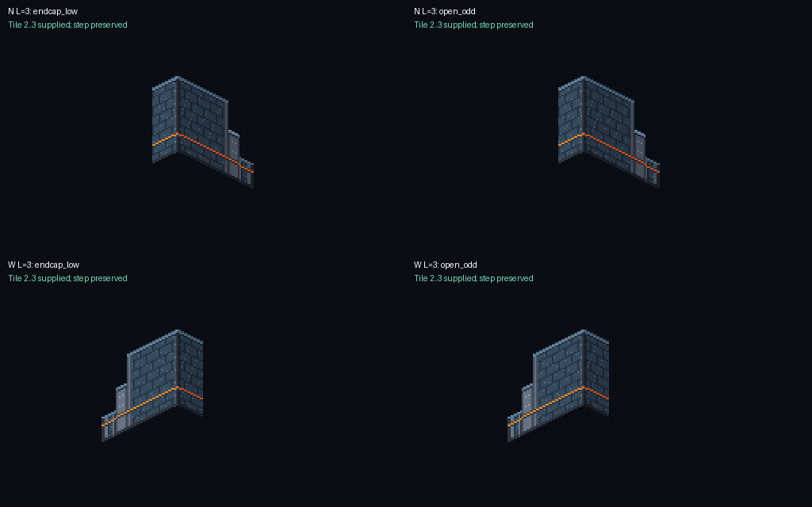

# TLF-068 — Sol visual approval at 4acda3a

**APPROVE VISUAL — exact Argon SHA `4acda3ae00810f46b547d14dbb1eda28215eefff`.**

Reviewed 2026-11-07. Delivery: `origin/adityadaffa522/tlf-068-shape-art-kit`. Review branch: `adityadaffa522/tlf-068-visual-review`. This supersedes the outstanding verdicts on [835a3a3](TLF-068_835a3a3_visual_review.md) and [7b37a16](TLF-068_7b37a16_visual_rereview.md) for the requested TLF-068 acceptance. **P1 and P2 are closed.** No remaining blocking visual finding in this review; Lead owns integration and merge.

## Acceptance evidence

| Check | Result at this SHA |
|---|---|
| Three-tile uncornered N end | PASS: the documented `assemble_wall_run('N', (0,0), (3,0), 'corner', 'endcap_low')` produces WallN at tile (1,0) and N endcap at (2,0). Residual `[2,3]` is supplied; 0 empty footprint columns, 0 refilled step pixels. |
| Three-tile uncornered W end | PASS: the documented `assemble_wall_run('W', (0,0), (0,3), 'corner', 'endcap_low')` produces WallW at tile (0,1) and W endcap at (0,2). Residual `[2,3]` is supplied; 0 empty footprint columns, 0 refilled step pixels. |
| Alias and even-length continuation | PASS for all eight combinations of N/W, lengths 3/4 and `endcap_low`/`open_odd`. Alias placements exactly equal canonical placements, including the reserved stepped last tile. |
| Endcap contract | PASS: ASSET_METADATA §10.2 now requires `endcap_low` for uncornered N/W ends and explicitly identifies `open_odd` as a compatibility alias. `assemble_wall_run()` uses one `use_endcap` condition for both the reserved end interval and actual cap emission. The previous silent fallthrough is gone. |
| Earlier P1 inner-turn joins | PASS: N/W first ordinary module stays at +2 tiles; 0 refilled corner-step pixels. Adjacent join columns preserve full-height faces and the 2:1 cornice/base profile without a transparent slit. |
| Corner-ended odd/short runs and explicit low endcaps | PASS: all six previous N/W short, inner-residual and explicit-endcap fixtures retain continuous footprint columns and correctly aligned residual face joins. |
| Proof and mockup use the contract | PASS: the new proof visibly includes the actual documented uncornered N and W length-3 calls plus the length-4 endcap case. The L-room still executes 12 calls to the documented helper and regenerates its committed 640x360 pixels exactly. |
| Requested column corrections | PASS: the N-turn inner low_E/tall-N arms are documented in x=16..31; the W-turn inner low_S/tall-W arms in x=0..15, matching their generator geometry. |

Independent proof uses committed runtime PNGs, not the generator's assertions alone: [endpoint_probe.py](TLF-068/4acda3a/endpoint_probe.py), [measurements and mockup call trace](TLF-068/4acda3a/endpoint-probe.json), [N/W canonical-versus-alias images](TLF-068/4acda3a/uncornered-endcaps.png). Each endcap step is checked against preceding full-height pixels, not merely for a nonempty silhouette.

[Argon's updated native join proof](TLF-068/4acda3a/argon-endpoint-join-proof.png) was copied byte-for-byte from the reviewed archive and visually inspected. The 12 runtime PNGs and 12 `.pxo` sources remain unchanged from the first reviewed SHA, so the established palette, binary alpha, top-left light, 2:1 individual sprite projection, pivots, 16–17 px low-family height and native 32x48 Elias reference remain valid. The current full gates below independently recheck the asset pipeline.

## Fresh exact-SHA gates

Fresh `git archive` extracted to `C:/Users/adity/AppData/Local/Temp/tlf068-sol-4acda3a`. [Verification/provenance](TLF-068/4acda3a/sol-verification.txt) records every tracked-file blob matching the SHA after checks. No game project was launched, no real game save was used, and Pixelorama exported temporary source copies.

| Command | Exit | Exact result |
|---|---:|---|
| `python tools/art/check_assets.py` | 0 | `RESULT: ALL PASS (263 file(s))` — [raw output](TLF-068/4acda3a/sol-check-assets.txt) |
| `python tools/art/gen/verify_regen.py` | 0 | `RESULT: ALL REPRODUCIBLE` — [raw output](TLF-068/4acda3a/sol-verify-regen.txt); all three TLF-068 mockup/proof sheets byte-identical. |
| `python tools/art/gen/verify_pxo.py --only ch01_env_wall_ --log <absolute-log-path>` | 0 | `TOTAL pxo: 17, all identical: True` — [raw size/export output and SHA-256 comparisons](TLF-068/4acda3a/sol-pixelorama.txt). All 12 kit sources plus five existing wall sources checked; 34 invocations exit 0. |

The nine legacy batch-1 generator exclusions remain explicit in `verify_regen`; existing N/W joining modules are included in the separate Pixelorama re-export. Pixelorama still emits the previously recorded 136 `custom_samplers` shader-compiler diagnostics; they are retained in the raw log, with every export byte-identical and no failed size/export result. The archive log's empty git-HEAD header has its trailing blank trimmed; full-SHA provenance is recorded separately.

**Handoff:** TLF-068 art and its corrected endcap assembly are visually approved at this exact SHA. Runtime placement, actor sorting, collision/reach and ADR-023 R2b hidden-floor checks remain the normal pilot-room integration gates. This branch adds review documentation/evidence only; Sol does not merge.
