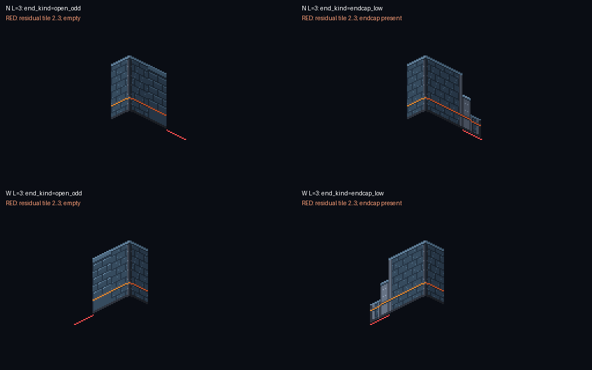

# TLF-068 revised endpoint recipe — Sol re-review

**CHANGES REQUIRED — exact Argon SHA `7b37a16be077a29b5ebac8bac79f4db365ed926d`.**

2026-11-07. Delivery: `origin/adityadaffa522/tlf-068-shape-art-kit`. Review: `adityadaffa522/tlf-068-visual-review`. This new review preserves the [835a3a3 review](TLF-068_835a3a3_visual_review.md). The previous P1 inner-turn overlap is **fixed**. One P2 discrepancy remains in the newly advertised open odd-end recipe. No asset edits or merge by Sol.

## Remaining required change (P2): `open_odd` omits its promised cap

[ASSET_METADATA.md §10.2, line 946](https://github.com/Zeeynrs/the-last-frame/blob/7b37a16be077a29b5ebac8bac79f4db365ed926d/design/art/ASSET_METADATA.md#L946) says an uncornered odd N/W end uses `end_kind == "open_odd"` and receives the low endcap at `t - 1`. However, [assemble_wall_run(), lines 1007–1032](https://github.com/Zeeynrs/the-last-frame/blob/7b37a16be077a29b5ebac8bac79f4db365ed926d/tools/art/gen/tlf068_shape_kit.py#L1007) only reserves/emits an endcap for `end_kind == "endcap_low"`. `open_odd` silently falls through to ordinary module placement.

Reproduction against this exact archive, with pixel origin (0,0):

```python
assemble_wall_run('N', (0,0), (3,0), 'corner', 'open_odd', origin=(0,0))
# Only WallN at (16,8), tile anchor (1,0); no endcap.
assemble_wall_run('W', (0,0), (0,3), 'corner', 'open_odd', origin=(0,0))
# Only WallW at (-16,8), tile anchor (0,1); no endcap.
```

In both cases the ordinary module covers tiles `[0,2]`. The uncornered residual `[2,3]` has **16 empty screen columns**. There is no end-corner wing to supply it. The added proofs demonstrate corner-ended residuals and the separate `endcap_low` mode; they do not exercise this advertised mode. Calling the same cases with `endcap_low` emits the required cap at tile 2 and closes the residual.



**Argon:** either implement the documented `open_odd` mode, or remove that mode from the contract and explicitly require callers to use `endcap_low` for an uncornered odd/open termination. Include the actual documented N/W calls in the deterministic proof so each supplies its residual tile without refilling the step. This can be a contract/call-site correction; no redraw is requested. Opus/Flash should consume the resulting single recipe.

While editing §10.2, correct the non-blocking sprite-column descriptions: the N-turn inner's low_E arm is painted in `x=16..31`, and the W-turn inner's low_S arm in `x=0..15` ([generator lines 454 and 592](https://github.com/Zeeynrs/the-last-frame/blob/7b37a16be077a29b5ebac8bac79f4db365ed926d/tools/art/gen/tlf068_shape_kit.py#L454)); the metadata currently states the opposite halves. These arms and their stepped tall arms project into the same horizontal half, not one arm into each half. Whole-sprite placement in the revised mockup is correct; this note concerns the crop/occupancy explanation.

## Acceptance rechecked

| Acceptance | Result |
|---|---|
| Low-to-tall transition preserved | **PASS; previous P1 closed.** N/W `inner_turn` starts the first ordinary module at +2 tiles. Independent PNG overlap measurement gives **0 refilled step pixels**, formerly 227 per axis. |
| 2:1 cornice/base alignment and no gap at first ordinary N/W module | PASS. The two columns straddling each inner-turn join contain the full 48 px face with the expected one-pixel cornice/base change. No transparent slit. |
| Short/odd run explicit, corner-ended | PASS. N/W 3-tile regular runs and 4-tile inner-turn runs have their residual supplied by the end-corner wing. Independently checked all active-axis footprint columns and residual face joins. The provided W inner 3-tile run also reads correctly. |
| R2b low endcap termination | PASS for explicit `endcap_low`. N/W length-4 runs reserve the stepped final tile and join the preceding full-height module without a gap. The advertised `open_odd` case remains the discrepancy above. |
| Mockup uses documented recipe | PASS for the modes it uses: all **12** straight-run calls go through `assemble_wall_run()`. Running that function through a recording wrapper regenerates the committed 640x360 mockup pixel-for-pixel, with inner-turn +2 anchors. |
| Art direction retained | PASS. All 12 runtime PNGs and 12 `.pxo` sources are unchanged from 835a3a3. Prior native-scale/greyscale, TLF-CH01-32, top-left light, 16–17 px low-family height, Elias v2 scale and pivot checks remain applicable. New gates were nevertheless run below. |

Independent evidence: [endpoint_probe.py](TLF-068/7b37a16/endpoint_probe.py), [measurements and mockup call trace](TLF-068/7b37a16/endpoint-probe.json). The probe covers six N/W regular-odd, inner-residual and explicit-endcap assemblies, checks first inner joins, and reproduces the two open-end defects. It measures the relevant run face separately from a corner's other projecting leg. It writes review artifacts only.

Delivery images copied byte-for-byte from this SHA: [new endpoint proof](TLF-068/7b37a16/argon-endpoint-join-proof.png), [native L-room](TLF-068/7b37a16/argon-l-room-native.png), [colour/greyscale proof](TLF-068/7b37a16/argon-greyscale-proof.png). Visually inspected all three. These are art assembly proofs, not runtime room/collision approval; ADR-023 R2b hidden-floor and opening-reach checks remain pilot integration requirements.

## Fresh gates on exact-SHA archive

Extracted `git archive 7b37a16be077a29b5ebac8bac79f4db365ed926d` to `C:/Users/adity/AppData/Local/Temp/tlf068-sol-7b37a16`. No game project was launched. Pixelorama uses temporary source copies; game saves are not used. [sol-verification.txt](TLF-068/7b37a16/sol-verification.txt) records archive blob identity, probe output and review scope checks.

| Command | Exit | Observed result |
|---|---:|---|
| `python tools/art/check_assets.py` | 0 | **`RESULT: ALL PASS (263 file(s))`** — [raw log](TLF-068/7b37a16/sol-check-assets.txt). This is the fresh archive's actual count, rather than the reported 264. |
| `python tools/art/gen/verify_regen.py` | 0 | **`RESULT: ALL REPRODUCIBLE`** — [raw log](TLF-068/7b37a16/sol-verify-regen.txt); revised mockup, new endpoint proof and greyscale proof all byte-identical. Nine legacy batch-1 sources remain explicitly outside generator coverage. |
| `python tools/art/gen/verify_pxo.py --only ch01_env_wall_ --log <absolute-log-path>` | 0 | **`TOTAL pxo: 17, all identical: True`** — [raw log](TLF-068/7b37a16/sol-pixelorama.txt). Includes all 12 kit sources plus five existing wall-family sources; all 34 size/export invocations exit 0, all SHA-256 pairs match. |

Pixelorama 1.2.3 / Godot 4.7.2 again prints 136 nonfatal `custom_samplers` shader-compiler diagnostics across both old and new sources. Messages are retained in the log; they do not prevent the byte-identical exports. No claim of an error-free Pixelorama console. The empty archive git-HEAD log header has its trailing blank trimmed; full-SHA provenance is checked separately against every tracked-file blob.

**Handoff:** original P1 fixed; finish the open odd-end contract/proof correction before APPROVE VISUAL. This is a narrower remaining issue, not a request to revisit the kit's visual direction. Sol does not merge.
