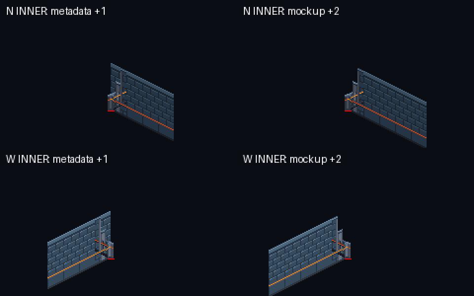

# TLF-068 shape art kit — Sol visual review

**CHANGES REQUIRED — exact Argon SHA `835a3a39d3a1aab6be57bdf87c284b2f83a7c0f0`.**

Reviewed 2026-11-07 against ADR-023 R2/R2b and plan Task 4. Delivery branch: `origin/adityadaffa522/tlf-068-shape-art-kit`. Review branch: `adityadaffa522/tlf-068-visual-review`, based on main `f0685edccf9606d41cf586e2d70b918ff44e4d5e`. This review changes documentation/evidence only. No merge and no asset edits by Sol.

## Required change: reconcile corner occupancy with the straight-run mapping (P1)

The inner N-turn and W-turn sprites have a useful low bollard / intermediate-height / tall-wall transition. **The mapping table fills that transition back up with the adjacent full-height module.** The native mockup avoids this by using different anchors from the table. Integration following the table therefore cannot reproduce the approved-looking mockup.

Source locations at the reviewed SHA:

- [ASSET_METADATA.md:924–925](https://github.com/Zeeynrs/the-last-frame/blob/835a3a39d3a1aab6be57bdf87c284b2f83a7c0f0/design/art/ASSET_METADATA.md#L924) starts an N/W straight run at `from + 1` tile, then every two tiles. The inner-corner rows at 933/935 put their pivot directly on the vertex, with no straight-run trim/occupancy exception.
- [tlf068_shape_kit.py:1055–1057](https://github.com/Zeeynrs/the-last-frame/blob/835a3a39d3a1aab6be57bdf87c284b2f83a7c0f0/tools/art/gen/tlf068_shape_kit.py#L1055) instead puts the first N module at `(9,0)` after the N-turn inner vertex `(7,0)`: **+2 tiles**, not the table's `(8,0)`.
- [tlf068_shape_kit.py:1072–1073](https://github.com/Zeeynrs/the-last-frame/blob/835a3a39d3a1aab6be57bdf87c284b2f83a7c0f0/tools/art/gen/tlf068_shape_kit.py#L1072) puts the first W module at `(0,9)` after the W-turn inner vertex `(0,7)`: **+2 tiles**, not the table's `(0,8)`.

I composited the committed runtime PNGs with the documented `(16,56)` pivots, placing the full-height module first and the corner last. Each `+1` placement introduces **227 opaque wall pixels into transparent space above the stepped half of the corner**. Drawing the corner later does not remove those tall pixels. The `+2` placements used by the mockup preserve the step and its join. This is reproducible from the exports, independent of Pixelorama or Godot sorting.



**Argon:** document one endpoint-aware assembly recipe in §10.2, including the portion already supplied by each corner, the first/last straight-module anchors, and how residual/odd ends are handled. Make the mockup use that same recipe, or supply equivalent deterministic join proofs directly from its documented anchors. A documented trim/crop solution is also possible; an unconditional `from + 1` rule is not sufficient for these stepped inner turns. Do not blindly shift every wall run: regular full-height corners have different overlap needs. **Opus/Flash:** consume the corrected contract when wiring the kit. This review does not request runtime edits from Argon or assume a redraw is necessary.

Re-review acceptance: both N-turn and W-turn inner connections assembled from the revised table retain their low-to-tall transition, keep the 2:1 cornice/base alignment, and have no gap at the next ordinary N/W module. Demonstrate a short/odd run as well as the two existing mockup connections so endpoint occupancy is explicit.

## Visual checklist

| Requested check | Result at 835a3a3 |
|---|---|
| 2:1 projection | PASS for the delivered sprite geometry: straight cornices/bases step one pixel vertically per two horizontally. No perspective or non-integer scaling introduced. |
| Joins with existing N/W pieces | The mockup's chosen joins read continuously in cornice, ceramic course, amber dado and dark skirting. **CHANGES REQUIRED for the table-driven inner N/W placements above.** Visual continuity in a manually placed mockup does not establish the published assembly contract. |
| Tall inner/outer corners, including N-turn and W-turn | All six tall variants are present. NW outer reads as an interior angle, NW inner as a projecting quoin; N/W outer turns have a steel return, inner turns have distinct stepped shoulders. The N/W lighting distinction remains legible in greyscale. |
| Low S/E partitions, <= about 20 px | PASS: straight faces have a 16 px vertical extent (17 inclusive raster pixels); low inner/outer corner stanchions reach 17 px (18 inclusive pixels). All stay below 20 px. Do not confuse the 32 px canvas or sloping footprint extent with vertical wall height. |
| Elias visibility beside low faces | PASS for the native mockup reference: torso/head remain clear at the SE low corner and low south edge. The low family cannot cover a full 48 px character. This is an art-scale check, not a substitute for the pilot room's actor sorting/collision/hidden-floor checks. |
| Tall-wall termination at an opening | PASS for both N/W endcap designs: full-height wall transitions through a 30 px steel shoulder to a 16 px opening-side tip. The entire endcap is not a <=20 px object; its tip is the low part. Correct placement must keep the tall shoulder out of the walkable opening. |
| Palette and alpha | PASS: all 12 new exports use TLF-CH01-32 and binary alpha; no new colour or translucent fringe. The native colour mockup also passes the palette gate. Luminance proof panels are intentionally derived greyscale. |
| Top-left light | PASS: W ceramic/coping remains lighter than N; corner metal bevels and low S/E faces continue the existing hierarchy. No unapproved horizontal flips are needed for the paired N/W designs. |
| Pivots/anchors | Sprite canvas and metadata pivot values agree: tall/cap 32x64 at (16,56), low 32x32 at (16,24), `centered=false`, offset=-pivot. **The adjacent-run anchor recipe is the blocker**, not an incorrect pivot number. |
| `RoomShape.wall_segments()` mapping | All eight `(kind, faces)` corner combinations match the actual canonical builder output and have an asset. Straight/odd-end assembly must still account for corner occupancy as requested above. |
| 640x360 L-room mockup and Elias scale | PASS for native readability and scale: actual Elias v2 sheet regions (0,0)-(32,48) and (64,0)-(96,48) are cropped without resizing and placed at pivot (16,44). Architecture, low parapets and Elias have consistent density. This is a labelled kit demonstration with additional alcoves/mouths, not a runtime room or collision approval. |
| Floor-edge treatment | Existing terrazzo diamonds provide a readable mortar/bevel edge in the demonstrated cut; no visual need for a new standalone floor-edge tile is established here. Keep the existing exposed edge rather than adding an unexplained new surface family. |

References copied byte-for-byte from the reviewed archive: [native 640x360 mockup](TLF-068/835a3a3/argon-l-room-native.png), [colour/greyscale kit proof](TLF-068/835a3a3/argon-greyscale-proof.png). All 12 assets were inspected at native scale and enlarged nearest-neighbour in those proofs. [geometry-probe.json](TLF-068/835a3a3/geometry-probe.json) records the 12 canvases/pivots/layers, low-height measurements, eight mapping keys and native Elias crop bounds.

R2b remains a layout/integration gate: N/W concave cuts that geometrically hide floor require that floor to be unwalkable. Neither a low sprite's height nor this mockup authorizes bypassing `hidden_floor_cells()` in the pilot. There is no runtime integration in this art-only delivery; I have not treated the mockup's illustrative mouths as validated door apertures.

## Independent gates and provenance

A fresh `git archive` of the full SHA was extracted to `C:/Users/adity/AppData/Local/Temp/tlf068-sol-835a3a3`. The gates ran there, not in Argon's worktree or a mutable branch checkout. Pixelorama ran on temporary `.pxo` copies. No game project was launched, so the real game save directory was not used. Archive tracked-file blob verification after the gates is recorded in [sol-verification.txt](TLF-068/835a3a3/sol-verification.txt).

| Command in exact-SHA archive | Exit | Exact result / evidence |
|---|---:|---|
| `python tools/art/check_assets.py` | 0 | `RESULT: ALL PASS (262 file(s))` — [raw output](TLF-068/835a3a3/sol-check-assets.txt) |
| `python tools/art/gen/verify_regen.py` | 0 | `RESULT: ALL REPRODUCIBLE` — [raw output](TLF-068/835a3a3/sol-verify-regen.txt) |
| `python tools/art/gen/verify_pxo.py --only ch01_env_wall_ --log <absolute-log-path>` | 0 | `TOTAL pxo: 17, all identical: True` — [raw size/export commands and SHA-256 comparisons](TLF-068/835a3a3/sol-pixelorama.txt). This covers all 12 new assets plus five existing wall-family sources, including the joining N/W modules; every size/export exits 0 and every re-export is byte-identical. |

`verify_regen` explicitly lists nine legacy batch-1 assets without generators as `NOT COVERED`; this pre-existing limitation includes the N/W straight modules. Their actual Pixelorama sources were independently re-exported above. Both new mockup/proof sheets regenerate byte-identically. Pixelorama executable: `D:/Pixelorama/Pixelorama-Windows-64bit/Pixelorama.exe`.

**Pixelorama tool diagnostic:** the raw log contains 136 repeated `ERROR: Condition "!actions.custom_samplers.has(function->arguments[j].tex_builtin)" is true. Continuing.` messages at `shader_compiler.cpp:1329` (four per invocation, including the existing wall sources). These are retained, not filtered out. All 34 size/export invocations exit 0, all 17 SHA-256 pairs match, and there are no `SCRIPT ERROR` or failed export comparisons. I accept the re-export identity result with this tool diagnostic recorded; I do not describe the Pixelorama console as error-free or treat it as evidence that one of the new assets is corrupt. The raw log's git-HEAD field is empty because `git archive` has no `.git`; the separate full-SHA/blob verification establishes provenance.

Read-only review probes (Pillow; geometry probe also imports the archive's builder/generator):

```powershell
python docs/reviews/TLF-068/835a3a3/join_probe.py <exact-SHA-archive>
python docs/reviews/TLF-068/835a3a3/geometry_probe.py <exact-SHA-archive>
```

[join_probe.py](TLF-068/835a3a3/join_probe.py) writes only the comparison image and [join-probe.json](TLF-068/835a3a3/join-probe.json) beside itself under review docs; [geometry_probe.py](TLF-068/835a3a3/geometry_probe.py) writes its measurements there. Neither changes the archive assets or generators.

**Handoff:** gates pass; revise the assembly mapping and its proof before visual approval. The low family, palette, lighting, native character scale and the individually authored corner/endcap shapes do not need a new visual direction. No merge by Sol.
