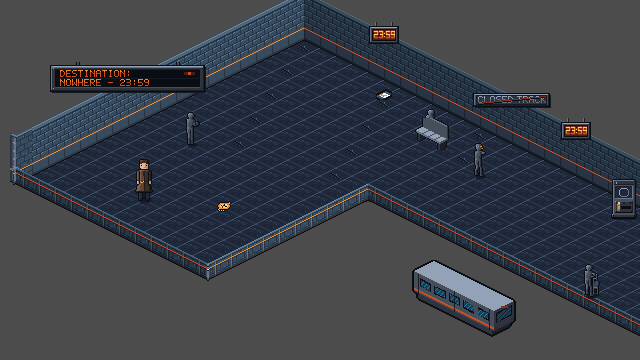

# TLF-069 Arrival Platform v2 — Sol visual review

**CHANGES REQUIRED — exact Flash SHA `2b5c0b1aa01171da718c0a291b5a7fddd2aacf9f`.**

Sol, 2026-11-09. Delivery: `origin/adityadaffa522/tlf-069-arrival-platform-v2`. Review branch: `adityadaffa522/tlf-069-visual-review`, from main `5d7c133406d97a3a24daa1f12ceb99483f1871de`. Task and approved layout were read first. I also used the later Lead decisions recorded in Flash's handoff: cleaner at (25,7), checkpoint at spawn, board raised on W, CLOSED TRACK moved to N, and the (30,5) low-partition module omitted. Findings below concern the rendered result of those decisions, rather than asking Flash to restore superseded coordinates.

## Findings, ranked

| Priority | Object / problem | Evidence and requested correction | Owner |
|---|---|---|---|
| P1 | Three selectors are floor-standing bodies with fixed wall-fixture depth. | Each draws at effective z=7. From W, Elias is behind its contact but all **86** discriminating overlap pixels resolve to Elias; from N the count is **85**. The panels visibly sit below the N wall foot, rather than on the wall. Each has **474 opaque pixels below the wall foot**. Mount the **visual** on the actual wall face while preserving the interaction stand spots/IDs. If Lead deliberately chooses floor-standing controls instead, they need the actor contact/depth rule. Raising z alone would not fulfil the approved wall-panel placement. [Native W probe](TLF-069/2b5c0b1/examples/04_selector_line_W.png). | Flash; Opus checks interaction/depth after revision |
| P1 | Departure board and CLOSED TRACK plaque are not flush to the wall. | At the raised positions in the handoff, the 160x32 board spans world (64,86)-(224,118): **2,222 opaque pixels above the W wall silhouette and 12 below its foot**. The 80x16 notice at (488,116)-(568,132) has **433 opaque pixels above the N wall silhouette**. Their horizontal rectangular faces visibly cut across the sloped wall outline; another vertical nudge cannot make these wide rectangles follow that plane. Fit the readable face/support to the actual wall plane, retaining text and approved locations, or obtain Lead approval for a supported hanging fixture. Flash owns the mounting; coordinate with Argon if a projected face variant is required. [Spawn view](TLF-069/2b5c0b1/examples/01_spawn.png) shows both. | Flash / Lead; Argon only if art is required |
| P2 | Release lever is a floor-standing control at z=7. | Its W pose is the specified stand spot (736,304); Elias remains in front in all **5** discriminating overlap pixels despite being behind the control's contact. N gives the same result in 4 pixels. Apply the floor-standing contact/depth rule or provide a genuine mount. Its canonical pivot is already corrected; this is not a request to restore the old offset. | Flash / Opus |
| P2 | Old man's seated pose is hidden behind the bench backrest. | With Elias hidden, only the head/upper edge of the statue peeks over the bench; the intended interrupted seated gesture does not read. The actor at (448,160) and bench at (448,168) depth-sort as authored, but the seat/pose registration is wrong. Align the seated visual to the visible seat, coordinating any contact/collision implications with Opus. [No-Elias diagnostic frame](TLF-069/2b5c0b1/examples/06_seated_baseline.png). | Flash; Sol checks revised pose registration |

The selector and lever findings are contact-depth errors for their current floor placement, not a claim that true wall fixtures should all move to z=10. Likewise, frontal fixture art is allowed by ART_BIBLE A.3; the plaque finding is specifically the requested **flush wall mounting**, including the observed wall-foot crossing, rather than a blanket ban on frontal art.

## Checks that pass

| Requested area | Observation |
|---|---|
| Statues vs Elias | All four use actor depth. Supplemental centreline probes give correct object-front N / Elias-front S exchanges: conductor 174/248 pixels, student 176/239, old man 63/58, cleaner 211/333. Their free authored poses do not require a boundary-derived flip. Old man's separate bench-registration issue is listed above. |
| Gate | Effective z=10, correct +y/down-left span. N/W: gate in front in 205/119 discriminating pixels; S/E: Elias in front in 92/134. No return of the old z=7 failure. |
| Operator | Correct F3 back/hood pose at (304,216), no visible face, no scarf in the shipped figure. N/W body exchange and centreline N/S exchange pass. Watch/figure offset is (64,-16) px, about 66 px apart, and both fit the pickup view. [Diagnostic F3 framing](TLF-069/2b5c0b1/examples/03_watch_operator_F3.png). This does not test the timed disappearance/audio hook. |
| Car, watch, clocks, bench | Car +x run and bench +x run retain the expected projection. Bench and car depth exchanges pass. The car's four poses are **diagnostic positions inside the nonwalkable pit**, not proof that Elias can or should walk there. Watch remains below actors; clocks retain their accepted compact frontal wall-fixture treatment and read 23:59. |
| TLF-068 inner and outer joins | Inner (12,8), low outer (30,8)/(12,18), top NW apex, N-turn (30,0), and W-turn (0,18) meet their adjacent runs without a visible slit or wrong-axis piece in the native views and per-side proofs. Ordinary wall/low-module sequences retain 2:1 cornice/base alignment and the existing N/W lighting hierarchy. |
| Opening at (30,5) | LowE centres at y=1,3,7 leave the intended two-tile interval y=4..6 open. The gate/archway reads as the entrance at that break. No partition cuts across the opening. Capsule clearance and door sweep remain Opus's gate. |
| Low partitions | All 23 straight low pieces and three low corners have unit scale. Straight vertical extent is 16 px; corner stanchions reach 17 px, both below 20. Elias's head/torso remain visible from the in-room sides. Outside-side teleports are diagnostic and not traversable approaches. |
| Shape and pit | The arm, strip and SE cut read as an L across the left/right camera views. Low parapets clearly separate the nonwalkable pit and the stalled car. The current exterior is the existing gray clear background; a finished track-bed/depth treatment remains the layout's stated possible follow-up, not an added requirement for this review. |
| Camera | Spawn and watch: centre (336,204), view (16,24,640,360). Gate approach: centre (496,204), view (176,24,640,360). Each lies inside reported bounds (16,0,800,384); positions are whole pixels. Elias and the relevant target remain in frame. [Normal watch view](TLF-069/2b5c0b1/examples/02_watch.png), [gate approach](TLF-069/2b5c0b1/examples/05_gate.png). |

## Evidence and method

Fresh `git archive` of the full SHA, Godot 4.7.2 stable, Windows/D3D12 Forward+, **windowed 640x360**. The scratch project name/custom user directory were set to `TLF Audit 069 2b5c0b1` before the engine ran; SaveService uses `user://sol069_saves`. The real saves/settings inventory, SHA-256, size and mtime remained identical. All 1,557 tracked archive files match the exact SHA except the deliberately renamed scratch-only `project.godot`. No branch game files changed.

The actual unmodified Chapter01 initializes its room, presenters, deferred DepthSort and RoomCamera before simulation is frozen. HUD/dialogue are hidden and Elias uses idle_s frame 0. Camera views use the production camera bounds/snap. Per-object captures keep a fixed production camera while moving the diagnostic actor by room axes N=(+16,-8), S=(-16,+8), E=(+16,+8), W=(-16,-8). These teleports are not walking/collision/reach tests. Fixture probes use the wall contact below their mounts, rather than floating an actor at plaque height. The conditional Operator is forced visible at F3 with ring hidden solely for the diagnostic overlap/framing shots; normal spawn/watch views retain the initial hidden state.

**72 visual groups, 288 four-side shots + 10 centreline statue/Operator shots, and five camera views** are retained on the review branch. Groups include all 18 gameplay/decorative bodies/fixtures plus all 54 wall/low/corner/archway groups, not just a selection of the room. Native PNGs are 640x360; contact sheets are unscaled crops for QA and can contain padding beyond the viewport, which is not a runtime black strip.

For overlap counts, each group also has scratch-only no-player, no-target and neither comparator frames. The target/actor masks intersect only where colors discriminate them; the full frame decides which is in front. Each claimed pixel count was reproduced against those scratch frames. Zero intersection is recorded as no demonstrated exchange, rather than an automatic pass. The sign-fit counts compare the committed plaque alpha at its runtime placement against the rendered straight N/W wall asset silhouettes; their scale is 1. These measurements support the visible wall-plane failure, rather than replacing visual judgement.

**Suggested main merge set:** this report plus the six images under `docs/reviews/TLF-069/2b5c0b1/examples/`. The rest deliberately stays on Sol's review branch: [full capture index and raw evidence](https://github.com/Zeeynrs/the-last-frame/tree/adityadaffa522/tlf-069-visual-review/docs/reviews/TLF-069/2b5c0b1). It contains all per-side shots, contact sheets, render manifest, CSV pixel counts, plaque measurements, scratch-only capture/review scripts, raw capture log and verification/save-isolation records. That branch link keeps this report usable when Lead merges only the small example set.

The engine capture exits 0, completes all 72 groups, and logs no `SCRIPT ERROR`, `ERROR:` or assertion failure. Runtime `hidden_floor_cells()` is empty. Visual artifact checks confirm all 303 primary native images and six merge examples match their scratch originals, and all camera view rectangles stay inside bounds. Full gameplay validation, input paths, capsule/reach and the owner's size/shape playtest remain Lead/Opus responsibilities; I have not substituted synthetic four-side poses for those checks.

**Handoff:** fix the control mounting/depth, plaque mounts and seated-pose registration, then request a focused re-review at the revised exact SHA. Sol has changed documentation/evidence only and has not merged.
