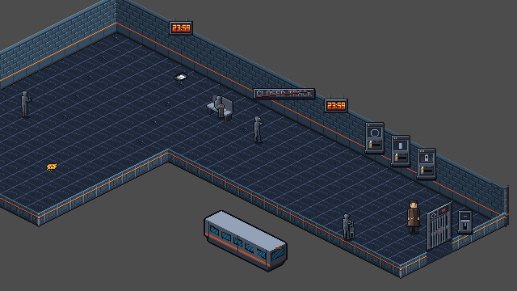

# TLF-069 Arrival Platform v2 — Sol re-review

**CHANGES REQUIRED — exact Flash SHA `90da97014250b2ac89e41b38258e7b90f303c42c`.**

2026-11-09. Delivery `origin/adityadaffa522/tlf-069-arrival-platform-v2`; review `adityadaffa522/tlf-069-visual-review`. This is a focused re-review of the [previous findings](TLF-069_2b5c0b1_visual_review.md). Departure board removal is intentional pending TLF-073 and is **not a defect**. I have not combined this SHA with Argon's separate plaque branch for the verdict.

## Finding disposition

| Previous finding | Disposition at 90da970 |
|---|---|
| Selector floor-standing mount / fixed z=7 | **Original finding closed.** All three visuals move up 28 px while interaction parents/stand spots stay put. No opaque pixels cross the N wall foot; they now read as compact wall fixtures, for which z=7 is appropriate. [Native front-side proof](TLF-069/90da970/examples/03_selectors.png). Their outer upper silhouettes still have 41 pixels above the cornice, so the handoff's claim of *zero above* is inaccurate. I accept the established compact frontal-fixture treatment under Bible A.3 here; this is not the former floor-standing depth failure. |
| Release lever depth | **Closed.** Effective z=10; N/W show lever-front in 4/5 discriminating pixels, S/E show Elias-front in 6/7. The W probe is the documented stand spot (736,304). [W proof](TLF-069/90da970/examples/04_lever_W.png). |
| Old man's seated pose behind backrest | **Closed.** Contact y moves from 160 to 169, just in front of bench y=168. Torso, seated legs and interrupted gesture now read instead of only the head peeking over the backrest. [No-Elias native frame](TLF-069/90da970/examples/05_seated_baseline.png). N centreline has no discriminating intersection because of the bench; I do not count that as a demonstrated depth exchange. |
| CLOSED TRACK flush **inside** the N wall face | **Still open, P2.** The move from (528,130) to (528,146) removes the wall-foot crossing and reduces above-wall pixels from 433 to **34**, but does not put the whole plaque inside the wall face. Its upper-right frame still crosses the cornice. [Native notice proof](TLF-069/90da970/examples/06_notice.png). Flash's own handoff also acknowledges 34 above-silhouette pixels. |

**Required correction:** use the approved sheared N-face notice from TLF-073 at its documented anchor when integrating that delivery, or remove the temporary frontal notice pending it as was done for the departure board. Request a revised exact SHA for the room. A prospective art fix on another branch is not present in this room SHA, so it cannot close the explicit flush-inside criterion here. No new puzzle/text/geometry changes are requested.

The distinction is deliberate: Bible A.3 permits compact frontal wall fixtures such as controls/clocks; the remaining wide notice was explicitly required to be flush inside the N wall face. The room's unchanged clock treatment is not being reopened.

## Retained checks and evidence

Fresh exact-SHA archive, renamed **before any engine invocation** to `TLF Audit 069 90da970` with its own custom user directory and SaveService root `user://sol069_saves`. Godot 4.7.2, Windows D3D12 Forward+, windowed **640x360**. The unmodified Chapter01, presenters, deferred DepthSort and RoomCamera initialize before diagnostic simulation freeze. No branch game files were edited.

All **71 visual groups** were recaptured at room-axis N/S/E/W: **284 four-side + 10 statue/Operator centreline = 294 per-side frames**, plus five camera views. The board is absent as authorized. [Spawn framing](TLF-069/90da970/examples/01_spawn.png) and gate framing retain the previous camera clamps: centres (336,204)/(496,204), inside bounds (16,0,800,384). TLF-068 joins, low partitions (unit scale, max 17 px vertical extent), gate depth and diagnostic F3 Operator framing retain their previous pass observations. The car's pit-side actor poses and out-of-room wall-side poses are synthetic diagnostics, not reachable player paths.

The same fixed-camera comparator method as the prior review reproduces every overlap count. Wall-fit measurement against the unchanged straight N/W wall alpha gives notice **34 above / 0 below / 34 outside**, selectors **41 above / 0 below / 41 outside each**. This measures geometry of the visible silhouettes, not whether a scene test accepts a node position.

The capture process exits 0, completes 71 groups, and logs no engine/script/assertion error. All 299 primary native frames and six selected merge examples match the scratch originals. Every tracked archive file matches the delivery SHA except the deliberately renamed scratch-only project.godot. Real saves/settings are unchanged by inventory, SHA-256, size and mtime. The HUD/dialogue are hidden; Operator F3 visibility/ring suppression is diagnostic; walking reach and story timing are not claimed by these frozen shots.

**Suggested small merge set:** this report plus `docs/reviews/TLF-069/90da970/examples/` (six PNGs). [Full per-side index, manifest, measurements, raw capture log, scripts, save-isolation and verification records remain on the review branch](https://github.com/Zeeynrs/the-last-frame/tree/adityadaffa522/tlf-069-visual-review/docs/reviews/TLF-069/90da970). This keeps the report usable when Lead merges only the report/examples. Full technical validation and the owner playtest remain Lead/Opus gates. Sol does not merge.
