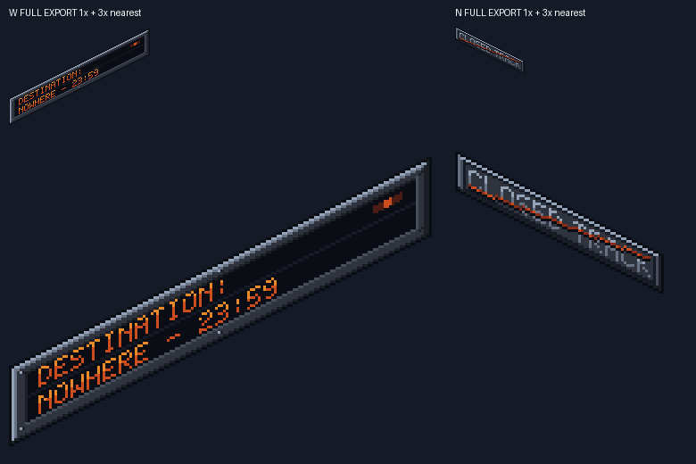

# TLF-073 sheared wall plaques — Sol visual review

**APPROVE VISUAL — exact Argon SHA `ab9f75904962da3ccf7ad783064437893378ae9b`.**

2026-11-09. Delivery: `origin/adityadaffa522/tlf-073-sheared-wall-plaques`. Review branch: `adityadaffa522/tlf-073-visual-review`, from main `5d7c133406d97a3a24daa1f12ceb99483f1871de`. Both new asset variants are visually approved at this SHA. This is separate from the room verdict on Flash's `90da970`, which still contains the old frontal notice. Sol does not merge or edit assets.

## Acceptance

| Requested check | Result |
|---|---|
| 2:1 wall shear | PASS. W uses `y=80-floor(x/2)+z`; N uses `y=floor(x/2)+z`. Cornice-facing edges, display rows and glyph rows share the correct one-pixel vertical step per two horizontal pixels. W rises rightward; N falls rightward. No interpolation/antialiasing or fractional scale. |
| Flush W board | PASS: all **5,112** opaque pixels, including cast shadow, fit the unchanged W wall-module silhouettes at the documented mount. **0 above / 0 below / 0 outside.** The long board spans WallW_7..WallW_3, centered on WallW_5; it does not cross the wall foot or cornice. |
| Flush N notice | PASS: all **1,274** opaque pixels, including shadow, fit the N wall silhouettes across WallN_5..WallN_7, centered on WallN_6. **0 above / 0 below / 0 outside.** This resolves the wide frontal rectangle's fit problem when the new asset is actually integrated. |
| Text shear / readability | PASS by native and nearest-neighbour enlarged inspection. `DESTINATION:`, `NOWHERE - 23:59` and `CLOSED TRACK` retain the canonical 5x7 glyph bits in the text layer: inverse-shear sampling finds **0 mismatches** (165 / 194 / 163 glyph pixels). The W runtime preserves every text pixel. The N notice intentionally strikes through 45 of 163 glyph pixels with its closure stroke; the crossed-out words remain readable. No new text. |
| Palette / alpha / light | PASS. W uses 10 and N 9 TLF-CH01-32 colors; alpha is binary. Top/left bright bevels and lower/right dark bevels continue station steel lighting. Down-right mount shadows follow the same sheared wall plane. |
| Canvases, pivots, layers | PASS. W is 160x112, pivot (0,80), offset (0,-80); N is 80x56, pivot (0,0), offset (0,0), both `centered=false`, unit scale, Wall_Fixtures z=7. Each source has one static frame and four named editable layers. |
| Mockups | Both 640x360 wall-module mockups and the colour/luminance sheet show the intended wall face, retained light hierarchy and readable text. Regeneration reproduces all three byte-identically. Full native exports were also inspected independently of the proof sheet's thumbnails. |

## Integration anchors

Apply **both** position and offset; do not merely swap the texture under the old frontal sprite's transform.

| Asset | Arrival v2 anchor | World canvas rectangle |
|---|---|---|
| `ch01_prop_departure_board_nowhere_w_idle.png` | `position=(64,148)`, `offset=(0,-80)`, centered false. Equivalent to WallW_5 (144,152) + (-80,-4), or WallW_7 (80,184) + (-16,-36). | (64,68,160,112) |
| `ch01_prop_notice_closed_track_n_idle.png` | `position=(488,116)`, `offset=(0,0)`, centered false. Equivalent to WallN_6 (528,168) + (-40,-52), or WallN_5 (496,152) + (-8,-36). | (488,116,80,56) |

These §11.1 anchor/pivot formulas match the actual existing wall-module coordinates and the exported shear geometry. They are verified art mounting recipes, not an approval of a future room integration tree.

## Independent gates and proof

A separate Sol review worker ran the gates from fresh archive `C:/Users/adity/AppData/Local/Temp/tlf073-sol-ab9f759-c3e9de0f`. Sol then inspected the images, raw logs, source/docs and independently reran the geometry, text and Git-blob checks. No game project was launched and no real save was used. All **1,527** tracked archive blobs still match the exact SHA after the tools.

| Command | Exit | Raw result |
|---|---:|---|
| `python tools/art/check_assets.py` | 0 | `RESULT: ALL PASS (267 file(s))` — [log](TLF-073/ab9f759/check_assets.txt) |
| `python tools/art/gen/verify_regen.py` | 0 | `RESULT: ALL REPRODUCIBLE` — [log](TLF-073/ab9f759/verify_regen.txt) |
| `python tools/art/gen/verify_pxo.py --only ch01_prop_departure_board_nowhere_w_idle --log <log>` | 0 | `TOTAL pxo: 1, all identical: True` — [W size/export/hash log](TLF-073/ab9f759/verify_pxo_departure.txt) |
| `python tools/art/gen/verify_pxo.py --only ch01_prop_notice_closed_track_n_idle --log <log>` | 0 | `TOTAL pxo: 1, all identical: True` — [N size/export/hash log](TLF-073/ab9f759/verify_pxo_notice.txt) |

Pixelorama 1.2.3 re-exported temporary copies of both new sources; all four size/export invocations exit 0 and both PNG SHA-256 comparisons are byte-identical. Its known `custom_samplers` shader compiler diagnostic repeats four times per invocation (16 total), retained in the logs; the console is not claimed error-free. The nine pre-existing batch-1 generator exclusions are explicitly listed by `verify_regen` and do not exclude either new plaque. Log text is normalized to UTF-8/LF; messages are retained.

Root's reproducible checks: [verify_plaques.py](TLF-073/ab9f759/verify_plaques.py), [geometry/text measurements](TLF-073/ab9f759/plaque-checks.json), [verification](TLF-073/ab9f759/verification.txt). Exact copied references: [W mockup](TLF-073/ab9f759/argon-w-mockup.png), [N mockup](TLF-073/ab9f759/argon-n-mockup.png), [greyscale proof](TLF-073/ab9f759/argon-greyscale-proof.png). The complete-export image above avoids thumbnail cropping and shows the full sprites at 1x and 3x.

## Nonblocking documentation corrections

- §11.1's opaque counts 4,892 / 1,180 do not match the exported all-layer alpha counts 5,112 / 1,274. Update the counts or clearly define a different mask. The important zero-overflow result is true with **all** opaque pixels, so the mismatch does not invalidate the art/anchor approval.
- The N mockup's `X3 PLAQUE` caption points to a native 1x inset; the greyscale sheet's standalone W thumbnail crops its first 16 rows. Correct the label/crop when updating proofs. The actual PNGs, full wall assemblies and independent complete-export proof are available and pass; no new visual direction or redraw is required.

**Handoff:** approve these two sheared variants at `ab9f75904962da3ccf7ad783064437893378ae9b`. Flash integrates using the transforms above; review that resulting exact room SHA separately. This review branch changes docs/evidence only and performs no merge.
